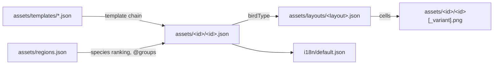

# Contributing to Birds Everywhere

Use [the manual test cases](docs/MANUAL_TESTS.md) for in-game checks. Automated tests and builds do not verify rendering, timing, or multiplayer behavior.

## Fast test save

1. Use Stardew Valley 1.6.15 with SMAPI 4.5.2 and this mod installed on every client. Keep a disposable save for repeat runs; do not use a personal farm for `birds_clear` or `birds_replan`.
2. For a new farm, choose **Co-Op > Host > Host New Farm** and add **one starting cabin** for a second player (nearby layout is convenient). For a solo check, an existing save is faster. Press Escape on the opening splash screen to reach the title menu sooner. Neither SMAPI nor the game documents a launch argument that skips the intro or auto-loads a save; install the optional [Skip Intro](https://www.nexusmods.com/stardewvalley/mods/533) mod instead (see "Faster startup").
3. Set **Windowed** mode so the game and SMAPI console remain visible. For two clients on one computer, also turn off **Pause When Game Window Is Inactive** in the game's Options; otherwise the background window can interrupt timing checks. Keep both clients at the same game/mod version.
4. Build/deploy with `dotnet build BirdsEverywhere.sln` (requires a configured game path; see [AGENTS.md](AGENTS.md)). Start the game **through SMAPI**, not the vanilla executable. Check the SMAPI console for load errors before testing. For compile-only builds, use `dotnet build BirdsEverywhere/BirdsEverywhere.csproj -p:EnableModDeploy=false -p:EnableModZip=false`.

### Faster startup

SMAPI documents these launch arguments (`docs/technical/smapi.md` in the SMAPI repository): `--mods-path <dir>`, `--no-terminal`, `--use-current-shell` and `--prefer-terminal-name <name>`. On Linux/macOS the launch script may not forward them; SMAPI documents environment variables for that case.

- Install [Skip Intro](https://www.nexusmods.com/stardewvalley/mods/533) by Pathoschild (a development-only convenience, not a dependency of this mod). It skips the intro logos and screen transitions and lands on the title screen; it can optionally skip to the load, co-op join, or co-op host screen. Per its README, settings are changed through [Generic Mod Config Menu](https://www.nexusmods.com/stardewvalley/mods/5098) (cog button on the title screen); the `config.json` key names are unverified. It supports 1.6+, macOS, and multiplayer even if other players lack it. Install it only on the clients where you want the speed-up.
- `--mods-path "Mods (test)"` loads only a minimal mod folder (this mod plus dependencies), which shortens SMAPI load time. Build output still deploys to the standard `Mods` folder; copy it over or point `GamePath` accordingly.
- Run `debug performTitleAction <button>` (alias `pta`) in the SMAPI console while on the title screen to jump to a title submenu. Button names are not documented; try `help debug` or `debug search`.
- `debug runmacro <file>` runs vanilla debug commands from a `.txt` file in the game folder (one `/command` per line). It does not run `birds_*` console commands.

## Debug mode and commands

Commands go into the **SMAPI console window of the client in question**, without a leading slash; they are not in-game chat commands. Load a save before using commands other than `birds_debug`. Run `help birds_spawn` in SMAPI for command help. For a quick start on the host:

```text
birds_debug on
birds_rules blue_tit
birds_check blue_tit
birds_spawn blue_tit -l Farm -f
birds_live
```

`birds_debug on` enables name/state labels above birds and day-plan HUD/log messages **for that client and session only**. It is independent of SMAPI verbose logging, which provides additional skip reasons when enabled for the mod. To enable the overlay on both screens, run `birds_debug on` in each client's console. `birds_debug off` hides it. The mod config's `Debug` setting defaults to false; set it in the installed mod's `config.json` to enable the overlay on startup.

| Command | Client | Purpose |
| --- | --- | --- |
| `birds_plan` | Either | Print today's placements, or report no plan. |
| `birds_rules <bird>` | Either | Show a bird's rules and today's eligibility. |
| `birds_live` | Either | List birds in this location, their type, state, tile, and plan rule. |
| `birds_xp` | Either | Show birding level and XP. |
| `birds_check <bird> [<ruleId>] [-l <location>]` | Host | Check eligibility, available tiles/features, and a dry-run placement count; does not change the plan. |
| `birds_spawn <bird> [<ruleId>] [-l <location>] [-f]` | Host | Add placements to today's plan and populate here immediately; `-l` selects a location. `-f` bypasses day/habitat eligibility and can fall back to a free adjacent ground tile **only in the host's current location**. |
| `birds_replan [seed]` | Host | Clear birds here, rebuild and broadcast today's plan; optional integer seed makes the plan repeatable. |
| `birds_clear` | Host | Clear mod birds and plan entries for this location, then broadcast the new plan. |
| `birds_reload` | Host | Reload bird definitions, replan, and broadcast; existing texture assets may remain cached until restart. |
| `birds_dump <bird>` | Either | Inspect merged content and field sources. |
| `birds_anim <bird> <clip>` | Either | Play a layout clip on your own (non-replica) live birds of that species here; bird logic may override it. |
| `birds_fishareas [here]` | Either | Inspect location fish-area data. |
| `show_all_birds` | Either | List seen and unseen species. |

Bird arguments accept the ID, English name, scientific name, or optional `shorthand` value from the bird JSON (for example, `gretit1`). Matching ignores case, spaces and underscores; quote names with spaces in the console. IDs remain canonical in content, regions and saves.

Use `birds_rules blue_tit` to choose a valid rule and location before testing natural placement. Force-spawned birds and replanned days are **not** evidence of normal spawn frequency. If spawning into another location, travel there after the host runs the command. For clean comparisons, note the seed, location, time, weather and whether `-f` was used.

## Adding birds and animations

Design and rules: [ARCHITECTURE.md → Bird configuration](docs/ARCHITECTURE.md#bird-configuration) and [Bird composition](docs/ARCHITECTURE.md#bird-composition-config-driven-behavior). Today a species is JSON plus art; behavior comes from its `birdType`, which also fixes its layout (until [Phase 10 step 3](docs/REFACTOR.md#step-3-actions-routines-and-sound-roles) makes behavior JSON too).



| `birdType` | Layout | Cell size | Clips the class plays |
|---|---|---|---|
| `LandBird` | `land_32` | 32×32 | `stand`, `walk`, `peck`, `sleep`, `fly` |
| `WaterLandBird` | `waterland_32` | 32×32 | `stand`, `walk`, `peck`, `rest`, `hop`, `swim`, `fly` |
| `TreeTrunkBird` | `trunk_16` | 16×16 | `peck`, `fly` |
| `BushBird` | `bush_32` | 32×32 | `run` |

**New species reusing a bird type**

1. Add `assets/<id>/<id>.json` (identity + `template` and rules), `<id>.png`, optional `<id>_<variant>.png`, `<id>_icon.png` (16×16), the species in `assets/regions.json`, and `bird.<id>.description` in `i18n/default.json`.
2. Draw the sheet to the layout: run the playground and `layout land_32 cols 5 svg land_32.svg` for a numbered template and a cell → clip list. `cols` must equal your sheet's cells per row; cells count left to right, top to bottom.
3. `dotnet test --arch x64`: `ContentTests`, `SchemaTests` and `ShippedBird_FitsItsLayouts` catch missing files, bad fields and sheets with too few cells. In game, `birds_spawn <id> -f` then `birds_anim <id> <clip>`.

**Editing a layout** (`assets/layouts/<id>.json`, schema `schemas/layout.schema.json`)

- A clip is a frame list or `{ frames?, repeat: { frames, count }?, end?, loop? }`. A frame is `[cell, ms, ...tags]`; `ms` is a number or `[min, max]` / `[min, max, step]`.
- Tags: one event name (`peck`, `flap`, `hop`; what a bird type understands is in `BirdTypeProfiles.ByBirdType`) and optionally `"flip"`, which gives the frame the bird's facing.
- Single-frame clips used as poses (`stand`, `sleep`, `swim`) show their first cell.
- Append new poses at the end of a sheet; never insert or reorder cells, or every clip using later cells breaks. A different cell size is a new layout.
- Changing a shipped clip changes `AnimationCharacterizationTests`; update the golden values only for a deliberate change and say so in the commit.

**Idle routine and sounds per species** (rule fields, so they can sit in `defaults`, a template, or a single rule)

```json
"defaults": {
  "routine": { "chance": 0.01, "pick": { "walk": 3, "peck": 1 }, "next": { "peck": { "peck": 1, "stop": 2 } } },
  "sounds": { "alarm": "crow", "peck": "" }
}
```

- `routine` is a shared id from `assets/routines/` (schema `schemas/routine.schema.json`) or an inline object. Without it the bird type's default applies (`land_idle`, `waterland_idle`). Tree-trunk and bush birds have no idle routine.
- `pick` weights are integers; one roll picks an action. Allowed actions and `next` follow-ups per bird type are in `BirdTypeProfiles.ByBirdType`; the validator lists them on error.
- `sounds` maps roles (`alarm`, `flap`, `peck`) to vanilla cue names and merges over the bird type's defaults; `""` silences a role. Changing a shipped routine file changes the idle-schedule goldens in `AnimationCharacterizationTests`.

**New behavior** (a new primitive, event, trigger or bird type) needs C#; follow [REFACTOR.md Phase 10](docs/REFACTOR.md#10-fully-modular-config-driven-birds) for where it goes.

## Editor JSON schemas

`schemas/` holds JSON Schemas for bird, template, regions, compat, layout and routine files, with shared definitions in `common.schema.json`. They are editor-only, not shipped, and checked against all shipped assets by `SchemaTests`; a test fails if any `assets/**/*.json` has no schema, and a table checks that schema and loader agree. Runtime validation stays in `ContentValidator`/`LayoutValidator`. Content files must not contain `$schema`; `.vscode/settings.json` maps the schemas for VS Code. Update the schemas when changing content fields or enums.

## Translations

Bird `name` (international English), `scName`, and optional `shorthand` (an eBird code used as a command alias) live in the bird JSON. `description` and an optional local `name` are translated in `i18n/<locale>.json` under `bird.<id>.description` and `bird.<id>.name`. `i18n/default.json` is the English fallback and must contain a description for every bird. A missing `bird.<id>.name` falls back to the JSON `name`.

## Two-client multiplayer

For network synchronization, use **two separate game + SMAPI processes**, ideally on two machines or separate isolated game instances/profiles with independent consoles and the same mod version. Split-screen can exercise gameplay but is not a substitute for testing two networked mod clients. Do not let two simultaneously running instances share a writable save; let the host own the farm save. If one-machine setup is unreliable, use two machines.

1. Host loads the test farm via **Co-Op > Host**; the farm must have an unoccupied cabin. Farmhand launches SMAPI separately and joins via **Co-Op > Join** using a friend invite, invite code, or LAN/IP as available. Confirm the farmhand has the mod loaded in its SMAPI console.
2. In both consoles run `birds_debug on`. On the host, run `birds_spawn blue_tit -l Farm -f` while on the Farm, then `birds_live` on both clients. Put both players in the **same location** and compare the same bird's position, state, animation and disappearance. Do not use a host command from the farmhand's console.
3. Vary arrival order: host first, farmhand first, and farmhand joining after birds have moved. Approach birds with **each** player in turn. Warp the current location's first visitor away while the other stays, then return. Repeat with a disconnect/rejoin and across a day change. Check both consoles for errors.
4. Test observation persistence separately: let the farmhand discover a species, check both collection tabs, save/sleep, quit, reload and compare again. To test lag, introduce network delay on a real network only if you have a controlled setup; observe that reactions can arrive late but must not rewind or duplicate birds.

For results, record client count, who entered the location first, seed, exact commands, steps, observed outcome, and relevant SMAPI logs in [the manual test cases](docs/MANUAL_TESTS.md). Do not mark a case passed based solely on an automated test.