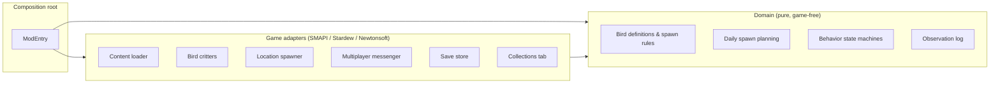
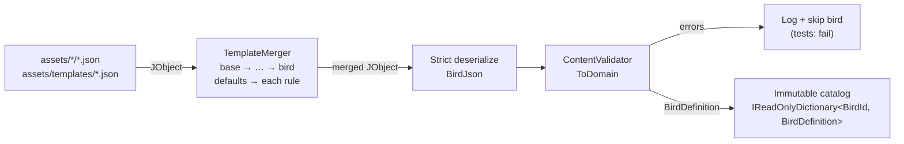
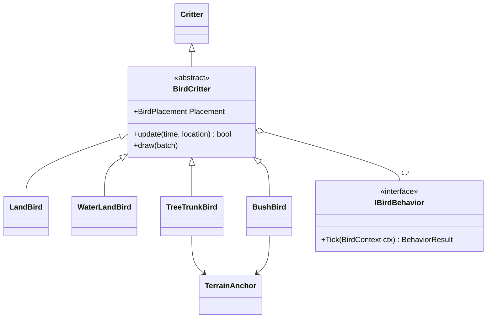
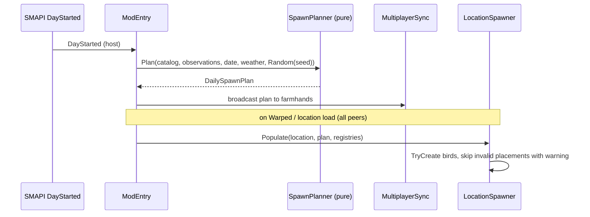

# Goal Architecture

Target design for Birds Everywhere after the refactor described in [REFACTOR.md](REFACTOR.md). Coding rules come from the global C# standards and [birdseverywhere.instructions.md](../.github/instructions/birdseverywhere.instructions.md); this document only covers structure, data flow, and ownership.

The current code is legacy. Where it conflicts with this document, this document wins.

## Principles

- **Functional core, imperative shell.** Decisions (what to spawn, where, whether a bird is valid, what an observation changes) are pure functions over records. Game and SMAPI access happens in thin adapters around them.
- **Data in, domain out.** JSON is merged, validated, and converted to immutable domain records once at load. Nothing after load sees raw JSON or nullable config fields.
- **Explicit wiring.** `ModEntry` builds every object, owns all long-lived state, and passes dependencies down. No static fields, singletons, reflection-based discovery, or process-wide settings.
- **Host is authoritative.** The host owns spawn plans and save data. Farmhands request; the host decides and broadcasts.
- **Fail safe in game, fail loud in tests.** Invalid content is rejected at load with a precise message. At runtime, a missing tree or unknown ID logs a warning and despawns the bird; it never crashes the game.

## Layers

Dependencies only point inward.



| Layer | May reference | Must not reference | Tests |
|---|---|---|---|
| Domain | BCL, `System.Collections.Immutable` | `Game1`, SMAPI, MonoGame, Newtonsoft | arm64, fast, no fakes for most |
| Game adapters | Domain, SMAPI, Stardew, MonoGame, Newtonsoft | other adapters' internals | x64, or via domain + fakes |
| Composition root | everything | business logic | in-game only |

`Vector2`/`Point` from MonoGame are the one tolerated exception in domain code if replacing them costs more than it gains; prefer a domain `readonly record struct Tile(int X, int Y)`.

## Target folder layout

Feature folders, one top-level type per file, namespaces mirror folders. One mod project and one test project.

```text
BirdsEverywhere/
  ModEntry.cs                 composition root: build, subscribe, delegate
  Content/                    JSON boundary
    BirdJson.cs, SpawnRuleJson.cs, LocationGroupsJson.cs
    TemplateMerger.cs         JObject merge, rule expansion, cycle detection, provenance
    ContentValidator.cs       JSON model -> domain, errors with file/field/chain
    ContentPaths.cs           all asset path construction
  Domain/
    BirdDefinition.cs, SpawnRule.cs, SpawnConditions.cs, IntRange.cs, Tile.cs
    Season.cs, Weather.cs
    Ids.cs                    BirdId, BirdTypeId, SpawnPatternId, BehaviorId
  Spawning/
    SpawnPlanner.cs           pure: rules + date + weather + Random -> DailySpawnPlan
    DailySpawnPlan.cs
    TileSelection.cs          pure tile/feature selection over ILocationQuery
    LocationSpawner.cs        adapter: plan + GameLocation -> critters
  Birds/
    BirdCritter.cs            the one mod-owned abstract layer under Critter
    LandBird.cs, WaterLandBird.cs, TreeTrunkBird.cs, BushBird.cs (sealed)
    Behaviors/                IBirdBehavior + small behavior implementations
    TerrainAnchor.cs          location + tile + feature kind
  Registries/
    BirdTypeRegistry.cs, SpawnPatternRegistry.cs
  Observations/
    ObservationLog.cs         pure: apply observation -> new log
  Multiplayer/
    Messages.cs               versioned message records
    MultiplayerSync.cs        adapter over Helper.Multiplayer
  Persistence/
    SaveData.cs               versioned save record
    SaveStore.cs              adapter over Helper.Data, migrations
  UI/
    CollectionsPageWithBirds.cs
  Diagnostics/
    ConsoleCommands.cs        in-game checks (spawn, list, validate)
```

## Key types

All domain types are records with read-only collections.

| Type | Role | Replaces |
|---|---|---|
| `BirdDefinition` | Validated species: id, names, description, `IReadOnlyList<SpawnRule>` | `BirdData` (config half) |
| `SpawnRule` | Fully merged rule: id, `SpawnConditions`, expanded location names, `SpawnPatternId`, `BirdTypeId`, group count and size (`IntRange`, inclusive), texture weights, selection weight | `SpawnData` |
| `SpawnConditions` | Seasons, weathers, day ranges, time ranges; an empty set means "any" | `SpawnData` weather/day/time fields |
| `DailySpawnPlan` | Per location: chosen bird, chosen rule, planned bird placements. Built once per day by the host | `DailySpawner` + `BirdData.currentSpawnData` |
| `BirdPlacement` | Bird id, rule, `Tile` or `TerrainAnchor`, texture, seed | `SingleBirdSpawnParameters*` |
| `TerrainAnchor` | Location name, tile, feature kind (`Tree`/`Bush`) | stored collection index |
| `BirdState` | Serializable snapshot of a live bird (placement, position, behavior state, animation) | reflection-based converter output |
| `ObservationLog` | Seen birds and observation details | `SaveData` contents |
| `SaveData` | `int Version` + `ObservationLog` | `SaveData` |

IDs are `readonly record struct` wrappers over `string` so a bird id cannot be passed where a spawn pattern id is expected.

## Content pipeline



Format, merge rules, and validation are specified in [Bird configuration](#bird-configuration). Defaults have three layers: C# fallbacks only for technically safe optional fields, base templates for gameplay defaults, bird files for species overrides. No gameplay defaults in property initializers.

## Bird configuration

Goal: a new species that behaves like an existing group of birds is a file with only identity fields and a `template`. Behavior that differs by season, weather, day, or time is data on rules, never code.

### Files

| File | Contains | Must not contain |
|---|---|---|
| `assets/templates/<id>.json` | optional `template`, `defaults`, `rules` | identity fields |
| `assets/<bird_id>/<bird_id>.json` | `id` (equals file name), `name`, `scName`, `description`, optional `template`, `defaults`, `rules` | — |
| `assets/locationGroups.json` | `{ "<group>": ["<GameLocationName>", ...] }` | bird ids, nested groups |

Only templates can be parents. Location groups are the only place that lists locations in bulk; birds are not listed per area anywhere (no second source of truth).

### Rule fields

A rule is one situation in which the bird can appear. `defaults` has the same fields and is merged into every rule.

| Field | Type | Meaning |
|---|---|---|
| `when.seasons` | `["spring" \| "summer" \| "fall" \| "winter"]` | missing = any |
| `when.weather` | `["sun" \| "rain" \| "storm" \| "snow" \| "wind" \| "greenRain"]` | today's weather at day start; festival and wedding days count as `sun`; missing = any |
| `when.days` | `[[min, max], ...]` | day of month, 1–28, inclusive; missing = any |
| `when.times` | `[[min, max], ...]` | game time `HHMM`, 600–2600, inclusive; gates spawning only; missing = any |
| `locations` | `["Forest", "@coast", ...]` | location names or `@group` references, expanded at load |
| `spawnPattern` | registry id | where birds are placed, e.g. `SpawnableGroundSpawner` |
| `birdType` | registry id | critter class, e.g. `LandBird` |
| `groupCount`, `groupSize` | `[min, max]` | inclusive |
| `textures` | `{ "<variant>": weight }` | `""` is the base sprite; other keys are texture variants |
| `weight` | number > 0 | selection weight among eligible rules; C# fallback `1` |
| `routineWeights`, `threatResponse` | reserved | Phase 5; same merge rules apply |

Required after merging: `locations`, `spawnPattern`, `birdType`, `groupCount`, `groupSize`, `textures`.

### Merge algorithm

One merge function, applied in two steps. Objects merge key by key, arrays replace, a JSON `null` removes the inherited key (a `null` rule removes the whole rule).

1. **Vertical:** merge the template chain, most general first: `base_bird → … → template → bird`. This yields one `defaults` object and one `rules` object.
2. **Horizontal:** for every rule id, `effective = merge(defaults, rules[id])`.

Resulting precedence, lowest to highest:

```text
template defaults  <  bird defaults  <  template rules[id]  <  bird rules[id]
```

**Rules beat defaults at every level.** A rule is situational and therefore more specific; template situations (e.g. larger flocks in winter) survive in every inheriting bird unless that bird overrides that rule. A bird's `defaults` only changes values that no inherited rule sets. To change a situational value, override the rule by id. The validator reports every bird `defaults` value that an inherited rule shadows.

Consequences:

- Rules are keyed by id, so a bird can override, extend, or remove a single inherited rule.
- Weight maps (`textures`, later `routineWeights`) merge per key; remove a variant with `"female": null`.
- Lists replace, so adding one location means restating the list; use `@groups` to keep that short.
- To drop all inherited situations, inherit a template without rules; there is no replace-all syntax.
- Rule ids are part of a template's contract. Renaming one breaks bird overrides, which validation reports.

### Rule selection

- **Day start (host):** for each bird, eligible rules are those whose `seasons`, `weather`, and `days` match today. One is picked by `weight` with the seeded day `Random`. No eligible rule: the bird is absent today. The chosen rule goes into the `DailySpawnPlan`.
- **Spawning:** when a peer enters a location in the rule's `locations`, or a `times` window opens while a player is in it, birds spawn if the current time is inside `times`.
- **After spawning** a bird stays until it flees, the location unloads, or the day ends. A closing `times` window never removes birds, so players can still observe them or call others over in co-op.

### Validation

Structure is enforced by Newtonsoft during deserialization of the merged object: `MissingMemberHandling.Error` rejects unknown keys (typos), `[JsonProperty(Required = Required.Always)]` rejects missing required fields, and type mismatches fail. Settings are passed per call. Everything else is a hand-written `Validate` returning `IReadOnlyList<ValidationIssue>` with file, bird or template id, JSON path, and template chain. `TemplateMerger` records the source file of every merged value for these messages.

| Severity | Checks | Runtime | Tests |
|---|---|---|---|
| Error | unknown key, missing required field, wrong type; identity field in a template; missing template or cycle (full chain); `id` ≠ file name; unknown season or weather; `min > max`; days outside 1–28; times outside 600–2600; `weight` or texture weight ≤ 0; unknown `spawnPattern`, `birdType`, or `@group`; missing texture file; a bird `rules.<id>` without `when` that matches no inherited rule (likely typo) | `Error` log, bird skipped, other birds load | fail |
| Warn | bird `defaults` value shadowed by an inherited rule; bird with no rules | `Warn` log | fail unless allow-listed |
| Info | bird `rules.<id>` with `when` that matches no inherited rule (new rule); season/weather combinations with no eligible rule | `Info` log | ignored |
| Runtime only | location name unknown to the game | `Warn`, location dropped from the rule | — |

The same code runs in `ContentTests` over every shipped file and on `GameLaunched` for player-edited files. A `birds_dump <id>` console command prints every effective rule with the source file of each value.

### Examples

`assets/locationGroups.json`

```json
{
  "valley_gardens": ["Farm", "Town", "Forest", "BusStop", "Backwoods"],
  "coast": ["Beach"],
  "inland_water": ["Forest", "Mountain", "Town"]
}
```

Base template shared by all birds, `templates/base_bird.json`:

```json
{
  "defaults": {
    "when": { "times": [[600, 2000]] },
    "groupCount": [1, 2],
    "groupSize": [1, 3],
    "textures": { "": 1 }
  }
}
```

Common garden birds (tits, finches, sparrows, blackbirds), `templates/garden_resident.json`. Active during the day, absent at summer noon, juveniles in summer, flocks in winter:

```json
{
  "template": "base_bird",
  "defaults": {
    "locations": ["@valley_gardens"],
    "spawnPattern": "SpawnableGroundSpawner",
    "birdType": "LandBird",
    "groupSize": [1, 4]
  },
  "rules": {
    "spring_fall": { "when": { "seasons": ["spring", "fall"] } },
    "summer": {
      "when": { "seasons": ["summer"], "times": [[600, 1100], [1500, 2000]] },
      "groupSize": [2, 6],
      "textures": { "juvenile": 1 }
    },
    "winter": {
      "when": { "seasons": ["winter"] },
      "groupCount": [1, 1],
      "groupSize": [4, 10]
    }
  }
}
```

Pure inheritance, `blue_tit/blue_tit.json`:

```json
{
  "id": "blue_tit",
  "name": "Blue Tit",
  "scName": "Cyanistes caeruleus",
  "description": "...",
  "template": "garden_resident"
}
```

Effective `summer` rule of `blue_tit` (source in comments):

```jsonc
{
  "when": {
    "seasons": ["summer"],                  // garden_resident.rules.summer
    "times": [[600, 1100], [1500, 2000]]    // garden_resident.rules.summer (replaces base_bird list)
  },                                        // weather, days missing: any
  "locations": ["Farm", "Town", "Forest", "BusStop", "Backwoods"], // @valley_gardens expanded
  "spawnPattern": "SpawnableGroundSpawner", // garden_resident.defaults
  "birdType": "LandBird",                   // garden_resident.defaults
  "groupCount": [1, 2],                     // base_bird.defaults
  "groupSize": [2, 6],                      // garden_resident.rules.summer
  "textures": { "": 1, "juvenile": 1 },     // base_bird.defaults + rules.summer, merged per key
  "weight": 1                               // C# fallback
}
```

Species tweak, `house_sparrow/house_sparrow.json`. `defaults.groupSize` alone only applies to `spring_fall`, because the template's `summer` and `winter` rules set their own `groupSize`; without the two rule overrides the validator warns about the shadowing:

```json
{
  "id": "house_sparrow", "name": "House Sparrow", "scName": "Passer domesticus", "description": "...",
  "template": "garden_resident",
  "defaults": { "groupSize": [3, 8] },
  "rules": {
    "summer": { "groupSize": [4, 12] },
    "winter": { "groupSize": [10, 25] }
  }
}
```

Extra texture variant, `blackbird/blackbird.json`. Every rule gets `female`; summer gets `""`, `female`, and `juvenile`:

```json
{
  "id": "blackbird", "name": "Blackbird", "scName": "Turdus merula", "description": "...",
  "template": "garden_resident",
  "defaults": { "textures": { "female": 1 } }
}
```

Winter visitor reusing the template, `fieldfare/fieldfare.json`. Removes two inherited rules, keeps `winter`, adds a late-fall arrival rule:

```json
{
  "id": "fieldfare", "name": "Fieldfare", "scName": "Turdus pilaris", "description": "...",
  "template": "garden_resident",
  "rules": {
    "spring_fall": null,
    "summer": null,
    "late_fall": { "when": { "seasons": ["fall"], "days": [[15, 28]] }, "groupSize": [3, 8] }
  }
}
```

Seasonal water birds, `templates/winter_waterbird.json`, and two species using it:

```json
{
  "template": "base_bird",
  "defaults": {
    "locations": ["@inland_water"],
    "spawnPattern": "WaterSpawner",
    "birdType": "WaterLandBird",
    "groupSize": [2, 8]
  },
  "rules": {
    "migration": { "when": { "seasons": ["fall"], "days": [[15, 28]] } },
    "winter": { "when": { "seasons": ["winter"] }, "groupCount": [1, 3] }
  }
}
```

```json
{ "id": "tufted_duck", "name": "Tufted Duck", "scName": "Aythya fuligula", "description": "...", "template": "winter_waterbird" }
```

```json
{
  "id": "goldeneye", "name": "Common Goldeneye", "scName": "Bucephala clangula", "description": "...",
  "template": "winter_waterbird",
  "defaults": { "groupSize": [1, 4], "textures": { "female": 2 } }
}
```

Weather-dependent behavior, `herring_gull/herring_gull.json`. On a stormy winter day all three rules are eligible and picked 25 / 50 / 25 %:

```json
{
  "id": "herring_gull", "name": "Herring Gull", "scName": "Larus argentatus", "description": "...",
  "template": "base_bird",
  "defaults": {
    "spawnPattern": "WaterOrGroundSpawner",
    "birdType": "WaterLandBird",
    "groupSize": [2, 10]
  },
  "rules": {
    "coast": { "locations": ["@coast"] },
    "storm_inland": { "when": { "weather": ["rain", "storm"] }, "locations": ["@valley_gardens"], "weight": 2 },
    "winter_inland": { "when": { "seasons": ["winter"] }, "locations": ["@inland_water"] }
  }
}
```

Night birds, `templates/nocturnal.json` (its `when.times` replaces the base list) and `tawny_owl/tawny_owl.json`:

```json
{
  "template": "base_bird",
  "defaults": {
    "when": { "times": [[2000, 2600]] },
    "spawnPattern": "TreeTrunkSpawner",
    "birdType": "TreeTrunkBird",
    "groupCount": [1, 1],
    "groupSize": [1, 1]
  },
  "rules": { "all_year": {} }
}
```

```json
{
  "id": "tawny_owl", "name": "Tawny Owl", "scName": "Strix aluco", "description": "...",
  "template": "nocturnal",
  "defaults": { "locations": ["Forest", "Backwoods"] }
}
```

Validation messages for typical mistakes:

```text
Error  great_tit.json: $.defaults.groupSzie: unknown key
Error  fieldfare.json: $.rules.wintr: no inherited rule 'wintr' and no 'when' (chain: fieldfare → garden_resident → base_bird)
Warn   house_sparrow.json: $.defaults.groupSize [3, 8] is shadowed in rules 'summer' (garden_resident.json), 'winter' (garden_resident.json)
Info   fieldfare.json: $.rules.late_fall: new rule
Error  herring_gull.json: $.rules.coast.groupSize: min 10 > max 2
```

## Registries

Plain `IReadOnlyDictionary<TId, Func<..., T>>` built in `ModEntry`. No reflection, attributes, or static dictionaries.

```csharp
var birdTypes = new Dictionary<BirdTypeId, BirdFactory>
{
    [BirdTypeIds.Land] = (placement, ctx) => new LandBird(placement, ctx),
    [BirdTypeIds.Bush] = (placement, ctx) => new BushBird(placement, ctx),
};
```

- Content validation checks every referenced id against the registry keys before gameplay starts.
- Lookups use `TryGetValue`; an unknown id at runtime logs a warning and skips the bird.
- Adding a bird type or spawn pattern is: implement, register once, reference from JSON, test.
- Spawn patterns only decide where birds are placed; conditions (season, weather, time, day) are `SpawnRule` data and never justify a new pattern class.

## Birds and behaviors

The game requires birds to be `Critter` subclasses. The hierarchy is capped at one mod-owned layer:



- `BirdCritter` owns identity, position, sprite, lifecycle, and an ordered behavior list. Concrete birds are `sealed` and mainly choose behaviors and anchoring.
- Behaviors (wander, peck, hop, swim, perch, flee, despawn) are small classes behind `IBirdBehavior`. Their decision logic is a pure function over a `BirdContext` record (position, nearest farmer distance, anchor still valid, elapsed time, `Random`) so it can be tested without the game.
- Behavior order and conflict rules live in one place (`BirdCritter.update`), not spread over overrides.
- Terrain-feature birds resolve their `TerrainAnchor` by location and tile each update. If the feature is gone or changed kind, the bird despawns cleanly.
- Each bird owns a `Random` seeded from its placement seed, so behavior is reproducible across peers.

The migration is gradual: inheritance stays where it is simple and stable; composition replaces it only where combining behaviors would otherwise need more subclasses.

## Daily spawn flow



- The planner receives everything as parameters: catalog, observations, date, weather, and a `Random` seeded from game state at the boundary.
- Selection uses inclusive ranges and handles empty candidate lists by returning no placement.
- Farmhands never plan; they receive the plan. Placements carry everything needed to recreate a bird, so farmhands do not need per-day mutable state in the catalog.

## Multiplayer ownership

| Message | Sender → receiver | Validated by | Persisted by |
|---|---|---|---|
| `SpawnPlan` | host → all (DayStarted, PeerConnected) | host builds it | not persisted |
| `ObservationRequest` (bird id, details) | any peer → host | host: bird exists, not a duplicate | host only |
| `ObservationAccepted` (log delta + version) | host → all | — | host already saved |
| `LocationBirdsRequest` | entering peer → peer in location | responder | not persisted |
| `LocationBirdsState` (`IReadOnlyList<BirdState>`) | responder → requester | requester: version, known ids | not persisted |

- All messages are records with a `Version` field. Unknown or older versions are logged and dropped.
- Observation updates send deltas plus a monotonic log version. A stale delta is ignored and the peer re-requests the full log.
- The host applies observations via the pure `ObservationLog.Apply`, so simultaneous discoveries merge instead of overwriting each other.
- Late joiners receive the current plan and full observation log on `PeerConnected`.

## Persistence

- `SaveData` carries an explicit `Version`. `SaveStore` loads, migrates older versions step by step, and writes only the current version.
- Only the host reads and writes `Helper.Data` save data.
- `BirdState` serialization uses explicit records, not reflection over critter properties. Animation state is captured from `sprite.CurrentAnimation`.
- Newtonsoft settings are passed per call (`JsonSerializer.Create(settings)`), never via `JsonConvert.DefaultSettings`.

## Error policy

| Situation | Behavior |
|---|---|
| Invalid shipped content | Unit test fails; at runtime the bird is skipped with an `Error` log naming file/field |
| Unknown registry id at runtime | `Warn`, skip bird |
| Missing asset texture | `Warn`, skip bird |
| Terrain anchor gone or wrong kind | `Trace`, despawn bird |
| Invalid or old-version message | `Warn`, drop message |
| Unexpected exception in an event handler | `Error` with context, keep game running; never swallow silently |

Logging goes through `IMonitor`, at state transitions only, never per tick or per critter scan.

## Testing strategy

No mocking library. Stardew types (`GameLocation`, `Farmer`, `Tree`) are concrete and largely non-virtual, so mocking frameworks cannot intercept them anyway. Instead:

1. **Pure domain tests (arm64):** content merge and validation over every shipped asset, spawn planning with seeded `Random`, behavior decisions over `BirdContext`, observation log merging, message and save round-trips. This is most of the suite.
2. **Seams with hand-written fakes:** small mod-owned interfaces where adapters need game state, e.g. `ILocationQuery` (tile passable/water/spawnable, terrain feature at tile) and `IMessageSender`. Fakes are a few lines each; revisit only if they start duplicating each other.
3. **x64 integration tests:** anything that must touch real game types (`SDate`, `AnimatedSprite`, SMAPI JSON settings).
4. **In-game checks:** console commands in `Diagnostics/` (list today's plan, force-spawn a bird, validate content, dump observations) plus the manual checklist in [REFACTOR.md](REFACTOR.md#9-verify-in-game-behavior-after-each-phase).

Tests assert observable outcomes (a bird flees when a farmer is near), not class names or private state. NUnit with `[TestCase]` / `TestCaseSource` tables.

## Future design goals

Goals, not designs; Phase 6 decides the implementation.

### Spawn selection: luck, rarity, experience

- The daily roll at `DayStarted` takes `Game1.player.DailyLuck` as a planner input (multiplayer: host or average, decide later). It stays seeded per save and day: random, but reproducible.
- Unseen birds in the main region: usually 1 per day, a small chance of 2, a tiny chance of 3. Luck raises or lowers these chances.
- Candidates are ordered by rarity, and a bias curve favours the top unseen entries (today `Utils.shuffleListByOrder` with a fixed `luckLevel` of 2.0, currently unused; `DailySpawner` just sorts unseen first). Good luck flattens the curve (more random, less rarity-driven); bad luck steepens it.
- Luck is one of several generic "birding modifiers"; keep room for birding experience or progression to raise the count and rarity of birds seen.
- A bird's spawn chance combines its position in the rarity order with a per-rule weight modifier in config, e.g. very likely at peak migration and rare on the days around it.
- Seen birds use the same rarity and weight model but have no 1-per-day limit: one or more species per area is fine when the rules fit. Groups of different species in one location keep a minimum distance; the daily plan records each group's area so placements don't overlap.
- Special spawn events (e.g. migrations) can be triggered like TV weather forecasts, or by dialogue or quests. Events are data-defined and act by changing rule weights or eligibility.

### Config-driven placement

- A small set of general spawn patterns (ground, tree trunk, tree canopy, bush, fence or other placed object, water, shore, flying), parameterized from JSON via a `spawnParams` field on `SpawnRule`.
- Patterns search the map for the kind of spot wanted (tile properties, water body kind such as river, pond or ocean, object or feature kind, proximity, or a coarse map region such as "bottom edge"). Never hardcode coordinates; they break when the game or map mods change.
- Each pattern has a cheap feasibility check (e.g. "this location has no fences") that runs before the candidate search. On failure the planner tries the bird's next rule or location, then the next bird, so an unseen bird always spawns if any can be placed, though not necessarily the first one tried.

## Out of scope for now

- Public mod API for other mods, Content Patcher integration, JSON schema files.
- Spatial indexing or other performance work without a profile showing the need.

These are tracked as Phase 10 in [REFACTOR.md](REFACTOR.md#10-nice-to-haves-and-future-improvements).
