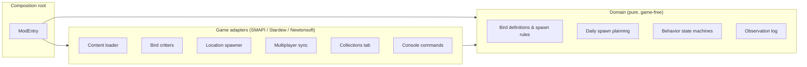
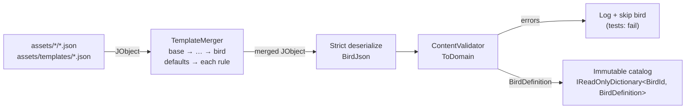
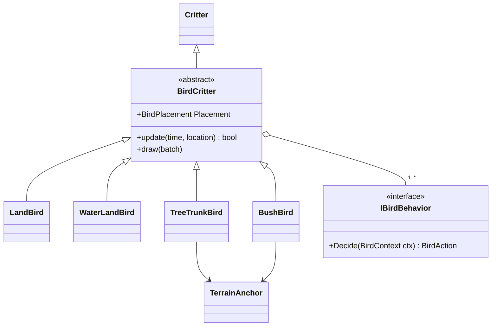
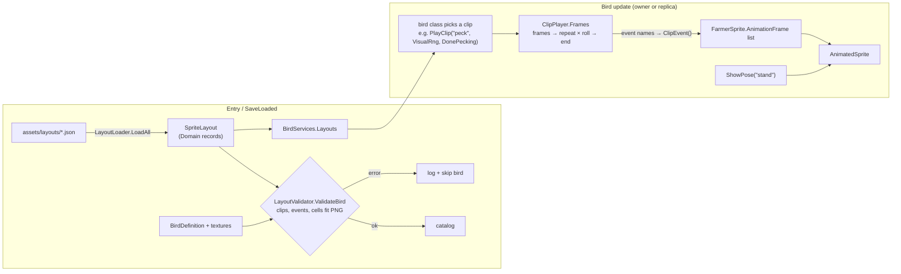
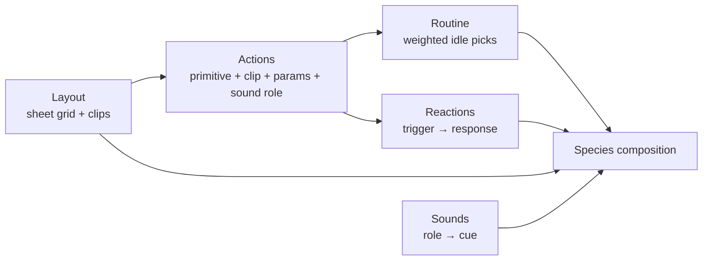
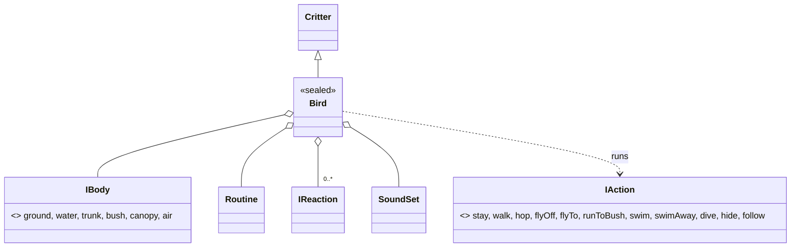
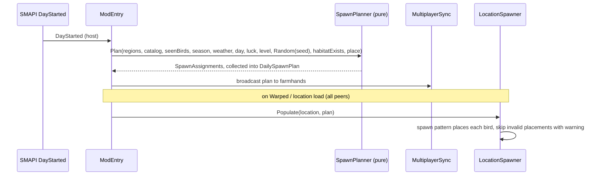

# Architecture

Structure, data flow, and ownership of Stardew Valley: Birding (`Birding`), as implemented. Coding rules come from the global C# standards and [birding.instructions.md](../.github/instructions/birding.instructions.md). Migration history and open work: [REFACTOR.md](REFACTOR.md). Sections under [Future design goals](#future-design-goals) and items marked planned are not built yet; items marked "not tested in game" are compile and unit-test verified only.

Keep this document current: a change to structure, data flow, ownership, or the JSON format updates it in the same change.

## Principles

- **Functional core, imperative shell.** Decisions (what to spawn, where, whether a bird is valid, what an observation changes) are pure functions over records. Game and SMAPI access happens in thin adapters around them.
- **Data in, domain out.** JSON is merged, validated, and converted to immutable domain records once at load. Nothing after load sees raw JSON or nullable config fields.
- **Explicit wiring.** `ModEntry` builds every object, owns all long-lived state, and passes dependencies down. No mutable static state, singletons, reflection-based discovery, or process-wide settings.
- **Host is authoritative.** The host owns spawn plans and save data. Farmhands request; the host decides and broadcasts.
- **Fail safe in game, fail loud in tests.** Invalid content is rejected at load with a precise message. At runtime, a missing tree or unknown ID logs a warning and despawns the bird; it never crashes the game.

## Layers

Dependencies only point inward.



| Layer | May reference | Must not reference | Tests |
|---|---|---|---|
| Domain | BCL, `System.Collections.Immutable` | `Game1`, SMAPI, MonoGame, Newtonsoft | arm64, fast, no fakes for most |
| Game adapters | Domain, SMAPI, Stardew, MonoGame, Newtonsoft | other adapters' internals | x64, or via domain + fakes |
| Composition root | everything | business logic | in-game only |

Pure code uses MonoGame `Vector2` for tiles (the one tolerated exception); `ILocationQuery` is the seam that keeps tile selection testable without game types. There is one mod project; the layers are enforced by folder and review, not by assembly. Pure logic (planner, merge, validation, behavior decisions) is tested on arm64; tests that load game or SMAPI types need the x64 test host (see the test map in [AGENTS.md](../AGENTS.md)).

## Folder layout

Feature folders, namespaces mirror folders (a few legacy namespaces such as `Birding.Spawners` differ). One mod project, one test project, one offline playground.

```text
Birding/                      mod project (net6.0)
  ModEntry.cs                 composition root: build, subscribe, delegate; reads/writes SaveData
  ModConfig.cs, Logging.cs, Utils.cs, VanillaBirds.cs, MessageJson.cs, CustomJSONConverters.cs
  Content/                    JSON boundary and loaders
    BirdJson.cs, SpawnRuleJson.cs
    TemplateMerger.cs         JObject merge, rule expansion, cycle detection, provenance
    ContentLoader.cs, ContentValidator.cs, ContentPaths.cs, ValidationIssue.cs
    ConditionParser.cs        one parser for `when` (rules and routine `rare`)
    LayoutLoader/Validator/Sheet, RoutineLoader, ActionLoader, ReactionLoader, SharedDefinitions, DefinitionFiles
    BirdTypeProfile(s).cs, AudioCues.cs
  Domain/                     immutable records
    BirdDefinition, SpawnRule, SpawnConditions, ConditionClause, SpawnParams, Region
    BirdComposition, SpriteLayout, SpriteClip, ClipFrame, ClipRepeat, Routine, RareAction, ActionDefinition, Reactions
    FollowSlot, WeightedId, IntRange, StepRange, TimeRange, TimeBound, TimeAnchors, AnchorKind
    Habitat, Season, Weather, Ids (BirdTypeId, SpawnPatternId, BirdId)
  Spawning/
    SpawnPlanner.cs           pure: rules + date + weather + luck + Random -> SpawnAssignment list
    DailySpawnPlan.cs         per location BirdPlacement lists
    TileSelection.cs, ShoreDistance.cs   pure placement over ILocationQuery
    LocationQuery.cs          ILocationQuery + GameLocationQuery adapter
    LocationSpawner.cs        adapter: plan + GameLocation -> critters
    Spawners/                 spawn patterns (TileSpawner, TerrainFeatureSpawner, Condition)
  BirdTypes/
    BirdCritter.cs            the one mod-owned abstract layer under Critter
    LandBird, WaterLandBird, TreeTrunkBird, BushBird (sealed)
    BirdServices.cs, BirdState.cs, BirdSnapshots.cs, ClipPlayer.cs, IdleCue.cs, EscapePlanner.cs
    TerrainAnchor.cs          location name + tile
    Behaviors/                IBirdBehavior, BirdContext, BirdActionIds, flee/alert/calm/wake/stop-walking
  Registries/                 BirdTypeRegistry, SpawnPatternRegistry
  Observations/               ObservationLog (static, pure), DeltaStatus, BirdingProgress (XP, level)
  Multiplayer/                Messages.cs (versioned records), MultiplayerSync.cs (adapter over Helper.Multiplayer)
  Data/SaveData.cs            save record and ObservationData
  BirdList/                   collections tab UI
  Diagnostics/                ConsoleCommands, InspectCommands, PlanText, RuleText, BirdSelector, GameHabitat, GameTimeAnchors, SpawnTarget
  assets/                     <bird_id>/ (json + textures), templates/, layouts/, actions/, routines/, reactions/, compat/, regions.json
schemas/                      editor/test JSON schemas, one per file kind + common.schema.json
Birding.UnitTests/            NUnit tests; test map in AGENTS.md
Birding.Playground/           offline planner CLI over the same pure code
```

## Key types

Domain types are immutable records with read-only collections.

| Type | Role |
|---|---|
| `BirdDefinition` | Validated species: id, names (descriptions live in `i18n/`), shorthand, `IReadOnlyList<SpawnRule>` |
| `SpawnRule` | Fully merged rule: id, `SpawnConditions`, expanded location names, `SpawnPatternId`, `BirdTypeId`, group count and size (`IntRange`, inclusive), texture weights, selection weight, `SpawnParams`, optional resolved `BirdComposition` and per-stage compositions |
| `SpawnConditions` | `SpawnConditions(ImmutableArray<ConditionClause> Any)`; each clause has seasons, weathers, day ranges, time bounds; an empty set means "any". See [Condition clauses](#condition-clauses-and-time-anchors-step-8) |
| `SpawnAssignment` | Planner output per location: habitat, bird, rule, region, unseen flag (`Spawning/SpawnPlanner.cs`) |
| `DailySpawnPlan` | Per location name, the `BirdPlacement` list. Built once per day by the host |
| `BirdPlacement` | Bird id, rule id, bird type, spawn pattern, tile, optional feature tile, active time windows, texture, seed, composition, group id, role, stage (`Spawning/DailySpawnPlan.cs`) |
| `TerrainAnchor` | `TerrainAnchor(string? LocationName, Vector2 Tile)`; the tree or bush tile a trunk or bush bird is bound to (`BirdTypes/`) |
| `BirdState` | Serializable snapshot of a live bird (position, behavior state, animation, anchor, group metadata, committed movement) |
| `ObservationLog` | Static pure functions (`TryApply`, `Check`) over `SaveData` |
| `SaveData` | `SeenBirds`, `BirdObservations`, `LogVersion`, `BirdingXp`, `SightingsDay`, `Sightings` (`Data/SaveData.cs`) |

There are three id wrappers, `BirdId`, `BirdTypeId` and `SpawnPatternId` (`readonly record struct` over `string`), so a bird id cannot be passed where a spawn pattern id is expected. `BirdPlacement` and `BirdState` still carry plain strings at the game boundary.

## Content pipeline



Format, merge rules, and validation are specified in [Bird configuration](#bird-configuration). Defaults have three layers: C# fallbacks only for technically safe optional fields, base templates for gameplay defaults, bird files for species overrides. No gameplay defaults in property initializers.

## Bird configuration

Goal: a new species that behaves like an existing group of birds is a file with only identity fields and a `template`. Behavior that differs by season, weather, day, or time is data on rules, never code.

### Files

| File | Contains | Must not contain |
|---|---|---|
| `assets/templates/<id>.json` | optional `template`, `defaults`, `rules` | identity fields |
| `assets/<bird_id>/<bird_id>.json` | `id` (equals file name), `name`, `scName`, optional `template`, `defaults`, `rules` | — |
| `assets/regions.json` | `{ "<region>": { "ratio": 0.6, "species": ["<bird_id>", ...], "groups": { "<group>": ["<GameLocationName>", ...] } } }`; `species` is ordered most to least frequent, `ratio` (default 0.6) is the weight factor per rank | nested groups, per-bird location lists |
| `assets/compat/<modUniqueId>.json` | same format, existing regions only; species and group members are appended when that mod is loaded | new regions, `ratio`, nested groups |

Only templates can be parents. Location groups are the only place that lists locations in bulk; birds are not listed per area anywhere (no second source of truth).

### Rule fields

A rule is one situation in which the bird can appear. `defaults` has the same fields and is merged into every rule.

| Field | Type | Meaning |
|---|---|---|
| `when.seasons` | `["spring" \| "summer" \| "fall" \| "winter"]` | missing = any |
| `when.weather` | `["any" \| "clear" \| "precipitation" \| "sun" \| "wind" \| "rain" \| "storm" \| "snow" \| "greenRain"]` | today's weather at day start; groups expand to leaves at load: `clear` = sun, wind; `precipitation` = rain, storm, greenRain, snow; `rain` is plain rain only; `any` = all. Festival and wedding days count as `sun`; missing = any (no default restriction; storms are playable, so birds spawn in them unless a rule excludes `storm`). Same names work in reaction `if.weather` (one name or a list) |
| `when.days` | `[[min, max], ...]` | day of month, 1–28, inclusive; missing = any |
| `when.times` | `[[min, max], ...]` | game time `HHMM`, 600–2600, inclusive; gates spawning only; missing = any. Bounds may be [anchors](#condition-clauses-and-time-anchors-step-8) such as `"dusk-60"` |
| `when.any` | `[ { seasons?, weather?, days?, times? }, ... ]` | alternatives, OR'ed (step 8); each clause ANDs its own fields; replaces the top-level fields, which may not be combined with `any` |
| `locations` | `["Forest", "Farm_Riverland", "Forest:River", "@coast", ...]` | location names or `@group` references, expanded at load; `Farm_<type>` = Farm on that farm type; `:Name` = fish area of the location |
| `spawnPattern` | registry id | where birds are placed, e.g. `SpawnableGroundSpawner` |
| `birdType` | registry id | critter class, e.g. `LandBird` |
| `spawnParams.shoreDistance` | `[min, max]` | tiles (0–20) to the nearest opposite kind (ground for water tiles, water for ground tiles); planning-time only; missing = any |
| `groupCount`, `groupSize` | `[min, max]` | inclusive |
| `textures` | `{ "<variant>": weight }` | `""` is the base sprite; other keys are texture variants |
| `weight` | number > 0 | selection weight among eligible rules; C# fallback `1` |
| `routine`, `sounds`, `soundCooldownMs` | ref or inline / role → cue / role → ms | implemented; see [Routine](#3-routine-idle) and [Species composition](#5-species-composition) |
| `actions`, `reactions`, `stages` | object / ref or inline / stage → overrides | implemented; see [Bird composition](#bird-composition-config-driven-behavior) |
| `spawnParams.group` (`formation`, `radius`, `spacing`, `groupSpacing`, `members`), `spawnParams.speciesDistance` | object | implemented; see [Spawning v2](#spawning-v2-groups-stages-spacing) |
| `body`, `layout` (rule level), `near`, `avoid`, `space`, `packing` | — | planned; `body` would replace `birdType`; same merge rules apply |

Required after merging: `locations`, `spawnPattern`, `birdType`, `groupCount`, `groupSize`, `textures`.

### Merge algorithm

One merge function, applied in two steps. Objects merge key by key, arrays replace, a JSON `null` removes the inherited key (a `null` rule removes the whole rule).

1. **Vertical:** merge the template chain, most general first: `base_bird → … → template → bird`. This yields one `defaults` object and one `rules` object.
2. **Horizontal:** for every rule id, `effective = merge(defaults, rules[id])`.

Resulting precedence, lowest to highest:

```text
template defaults  <  bird defaults  <  template rules[id]  <  bird rules[id]
```

**Rules beat defaults at every level.** A rule is situational and therefore more specific; template situations (e.g. larger flocks in winter) survive in every inheriting bird unless that bird overrides that rule. A bird's `defaults` only changes values that no inherited rule sets. To change a situational value, override the rule by id. The validator reports every bird `defaults` value that an inherited rule shadows.

Consequences:

- Rules are keyed by id, so a bird can override, extend, or remove a single inherited rule.
- Weight maps (`textures`, later `routineWeights`) merge per key; remove a variant with `"female": null`.
- Lists replace, so adding one location means restating the list; use `@groups` to keep that short.
- To drop all inherited situations, inherit a template without rules; there is no replace-all syntax.
- Rule ids are part of a template's contract. Renaming one breaks bird overrides, which validation reports.

**Single inheritance, composition by slot.** A bird or template has at most one `template`, so its values come from one chain and every value has exactly one source at each level. Multiple templates are deliberately not supported: two parents setting the same key or rule id would need precedence rules, a shared ancestor would apply twice, and provenance would turn from a chain into a graph. Behavior is mixed instead through the named composition slots ([Ref or inline](#ref-or-inline)): each slot holds one reference or one inline object with one `extends`, so two presets can never set the same field. Lists of presets that merge into one object (e.g. `"reactions": ["wary", "canopy_hider"]`) are not allowed for the same reason.
- Reconsider only when several templates repeat the same block of rules. The fix would then be a reusable rule set in its own slot, and validation would fail when two sets define the same rule id.

### Rule selection

- **Day start (host):** for each bird, eligible rules are those whose `seasons`, `weather`, and `days` match today. One is picked by `weight` with the seeded day `Random`. No eligible rule: the bird is absent today. The chosen rule goes into the `DailySpawnPlan`.
- **Spawning:** when a peer enters a location in the rule's `locations`, or a `times` window opens while a player is in it, birds spawn if the current time is inside `times`.
- **After spawning** a bird stays until it flees, the location unloads, or the day ends. A closing `times` window never removes birds, so players can still observe them or call others over in co-op.

### Condition clauses and time anchors (step 8)

Implemented; compile and unit-test verified, not yet tested in game.

One condition type serves spawn rules and routine `rare.when`.

```json
"rare": {
  "sing": {
    "chance": 0.02,
    "when": { "any": [
      { "seasons": ["spring"], "times": [[600, 1800]] },
      { "seasons": ["summer"], "times": [["sunrise", "sunrise+120"], ["dusk-60", "dusk"]] }
    ] }
  }
}
```

- `SpawnConditions(ImmutableArray<ConditionClause> Any)`; `ConditionClause(Seasons, Weathers, Days, Times)`; parsed by `ConditionParser`. A plain `when` is a single clause, so existing files are unchanged. An empty clause means "any"; `any: []` is a schema error.
- `MatchesDay` is true if any clause matches season, weather and day. Overlapping clauses count once; the rule's selection weight is not multiplied.
- `TimesOn(season, weather, day, anchors)` is the union of the matching clauses' windows; if a matching clause has no `times`, the rule is open all day. The planner puts that result on each placement, so `TileSpawner` no longer reads `When.Times`.
- With `any`, top-level `seasons`, `weather`, `days` and `times` are an error, including values inherited from a template or `defaults`. The message says to set the inherited field to `null` and move it into the clauses.
- Diagnostics (`RuleText`) print clauses joined by ` OR `.

**Time anchors.** Daylight is not fixed in Stardew: dusk varies by season and location and mods can change it, so a boolean "is dark" cannot express "2 hours after sunrise". A time bound is either an `HHMM` integer or a string `<anchor>[+|-]<minutes>`:

| Anchor | Source |
|---|---|
| `sunrise` | fixed `0600` (the game has no sunrise API; day start); the offset is the only variable part |
| `dusk` | `Game1.getStartingToGetDarkTime(location)` |
| `dark` | `Game1.getTrulyDarkTime(location)` |

- Anchors resolve against the bird's location when a window is evaluated (spawn check, `rare` roll), so modded or per-location dark times are respected. Offsets are minutes of clock time, added on a minutes-since-midnight basis (`sunrise+120` = 0800, not 0720) and snapped to the game's 10-minute step.
- A modded dawn cannot be detected; windows anchored to `sunrise` assume 0600.
- A window whose end is before its start after resolving is empty and reported at `Info` in the day-1 coverage report.
- Both `Game1` methods take a `GameLocation` and return `int` (verified against 1.6.15); `Game1.isDarkOut` is not used. `GameTimeAnchors.For(location)` builds the `TimeAnchors`; `TimeAnchors.Default` (0600, 1800, 2000) applies where no location is known.
- Night birds use `[["dark", 2600]]` instead of a hardcoded `[[2000, 2600]]`.
- Also implemented in step 8: group member `required` (placed first; the group is dropped if a required role cannot be placed) and member `textures` (weight map, falling back to the rule's); `follow` and `swimAway` actions with a typed `target` (`groupRole:<role>`) and `speedFactor`; the bird `shorthand` field (`^[a-z]{5,6}[0-9]?$`, unique across birds).

### Validation

Structure is enforced by Newtonsoft during deserialization of the merged object: `MissingMemberHandling.Error` rejects unknown keys (typos), `[JsonProperty(Required = Required.Always)]` rejects missing required fields, and type mismatches fail. Settings are passed per call. Everything else is a hand-written `Validate` returning `IReadOnlyList<ValidationIssue>` with file, bird or template id, JSON path, and template chain. `TemplateMerger` records the source file of every merged value for these messages.

| Severity | Checks | Runtime | Tests |
|---|---|---|---|
| Error | unknown key, missing required field, wrong type; identity field in a template; missing template or cycle (full chain); `id` ≠ file name; unknown season or weather; `min > max`; days outside 1–28; times outside 600–2600 (anchor offsets are not range-checked); `when.any` combined with top-level condition fields (clause errors use paths like `.when.any[1].times`), unknown time anchor or malformed anchor string, group member `required` with count min < 1, unknown action target kind, a shorthand that is missing, malformed or not unique; `weight` or texture weight ≤ 0; unknown `spawnPattern`, `birdType`, or `@group`; missing texture file; a bird `rules.<id>` without `when` that matches no inherited rule (likely typo) | `Error` log, bird skipped, other birds load | fail |
| Warn | bird `defaults` value shadowed by an inherited rule; bird with no rules | `Warn` log | fail unless allow-listed |
| Info | bird `rules.<id>` with `when` that matches no inherited rule (new rule); season/weather combinations with no eligible rule | `Info` log | ignored |
| Runtime only | location name unknown to the game | `Warn`, location dropped from the rule | — |

The same code runs in `ContentTests` over every shipped file and on `GameLaunched` for player-edited files. `birds_rules` and `birds_check` print and validate the effective rules.

### Examples

`assets/regions.json`

```json
{
  "valley_gardens": ["Farm", "Town", "Forest", "BusStop", "Backwoods"],
  "coast": ["Beach"],
  "inland_water": ["Forest", "Mountain", "Town"]
}
```

Base template shared by all birds, `templates/base_bird.json`:

```json
{
  "defaults": {
    "when": { "times": [[600, 2000]] },
    "groupCount": [1, 2],
    "groupSize": [1, 3],
    "textures": { "": 1 }
  }
}
```

Common garden birds (tits, finches, sparrows, blackbirds), `templates/garden_resident.json`. Active during the day, absent at summer noon, juveniles in summer, flocks in winter:

```json
{
  "template": "base_bird",
  "defaults": {
    "locations": ["@valley_gardens"],
    "spawnPattern": "SpawnableGroundSpawner",
    "birdType": "LandBird",
    "groupSize": [1, 4]
  },
  "rules": {
    "spring_fall": { "when": { "seasons": ["spring", "fall"] } },
    "summer": {
      "when": { "seasons": ["summer"], "times": [[600, 1100], [1500, 2000]] },
      "groupSize": [2, 6],
      "textures": { "juvenile": 1 }
    },
    "winter": {
      "when": { "seasons": ["winter"] },
      "groupCount": [1, 1],
      "groupSize": [4, 10]
    }
  }
}
```

Pure inheritance, `blue_tit/blue_tit.json`:

```json
{
  "id": "blue_tit",
  "name": "Blue Tit",
  "scName": "Cyanistes caeruleus",
  "template": "garden_resident"
}
```

Effective `summer` rule of `blue_tit` (source in comments):

```jsonc
{
  "when": {
    "seasons": ["summer"],                  // garden_resident.rules.summer
    "times": [[600, 1100], [1500, 2000]]    // garden_resident.rules.summer (replaces base_bird list)
  },                                        // weather, days missing: any
  "locations": ["Farm", "Town", "Forest", "BusStop", "Backwoods"], // @valley_gardens expanded
  "spawnPattern": "SpawnableGroundSpawner", // garden_resident.defaults
  "birdType": "LandBird",                   // garden_resident.defaults
  "groupCount": [1, 2],                     // base_bird.defaults
  "groupSize": [2, 6],                      // garden_resident.rules.summer
  "textures": { "": 1, "juvenile": 1 },     // base_bird.defaults + rules.summer, merged per key
  "weight": 1                               // C# fallback
}
```

Species tweak, `house_sparrow/house_sparrow.json`. `defaults.groupSize` alone only applies to `spring_fall`, because the template's `summer` and `winter` rules set their own `groupSize`; without the two rule overrides the validator warns about the shadowing:

```json
{
  "id": "house_sparrow", "name": "House Sparrow", "scName": "Passer domesticus",
  "template": "garden_resident",
  "defaults": { "groupSize": [3, 8] },
  "rules": {
    "summer": { "groupSize": [4, 12] },
    "winter": { "groupSize": [10, 25] }
  }
}
```

Extra texture variant, `blackbird/blackbird.json`. Every rule gets `female`; summer gets `""`, `female`, and `juvenile`:

```json
{
  "id": "blackbird", "name": "Blackbird", "scName": "Turdus merula",
  "template": "garden_resident",
  "defaults": { "textures": { "female": 1 } }
}
```

Winter visitor reusing the template, `fieldfare/fieldfare.json`. Removes two inherited rules, keeps `winter`, adds a late-fall arrival rule:

```json
{
  "id": "fieldfare", "name": "Fieldfare", "scName": "Turdus pilaris",
  "template": "garden_resident",
  "rules": {
    "spring_fall": null,
    "summer": null,
    "late_fall": { "when": { "seasons": ["fall"], "days": [[15, 28]] }, "groupSize": [3, 8] }
  }
}
```

Seasonal water birds, `templates/winter_waterbird.json`, and two species using it:

```json
{
  "template": "base_bird",
  "defaults": {
    "locations": ["@inland_water"],
    "spawnPattern": "WaterSpawner",
    "birdType": "WaterLandBird",
    "groupSize": [2, 8]
  },
  "rules": {
    "migration": { "when": { "seasons": ["fall"], "days": [[15, 28]] } },
    "winter": { "when": { "seasons": ["winter"] }, "groupCount": [1, 3] }
  }
}
```

```json
{ "id": "tufted_duck", "name": "Tufted Duck", "scName": "Aythya fuligula", "template": "winter_waterbird" }
```

```json
{
  "id": "goldeneye", "name": "Common Goldeneye", "scName": "Bucephala clangula",
  "template": "winter_waterbird",
  "defaults": { "groupSize": [1, 4], "textures": { "female": 2 } }
}
```

Weather-dependent behavior, `herring_gull/herring_gull.json`. On a stormy winter day all three rules are eligible and picked 25 / 50 / 25 %:

```json
{
  "id": "herring_gull", "name": "Herring Gull", "scName": "Larus argentatus",
  "template": "base_bird",
  "defaults": {
    "spawnPattern": "WaterOrGroundSpawner",
    "birdType": "WaterLandBird",
    "groupSize": [2, 10]
  },
  "rules": {
    "coast": { "locations": ["@coast"] },
    "storm_inland": { "when": { "weather": ["rain", "storm"] }, "locations": ["@valley_gardens"], "weight": 2 },
    "winter_inland": { "when": { "seasons": ["winter"] }, "locations": ["@inland_water"] }
  }
}
```

Night birds, an example `templates/nocturnal.json` (its `when.times` replaces the base list) and `tawny_owl/tawny_owl.json`:

```json
{
  "template": "base_bird",
  "defaults": {
    "when": { "times": [["dark", 2600]] },
    "spawnPattern": "TreeTrunkSpawner",
    "birdType": "TreeTrunkBird",
    "groupCount": [1, 1],
    "groupSize": [1, 1]
  },
  "rules": { "all_year": {} }
}
```

```json
{
  "id": "tawny_owl", "name": "Tawny Owl", "scName": "Strix aluco",
  "template": "nocturnal",
  "defaults": { "locations": ["Forest", "Backwoods"] }
}
```

Validation messages for typical mistakes:

```text
Error  great_tit.json: $.defaults.groupSzie: unknown key
Error  fieldfare.json: $.rules.wintr: no inherited rule 'wintr' and no 'when' (chain: fieldfare → garden_resident → base_bird)
Warn   house_sparrow.json: $.defaults.groupSize [3, 8] is shadowed in rules 'summer' (garden_resident.json), 'winter' (garden_resident.json)
Info   fieldfare.json: $.rules.late_fall: new rule
Error  herring_gull.json: $.rules.coast.groupSize: min 10 > max 2
```

## Registries

Plain `IReadOnlyDictionary<TId, Func<..., T>>` inside `BirdTypeRegistry` and `SpawnPatternRegistry`; `ModEntry` holds one instance of each (`CreateDefault()`). No reflection or attributes.

```csharp
[new BirdTypeId("LandBird")] = (p, _, s) => new LandBird((int)p.Tile.X, (int)p.Tile.Y, p.BirdId, p.Texture, s),
```

| Registry | Ids |
|---|---|
| `BirdTypeRegistry` | `LandBird`, `WaterLandBird`, `TreeTrunkBird`, `BushBird` (the last two need a `FeatureTile` and return no bird without one) |
| `SpawnPatternRegistry` | `GroundSpawner`, `WaterSpawner`, `WaterOrGroundSpawner`, `SpawnableGroundSpawner`, `TreeTrunkSpawner`, `BushSpawner` |

- Content validation checks every referenced id against the registry keys before gameplay starts.
- Lookups use `TryGetValue`; an unknown id at runtime logs a warning and skips the bird.
- Adding a bird type or spawn pattern is: implement, register once, reference from JSON, test.
- Spawn patterns only decide where birds are placed; conditions (season, weather, time, day) are `SpawnRule` data and never justify a new pattern class.

## Birds and behaviors

The game requires birds to be `Critter` subclasses. The hierarchy is capped at one mod-owned layer:



- `BirdCritter` owns identity, position, sprite, lifecycle, and an ordered behavior list. Concrete birds are `sealed` and mainly choose behaviors and anchoring.
- Behaviors (wander, peck, hop, swim, perch, flee, despawn) are small classes behind `IBirdBehavior`. Their decision logic is a pure function over a `BirdContext` record (position, nearest farmer distance, anchor still valid, elapsed time, `Random`) so it can be tested without the game.
- Behavior order and conflict rules live in one ordered list per bird type (`BirdBehaviors`); the first behavior returning an action wins. The bird applies the action (state, animation, movement).
- Idle options and weights become data: defaults per bird type, overrides per species in JSON. An action is only listed for species whose sprite sheet has its frames, so the sheet needs a fixed frame layout per action.
- Terrain-feature birds resolve their `TerrainAnchor` by location and tile each update. If the feature is gone or changed kind, the bird despawns cleanly.
- Each bird owns a `Random` seeded from its placement seed. Only the location owner advances its RNG and animation callbacks; replicas render its sequenced snapshots, since seed alone cannot keep frame-dependent behavior synchronized.
- Shared bird animation does not require rollback: the location owner commits choices, and peers play visuals locally. The owner prepares a short, bounded queue of future idle cues using a separate per-bird schedule RNG. Each cue has an owner tick, action and chosen parameters; the owner follows it only while eligible. An external change (flee, changed anchor, despawn) replaces the pending queue with a higher revision. Peers discard old revisions and never apply observations, sound or world changes from predicted visuals.
- Committed movement (flight or bush run) carries its starting pose, direction, velocity and animation. Replicas advance it between messages; the owner remains responsible for the end/despawn. Snapshot arrival must not restart an ongoing animation. If the queue runs out during a long pause, a peer holds a harmless idle loop until the next authoritative update. A late flee starts promptly on receipt from the peer's displayed position, with no rewind; occasional sequenced snapshots correct drift and recover late joins.

Implemented so far: land and water-land stopped routines prepare one cue up to 120 ticks ahead with an isolated schedule RNG, tick, revision, action and visual seed. Cues can fire immediately when a bird becomes idle, preserving the prior per-tick action chance; short-lead cues may occur before the next six-tick snapshot reaches a peer. Replicas advance flight and bush-run motion and animation locally, correcting drift against six-tick snapshots. Walking, hopping and collisions remain owner-driven and are not predicted. In-game multiplayer timing, lag and owner handoff still need verification.

Inheritance stays where it is simple and stable; composition replaces it only where combining behaviors would otherwise need more subclasses. The target is [Bird composition](#bird-composition-config-driven-behavior), implemented in [REFACTOR.md → Phase 10](REFACTOR.md#10-fully-modular-config-driven-birds).

## Bird composition (config-driven behavior)

Implemented in [Phase 10](REFACTOR.md#10-fully-modular-config-driven-birds) steps 1–8 (the Status table below says what is still planned). Goal: a species' animation, idle routine, reactions, sounds, spawn grouping and life stages are JSON; C# provides a small, closed vocabulary of verbs and nouns.

**Rule of thumb:** a new noun or verb (primitive, trigger, body, effect, target search, condition key) needs code; a new combination of existing ones is config. There is no expression language or scripting in JSON.

### Status

| Layer | State | Where |
|---|---|---|
| Layouts and clips | implemented (step 2) | `assets/layouts/*.json`, `Content/LayoutLoader`, `Content/LayoutValidator`, `BirdTypes/ClipPlayer`, `BirdCritter.PlayClip`/`ShowPose` |
| Routine (`chance`, `pick`, `next`) and sound roles | implemented (step 3a) | `assets/routines/*.json`, rule fields `routine`/`sounds`, `Content/RoutineLoader`, `ContentValidator` → `SpawnRule.Composition`, `BirdCritter.AdvanceIdle`/`PlaySound` |
| Actions | parameters implemented (step 3b); custom `stay` ids implemented (3c) | `assets/actions/*.json` per bird type, rule field `actions` (per-field overrides, plus new `stay` ids with a clip on Land/WaterLand that the routine can pick), `Content/ActionLoader`, `BirdCritter.Action(id)`/`ResolveIdle`; the class still decides when each built-in id runs |
| Sound playback | implemented (step 3d) | `audio:<name>` → `assets/audio/<name>.ogg\|.wav` registered via `Data/AudioChanges`; `BirdCritter.PlaySound` uses `PlayLocal` at the bird's tile, `ModConfig.SoundVolume`, rule `soundCooldownMs`; local cosmetic on every peer |
| Routine `rare` | implemented (step 5) | `RareAction` with `when` (season, weather, day, time) via `BirdServices.World`; `Routine.Choose` |
| Condition clauses (`when.any`), time anchors | implemented (step 8; not tested in game) | [Condition clauses](#condition-clauses-and-time-anchors-step-8); `SpawnConditions`, `ConditionParser`, `TimeBound`, `GameTimeAnchors`, `RareAction.Matches`, `DailySpawnPlan`, `ContentValidator`, schemas |
| Routine `cooldown` | planned | rejected as an unknown field |
| Forage primitives | `dive` and the `splash` clip event implemented (step 5); worm pull and fish strike are `stay` clips in `assets/actions/forage.json` | `WaterLandBird` dive cycle, `BirdTypeProfile.CustomPrimitives`, action `extends` |
| Group placement | implemented (step 6): `spawnParams.group` (`cluster`, `scattered`, `line`), `speciesDistance` | `TileSelection.Grouped`; `perched`, `near`/`avoid`, `space`, `packing` deferred |
| Reactions | `threat` implemented (step 4): `fleeRadius`, `runningMultiplier`, `alert`, `escape` + `maxRelocations` (trunk `otherTree`) | `assets/reactions/*.json`, rule field `reactions`, `Content/ReactionLoader`, `BirdCritter.ScanThreats`/`StartAlert`, `AlertBehavior`/`CalmBehavior`, `TreeTrunkBird` relocation; other triggers planned |
| Bodies, single sealed `Bird` | partly (step 3c): tile `TerrainAnchor`, `BirdState` snapshots (`BirdTypes/BirdSnapshots`); merge deferred to the first new body | today: four sealed `BirdCritter` classes |
| Groups, stages, spacing | spacing and formations implemented (step 6); families and stages planned (step 7); cohesion planned (step 9) | today: `groupCount` × `groupSize`, laid out by `spawnParams.group` |

Until bodies move to JSON, each bird class is a hardcoded composition: `BirdTypeProfiles.ByBirdType` maps it to a layout, its required clips, the event names it understands, the routine actions it can perform, its default routine and its default sound cues; the class decides which clip to play and when.

### Animation pipeline (implemented)



- Ranges roll on the RNG the caller passes (`VisualRng` for idle visuals so replicas replay them from the cue seed; `Rng` for owner-only clips such as the trunk peck). Fixed values draw nothing.
- Frame events resolve through the bird class's `ClipEvent(name)`; an unknown name throws in code and is rejected earlier by the validator.
- Clip end (`onEnd`) is attached to the last frame, replacing legacy end-of-animation callbacks.
- `AnimationCharacterizationTests` pin the generated frames and RNG draws of every shipped clip.

### Layers

Five layers, each referenced by name or defined inline (see [Ref or inline](#ref-or-inline)). All use the same merge rules as [TemplateMerger](#merge-algorithm): objects merge key by key, arrays replace, `null` removes.



#### 1. Layout (sheet grid and clips)

A layout describes one sprite-sheet arrangement and the named clips played from it. Clips are tied to the art, so the layout is the reusable unit; textures (male, female, juvenile variants) share a layout.

```json
"land_32": {
  "frameSize": [32, 32],
  "clips": {
    "stand": [[0, 1000]],
    "walk":  { "frames": [[0, 100], [1, 100]], "loop": true },
    "peck":  {
      "frames": [[2, 480], [3, 170], [4, 170]],
      "repeat": { "frames": [[3, 70], [4, 100, "peck"]], "count": [1, 4] },
      "end":    [[3, 100], [2, 70], [1, 70], [0, 500]]
    },
    "sleep": [[5, 0]],
    "fly":   { "frames": [[6, 70], [7, 60, "flap"], [8, 70], [7, 60]], "loop": true }
  }
}
```

- `frameSize` is `[width, height]` in source pixels. Frame index = cell counted left to right, top to bottom, exactly like `AnimatedSprite` (which wraps by texture width).
- A clip is either a frame list or an object `{ frames, repeat?, end?, loop? }`. Played sequence: `frames`, then `repeat.frames` rolled `repeat.count` times, then `end`. `loop: true` repeats the whole sequence until the action ends.
- A frame is `[cell, ms, ...tags]`. `ms` is an integer or a [range](#ranges), e.g. `[6, [500, 3999]]`. A tag is an event name (at most one) or `"flip"`, which makes the frame take the bird's facing (kept from legacy frames until the in-game flip check).
- `frames` may be omitted when `repeat` is present (e.g. `trunk_16` peck is only repeat + end). A single-frame clip used as a static pose (`stand`, `sleep`, `swim`) shows its first cell; its duration is unused.
- An event string names a sound role (played via the species' `sounds`) or a code-registered effect (`hop`, later `splash`, `feathers`, `hide`). A name may not be both; unknown names fail validation.
- Clip end is reported to the running action (replaces legacy `DonePecking`-style callbacks).
- **Sheet rule:** append new poses at the end of a sheet; never insert or reorder cells, so every existing clip stays valid. A different cell size is a new layout, usually one that `extends` an existing one.

#### Ranges

`[min, max]` inclusive, or `[min, max, step]`. Rolled as `rng.Next(min / step, max / step + 1) * step` (step defaults to 1), i.e. one `Next` call, so legacy `VisualRng.Next(5, 15) * 100` is exactly `[500, 1400, 100]` and `VisualRng.Next(1, 5)` is `[1, 4]`. Same convention for every range in this section.

#### 2. Actions

An action binds a code primitive (`do`) to a clip, parameters and an optional sound role.

```json
"peck":   { "do": "stay", "clip": "peck" },
"forage": { "do": "walk", "clip": "walk", "durationMs": [500, 1500] },
"sing":   { "do": "stay", "clip": "sing", "sound": "song" },
"dive":   { "do": "dive", "clip": "dive", "hiddenMs": [2000, 5000], "resurfaceTiles": [1, 3] }
```

- Primitives are a closed C# vocabulary: `stay`, `walk`, `hop`, `flyOff`, `flyTo`, `runToBush`, `swim`, `swimAway`, `dive`, `hide`, `follow`.
- Common fields: `clip`, `sound` (role played when the action starts), `soundChance`, and how the action ends: clip end (default for non-looping clips), `durationMs`, or `endChance` (per-tick chance, legacy `Wake`/`StopWalking`).
- Primitive-specific fields (`speed`, `impulse`, `turn`, `hiddenMs`, `target`, `speedFactor`, ...) are validated per `do`.
- Targets are `kind` or `kind:arg` strings. Step 8 (implemented): a closed kind list (only `groupRole:<role>` and the `flyTo` searches today) with a clear error for unknown kinds, so later kinds such as `food:<id>` (bird feeding) need only a new search and no format change. Feeding itself is not designed here.
- Action ids are strings. They replace the `BirdAction` enum, and `IdleCue.Action` becomes the action id.
- Implemented (step 3b): action sets per bird type in `assets/actions/<type>_actions.json` (one file per set rather than one per action, since shipped actions are small and belong to a body). A rule's `actions` overrides single fields per id. Built-in ids are fixed per bird type (`BirdTypeProfiles.ActionPrimitives`); `soundChance` is rolled on the owner RNG only when the action has a `sound`. Step 3c: `IdleCue.Action` is a string id, and a rule on a routine-driven bird type may add new ids with `do: "stay"` and a `clip`; the routine can pick them, and the bird plays the clip (and sound) while staying stopped.

#### 3. Routine (idle)

```json
"garden_ground": {
  "chance": 0.008,
  "pick": { "peck": 4, "forage": 2, "hop": 1, "stand": 2, "sing": 1 },
  "next": { "forage": { "peck": 3, "stand": 1 } },
  "cooldown": { "sing": 10000 },
  "rare": { "wormPull": { "weight": 0.05, "when": { "weather": ["rain"] } } }
}
```

- Implemented: `chance`, `pick`, `next` (step 3a). Pick ids are routine actions of the bird type (`BirdTypeProfiles`: land `sleep`, `peck`, `hop`, `turnAndHop`, `walk`; water-land `peck`, `rest`, `hop`, `walk`) or the rule's custom `stay` actions (3c); `next` is limited to the follow-ups a bird type reports (land: after `peck` → `peck`, `sleep` or `stop`). A missing `next` entry stops without drawing from the RNG.
- `chance`: per-tick chance to schedule an idle cue while eligible (legacy 0.008 land, 0.003 water-land).
- `pick`: integer weights; one roll `Next(sum)` walked cumulatively in key order after merging. A list with a duplicate (legacy `Walk, Walk`) becomes weight 2 and consumes the RNG identically.
- `next`: sparse follow-up weights when a specific action ends; actions without an entry fall back to idle scheduling. Not an N×N transition matrix, and no frame-level probabilities.
- `cooldown`: minimum ms between two starts of an action.
- `rare`: probability-weighted extras with optional `when` [conditions](#context-conditions), rolled before `pick`. Shipped birds have no `rare` entries, so their RNG consumption is unchanged.

#### 4. Reactions

```json
"skittish_ground": {
  "threat": {
    "alert": { "radius": 6, "do": "stay", "clip": "alert", "sound": "alarm" },
    "flee":  { "radius": 3, "do": "flyOff", "sound": "alarm" }
  },
  "playerEnters": { "chance": 0.3, "sound": "call" }
},
"relocating_tree": {
  "threat": { "flee": { "radius": 5, "do": "flyTo", "target": "otherTree", "maxRelocations": 2, "then": "flyOff" } }
}
```

- Triggers are code: `threat`, `playerEnters`, `treeShaken`, `toolUsed`, `timeOfDay` (legacy felled-tree flee becomes a trunk-body trigger feeding `flee`).
- Two-radius threat response: inside `alert.radius` the bird freezes (head-up clip), inside `flee.radius` it responds, and it resumes idling a short while after the threat leaves the outer radius.
- A running farmer counts as closer (optional `runningMultiplier` in JSON; C# fallback in code).
- `BirdContext` carries the threat distance instead of a bool. Decision order: `Flee(inner) → Alert(outer) → Wake → IdleRoutine`.
- The observation registers on any visible response (alert, flee, escape), not only flee.
- `flyTo` uses a target search (`otherTree`, `otherBush`, `water`, `groupRole:<role>`), backed by `TileSelection`/`ILocationQuery`; on arrival the bird updates its `TerrainAnchor`. After `maxRelocations`, `then` applies.
- Implemented shape (step 4): `{"threat": {"fleeRadius": 3, "runningMultiplier": 2, "alert": {"radius": 7, "clip": "stand", "sound": "alarm", "calmMs": 2000}, "escape": [{"target": "otherTree", "maxDistance": 12}], "maxRelocations": 2}}`. Planned (step 9 H): optional `alert.fleeAfterMs` makes the bird flee once a threat has stayed inside the alert ring that long. The timer resets when the ring is empty. Absent means never, so gulls keep swimming away indefinitely while the farmer stays outside `fleeRadius`. The flee response is the bird's `flee` action, so reactions only set radii and alternatives; after the relocations the bird flees (`then` is implicitly the flee action). Missing fields keep the bird type's default.
- Water-land alternatives may also set `flee.escape` and `flee.maxRelocations`. The herring gull weights `water` 0.4, `ground` 0.3 and `offscreen` 0.3; options without an eligible tile are skipped, and with none left the flight continues offscreen. Herring gulls register discovery within eight visible tiles, swim away within six tiles on water, then fly within three tiles if the threat closes in. Flights may land on water or ground; after landing the bird resumes surface-appropriate idle behavior. Other bird types retain their own flee radii.

##### Escape options (planned, [step 9](REFACTOR.md#step-9-natural-escape-and-coordination-planned))

A bird should leave the location only as a last resort. `escape` is a weighted list of escape options and replaces `relocate` (step 9 A; the format, weighted pick and `ground`/`water`/`otherTree`/`offscreen` targets are implemented, the shared eligibility rules (`TileRules`, every-farmer distance, passability, open water) and the 30 s budget reset are implemented; `tree`, `hideForMs` and the `otherTree` cone are implemented). One option is chosen by weight from the options that have an eligible spot, and the bird flies offscreen only if none have one.

```json
"threat": {
  "fleeRadius": 3,
  "escape": [
    { "target": "tree",   "weight": 3, "maxDistance": 8, "hideForMs": 10000 },
    { "target": "ground", "weight": 1, "maxDistance": 12 }
  ],
  "maxRelocations": 2
}
```

- Targets (closed list, each a search over `ILocationQuery`):
  - `ground` and `water` (existing).
  - `tree`: hides in a canopy.
  - `otherTree`: trunk birds; directional, see below.
- Eligibility, shared by all targets:
  - the spot is free (no bird, existing occupancy rule);
  - it lies at least `fleeRadius + 1` tiles from **every** farmer in the location, not only the triggering one;
  - it is within `maxDistance` and at least 3 tiles from the bird;
  - a ground spot must be passable for a farmer (not a building, cliff or blocked object tile), so the bird doesn't land somewhere unreachable or inside scenery;
  - a water spot must be open water: a water tile with no land within 1 tile (`shoreDistance ≥ 2`, the same rule spawning uses). Pier, dock and bridge tiles count as land.
- `otherTree` is directional: a candidate tree must lie inside a cone (about ±60°) pointing away from the threat, so a woodpecker moves on to a trunk ahead of its flight instead of back past the player.
- Water birds weight `water` above `ground` (herring gull: water when starting from water), so they land and keep swimming. Escapes work from either surface: a water-land bird standing on land can fly to other ground or back to water.
- Swimming, drifting and `swimAway` stay in open water. If the next `swimAway` step would leave open water, the bird escalates to its escape list (fly to other water or ground, then offscreen) instead of falling back to `Swimming`, so it never loops against the shore.
- The pick is deterministic per bird. Candidates are sorted and options and tiles are rolled on the owner's RNG, as `EscapePlanner.Choose` does (one weight roll only when several options are open, then one tile roll).
- `maxRelocations` caps all escapes within one threat episode. The counter resets once no farmer has been within the bird's alert or flee radius for a calm period (code constant, about 30 s), so a bird that escaped once can escape again later. After the cap, or when no option has an eligible spot, the bird runs its flee action (offscreen).
- Implemented (compile/test verified, not tested in game): `escape` is the only format. The legacy `relocate` block and the `any` target are removed (the mod is unreleased) and shipped JSON is migrated; a `relocate` key is a load error naming the file. An explicit `{ "target": "offscreen", "weight": w }` option replaces the old `chance < 1`.

**Canopy hide (`tree`).** The bird flies into the crown of a fully grown tree (`Tree` terrain feature, growth stage ≥ 5) and turns invisible: it gets status `Hiding`, rustles leaves on arrival, and its anchor is set to the tree tile. No canopy drawing is needed, unlike the visible canopy body in the backlog.
- It comes back down to an eligible `ground` spot within a few tiles of the tree once no farmer has been within `fleeRadius` of the tree for `hideForMs` ms (default 10000, range 1000-120000).
- Shaking or felling the tree flushes the bird: it flees offscreen. Implemented by polling the anchor tree each tick (stump, falling or shaking means gone) rather than a `treeShaken` event.
- Multiplayer: `Hiding`, the hide timer and the anchor go into `BirdState`. Replicas draw nothing while the bird is hidden.
- Observation: a hidden bird can't be observed. A bird that has already registered keeps its observation.

#### 5. Species composition

```json
{
  "id": "great_tit",
  "template": "garden_resident",
  "body": "ground",
  "layout": "songbird_32",
  "routine": "garden_ground",
  "reactions": ["skittish_ground"],
  "sounds": { "call": "great_tit_call", "song": "great_tit_song", "alarm": "great_tit_alarm", "flap": "batFlap", "peck": "shiny4" }
}
```

- Composition fields live on rules (and therefore `defaults` and templates), so they merge and can vary by rule like every other rule field.
- Sound roles are indirect: clips, actions and reactions name a role; the species maps roles to cues. A missing role is silent, not an error.
- Implemented (step 3a): rule `sounds` merge over the bird type's default cues (land `alarm` `SpringBirds`, `flap` `batFlap`, `peck` `shiny4`; water-land `alarm` `seagulls`; trunk `flap` `batFlap`, `peck` `Cowboy_gunshot`). `""` silences a role (JSON `null` removes only an inherited template value, so the code default would return). A role the bird type never plays is a warning. Play chances (alarm 0.85 land, 0.25 water-land) and on-screen checks stay in code until actions are data.
- Cues are vanilla cue names or mod cues registered via SMAPI `Data/AudioChanges` with `<ModId>_` ids, played through `Game1.playSound`. Prototype audio: jsfxr/ChipTone or synthesized tones; real recordings only with a compatible license (Freesound CC0; many Xeno-canto clips are CC BY-NC). Mono `.ogg`/`.wav`.
- Sound features: distance-based volume, per-role cooldowns, a volume setting in `ModConfig`, and a player-enters-location hook (`playerEnters` trigger).

### Ref or inline

Every composable field (`layout`, `routine`, each `reactions` entry, each action, `stages` overrides) is either a string reference to a shared definition or an object with optional `extends` plus overrides. The schema is the same for shared files and inline objects.

```json
{
  "id": "black_woodpecker",
  "body": "trunk",
  "layout": {
    "extends": "trunk_16",
    "frameSize": [48, 32],
    "clips": { "drum": { "frames": [[5, 40]], "repeat": { "frames": [[6, 30, "drum"], [5, 30]], "count": [8, 20] } } }
  },
  "actions": { "drum": { "do": "stay", "clip": "drum", "sound": "drumroll" } },
  "routine": { "extends": "trunk_feeder", "pick": { "drum": 1 }, "cooldown": { "drum": 15000 } },
  "sounds": { "drumroll": "Birding_black_woodpecker_drum" }
}
```

- The floor of customization is code: primitives, triggers, effects, bodies, target searches, condition keys.
- One slot per concern (layout, routine, each reaction kind, each action, later escape and cohesion), one source per slot. A new behavior concern gets its own slot instead of sharing fields with an existing preset. See [Merge algorithm](#merge-algorithm).
- Promote an inline definition to a shared file only when a second species needs it (WET first).
- Inline definitions are local to their species; they cannot be referenced from elsewhere. An inline name that shadows a shared one is reported at `Info`.
- Large species files may split definitions into files next to them (`assets/<bird>/layout.json`, `routine.json`), merged as if inline.
- Planned: a console command that prints the resolved composition with the source file of each value (same provenance as merge diagnostics).

Shared definitions live in `assets/layouts/`, `assets/actions/`, `assets/routines/`, `assets/reactions/`, one id per file (`<id>.json`).

### Code shape

Planned end state; today the four sealed `BirdCritter` subclasses ([Birds and behaviors](#birds-and-behaviors)) are the hardcoded compositions.



- One sealed `Bird : Critter` composed of an `IBody` (anchoring, drawing offsets, movement physics, collision, body triggers), a `Routine`, `IReaction`s, a `SoundSet`, and `IAction` primitives created from action definitions.
- Bodies, primitives, triggers, effects, target searches, condition keys and formations are registered by string id in `ModEntry` (same registry pattern, no reflection). No combinatorial subclasses (no `FlyingWaterBirdWithSongAndCallWhichIsShy`).
- Capabilities are derived from data: a bird can fly if its layout has a `fly` clip and it has a `flyOff` action.
- Escapes split into **scan → decide → move**:
  - Scan: `BirdCritter.ScanThreats` finds the nearest threat (game boundary).
  - Decide: pure `EscapePlanner` returns an `EscapeChoice(Kind, Tile)` from the bird's position, threats, reaction, occupied tiles, an `ILocationQuery` and the RNG. One shared `EscapeEligibility` holds the spot rules for every target.
  - Move: the body or bird type flies, hops or swims to the chosen tile (`Relocation.ArcOffset` for arcs). Bird classes never search for spots themselves.
- Coordination units (`GroupAlarm`, `ActionLocks`, `DepartureLog`) are pure and return data (who responds, who holds a lock, who returns where); the bird or spawner applies it.
- Migration: the four current classes first become bodies with hardcoded compositions (behavior unchanged), then the compositions move into JSON.
- `BirdState` serializes body kind, current action id, action progress, clip index and anchor; old saves map legacy `birdTypeName` values to bodies.

### Config vs code

| Config (JSON) | Code (C#) |
|---|---|
| clips, frame timings, repeat counts | primitives (`stay`, `walk`, `flyOff`, ...) |
| routine weights, `next`, cooldowns, rare actions | physics, collision, movement |
| reaction radii, chances, targets, responses | trigger detection (`threat`, `treeShaken`, ...) |
| sound role → cue mappings | target searches (`otherTree`, `groupRole:*`) |
| conditions (`when`, `if`) using fixed keys | bodies and their anchoring/drawing |
| composition, stages, groups, formations, spacing | effects (splash, feathers, hide sprite) |
| | multiplayer, observations, despawn |

### Multiplayer

- The owner picks the next action id plus a seed (the existing `IdleCue(Tick, Action, Seed)`); peers replay the clip deterministically from the seed. Clip ranges roll on the cue's visual RNG; routine and reaction decisions roll on the owner's RNGs only.
- Committed movement (`flyOff`, `flyTo`, `runToBush`, `swimAway`, `follow`) carries start pose, direction and velocity, as today.
- Sounds are local cosmetic (decided in step 3d): each peer plays the sounds of what it renders. Replicas fire frame events only for clips they built themselves, and alarm/alert sounds when a snapshot changes their state, rolling chances on the visual RNG.

### Spawning v2: groups, stages, spacing

A rule may gain a `group` block; without it a rule spawns as today (`groupCount` × `groupSize`).

```json
"group": {
  "formation": "cluster",
  "radius": 2,
  "members": {
    "parent":   { "count": [1, 2], "stage": "adult" },
    "duckling": { "count": [3, 8], "stage": "duckling" }
  }
}
```

**Stages** are richer variants of a species: a stage overrides any composition field. The existing `textures` weights still pick plumage within a stage.

```json
"stages": {
  "adult": {},
  "duckling": {
    "layout": "duckling_16",
    "routine": { "extends": "dabbling", "pick": { "dive": null } },
    "reactions": [{ "threat": { "flee": { "radius": 3, "do": "follow", "target": "groupRole:parent", "speedFactor": 1.4 } } }]
  }
}
```

#### Context conditions

Reactions (and routine `rare.when`) can branch on context. A list of alternatives; the first match wins.

```json
"threat": [
  { "if": { "groupHasRole": "duckling" }, "flee": { "radius": 4, "do": "swimAway", "sound": "alarm" } },
  { "flee": { "radius": 5, "do": "flyOff", "sound": "alarm" } }
]
```

Condition keys are a fixed C# vocabulary: `groupHasRole`, `nearWater`, `season`, `timeOfDay`, `weather`, `stage` (planned: `role`, the bird's own role, see [Behavior coordination](#behavior-coordination-planned-step-9)). Keys in one object are ANDed; there is no OR/NOT inside an object (use separate alternatives).

Member fields (step 8, implemented):

- `required: true`: the group is placed only if every required member can be placed, and required roles are placed first so a partial placement never drops a parent. The validator requires `count` min ≥ 1 for them.
- `textures`: optional weight map for that role, picked after role assignment and falling back to the rule's `textures`; without it the RNG order is unchanged. Lets a role (e.g. `drake`) use its own plumage.

#### Group runtime

- Each bird carries `groupId` and `role` (also in `BirdState`).
- Group-level reactions: one member's flee or escape can pass on to others, see [Group cohesion](#group-cohesion-planned-step-9).
- The owner of the group leader owns the whole group.
- `follow` is committed movement relative to the leader. Each follower takes a stable slot (rank among same-role members by bird id) on a golden-angle spiral around the leader (`FollowSlot`), so a brood spreads out instead of stacking; a slot that is not water falls back to the leader's position. Later reused for cattle egrets on farm animals (moving anchor).

#### Behavior coordination (planned, [step 9](REFACTOR.md#step-9-natural-escape-and-coordination-planned))

Some actions look wrong when several birds do them at once. For example, a signature song from two great tits at the same time sounds like a bug. An action can claim a location-wide lock:

```json
"actions": {
  "song": { "do": "stay", "clip": "sing", "sound": "song", "exclusive": "song", "exclusiveCooldownMs": 30000 }
},
"routine": { "rare": { "song": { "chance": 0.02, "when": { "any": [{ "seasons": ["spring"] }] }, "if": { "role": "male" } } } }
```

- `exclusive` names a lock. Lock names are shared across species, so one `song` holder per location covers every songbird. A different name (e.g. `display`) is a separate lock.
- Each location has one lock table, owned by the location owner (see [Multiplayer ownership](#multiplayer-ownership)). It maps a lock name to the holder bird id and the time it becomes free. It is runtime state only: not saved and not in `BirdState`. A new owner starts with an empty table. Replicas never check locks; they just render the action the owner picked.
- The routine skips an action whose lock is held or still cooling down, and the roll is not repeated, so lock state never shifts the RNG of other picks. The bird takes the lock when the action starts. The lock is released when the action ends, the bird flees, hides or despawns, or the location unloads; after release it stays blocked for `exclusiveCooldownMs` (default 0).
- Only routine and `rare` actions can be exclusive; reactions always run.

**Sex as roles.** Sex is a group role, not a new trait. A species that needs it lists `male`/`female` members. Members can share textures, since role and texture are picked separately, so great tits need no new art. `required: true` with `count` min ≥ 1 guarantees each placed group has a male, and the group is dropped if no male can be placed.

```json
"group": { "members": { "male": { "count": [1, 2], "required": true }, "female": { "count": [0, 2] } } }
```

The routine `rare` entry gains an optional `if` using the context condition keys, plus a new `role` key (the bird's own role; `groupHasRole` checks the group). Actions limited to one sex are gated with `if: { role: male }`. Ungrouped rules have no role, so a role-gated action never fires for them.

#### Group cohesion (planned, [step 9](REFACTOR.md#step-9-natural-escape-and-coordination-planned))

A group should react as a group, but not by chasing a leader. Members drift apart while idling, and a player who runs through the middle would otherwise make followers fly through the player toward the leader. So cohesion only decides **whether** and **when** a member responds. **Where** it goes is always the member's own escape decision (see [Escape options](#escape-options-planned-step-9)), with its own position and the same eligibility rules.

```json
"reactions": {
  "threat": "wary",
  "cohesion": "tight_flock"
}
// or inline / extending a preset
"reactions": {
  "threat": "wary",
  "cohesion": { "extends": "loose_flock", "spread": 0.5, "rally": 4 }
}
```

`cohesion` is its own named reaction slot ([Ref or inline](#ref-or-inline): one source per slot). Presets are files in `assets/reactions/<id>.json`, loaded by the reaction loader, and follow `extends` plus overrides. Missing `cohesion` = independent birds, as today.

| Field | Meaning | Default |
|---|---|---|
| `spread` | chance (0–1) that an informed bird passes the alarm to each neighbour within `linkRadius` (rolled per neighbour, not per group) | 0 |
| `linkRadius` | tiles between two birds for one to inform the other | 5 |
| `delayMs` | `[min, max]` stagger before an informed bird reacts, scaled up with its distance from the trigger bird | `[80, 400]` |
| `sameOutcome` | chance (0–1) that an informed bird tries the trigger bird's outcome kind first (`tree`, `ground`, `water`, `offscreen`); otherwise it rolls its own escape list | 1 |
| `rally` | radius (tiles) within which birds of one sub-flock prefer to land near each other; 0 disables rallying | 3 |
| `regroup` | if true, scattered members drift back together once calm (see below) | true |

Examples:
- Sparrow or finch flock: `spread` 1, short delays, `sameOutcome` 1, so the whole flock goes at once.
- Mallard family: ducklings already `follow` the parent (`groupRole`); `cohesion` only needs `spread` 1 so the parents react together.
- Large winter crow flock: `spread` 0.3 and `sameOutcome` 0.4. A few birds leave, the rest stay on their tiles, and some of those leave when the neighbours near them go.

**Alarm wave.** When a bird commits to a threat response (escape or offscreen flight), the owner builds the list of birds that will respond, once, and does not change it afterwards:
1. Start with the trigger bird. Visit its neighbours (same group, within `linkRadius`) in bird-id order and roll `spread` for each; an informed bird informs its own neighbours the same way.
2. Birds the wave does not reach keep idling. They still react to the threat themselves if it gets within their own alert or flee radius.
3. Every informed bird gets a delay and its own RNG seed derived from its bird id and the trigger time, so tick order never shifts other picks.
4. An informed bird that is already fleeing, hiding or departed is skipped. A bird that is farther from every farmer than `fleeRadius + linkRadius` is informed but rolls a normal escape, which may be "stay put and go alert" (it enters the existing `Alert` state).

**Own decision, shared outcome.** The informed bird runs the normal escape loop. `sameOutcome` only reorders which option it tries first. It still has to pass every eligibility rule: free tile, `fleeRadius + 1` from every farmer, passable, inside the cone away from the threat, within `maxDistance`. An addition to eligibility for all escapes, not only grouped ones: the straight flight line from the bird to the spot stays at least 2 tiles away from every farmer, so no bird flies through or over the player. A bird on the far side of the player therefore flies the other way.

**Sub-flocks and rally.** The informed set is a transient sub-flock. Landing spots are assigned greedily in bird-id order:
1. The first bird picks a spot as usual and that spot becomes a rally anchor.
2. Each next bird prefers eligible spots within `rally` tiles of an existing anchor, if the anchor is in the bird's own escape cone and the flight line to it is clear.
3. If no existing anchor works, the bird picks its own spot and that becomes a new anchor.

A player running through the middle of the flock therefore splits it into two sub-flocks on the two sides without any special case, and each side lands together. Rally is a preference, never a reason to use a spot that fails eligibility.

**Regroup.** With `regroup`, a bird that is calm (no farmer within alert radius) and farther than `linkRadius * 2` from the nearest group mate gets a low-weight routine action `rejoin`. It walks, hops or flies (by bird type) to an eligible spot within `rally` tiles of the nearest group mate, at most once per calm period. Members that left offscreen return through [Departures and return](#departures-and-return-planned-step-9) instead: if any group mate is still in the location, a departed bird returns near that mate; if none is, the group returns together around the planned centre.

**Ownership and multiplayer.**
- The group owner (the owner of the group leader, as above) builds the alarm list and the seeds. Only the owner decides; replicas play the resulting committed movement and clips. No new message is needed for the wave.
- The delayed start is a timer in `BirdState` (`AlarmDelayMs`), so a snapshot taken during the stagger resumes correctly. Alarm list, anchors and the regroup budget are runtime state: not saved, rebuilt empty on an owner change. A bird whose delay was pending then reacts on its own threat distance only.
- The song and other [exclusive locks](#behavior-coordination-planned-step-9) are unaffected by alarms; fleeing releases them as before.

**Out of scope.** Alert spreading (one bird freezes, neighbours freeze), flock-in-flight rendering (V formations, boids), and member-specific leaders other than the existing `follow` role. Alert spreading can use the same neighbour wave later.

#### Placement controls

Implemented: `group.formation` (`cluster`, `scattered`, `line`), `group.radius`, `groupSpacing`, `speciesDistance`, `spawnParams.shoreDistance`. Planned: `near`/`avoid`, `space`, `packing`, `perched`.

| Field | Meaning |
|---|---|
| `group.formation` | `cluster`, `scattered`, `line` implemented; `perched` planned |
| `group.radius` | tiles around the group center |
| `groupSpacing` | tiles between groups of the same rule (single int today) |
| `near` / `avoid` (planned) | `[{ "kind": "tree", "within": 3 }, { "kind": "water", "within": 1 }, { "kind": "crop" }]`; kinds backed by `ILocationQuery` |
| `spawnParams.shoreDistance` | unchanged |
| `space` (planned) | per-species body radius in tiles; C# fallback 0.5 (gull ≈ 1, heron ≈ 1.5) |
| `packing` (planned) | factor < 1 lets clusters pack tighter than `space` |
| `speciesDistance` | gap to groups of other species; default `TileSelection.MinSpeciesDistance` (8), now overridable per rule |

- Two birds A and B are valid neighbours when their distance is at least $(r_A + r_B) \cdot packing$.
- Placement is rejection sampling (Poisson-disk style) with N tries per bird and no spatial index. Partial placement is accepted; below the rule's minimum count, the existing feasibility fallback applies.
- Formation, spacing, `near`/`avoid` and `space` are pure planner logic over `ILocationQuery`, testable on arm64.
- `birdType` is mostly replaced by `body` plus behavior refs. The validator checks body vs spawn-pattern compatibility (e.g. `trunk` needs `TreeTrunkSpawner`).

### Validation

`ContentValidator` (runtime) checks the resolved composition:

- every clip referenced by an action exists in the layout; every action referenced by a routine, `next`, reaction or stage exists;
- frame indices fit the texture: e.g. `layout land_32 clip peck: frame 9 outside 9-cell sheet great_tit.png`;
- each primitive fits the body (`dive` needs a water-capable body; `flyTo otherTree` needs a tree anchor);
- unknown sound roles, effects, primitives, triggers, condition keys, formations and `near` kinds; unreachable `next` entries;
- `extends` targets exist and have no cycles; texture and sound files exist.

Error format and severity follow [Validation](#validation).

### Schemas

- One schema per file kind in `schemas/`: existing `bird`, `template`, `rule`, `regions`, `compat`, plus `layout`, `routine`, `reaction` and `action`. `action.schema.json` covers `follow`, `swimAway`, `target` and `speedFactor`; the rule and routine schemas model `when.any` (mixing it with top-level fields is rejected by `ContentValidator`). `common.schema.json` holds shared `$defs`: `weightMap` (values may be `null`), `timeBound`, `timeRange`, `range`, `stepRange`, `intOrStepRange`.
- Schemas describe partial files: no `required` on mergeable fields, and `null` allowed wherever merging allows removal.
- Primitive-specific fields use `if`/`then` on the `do` discriminator instead of deep `oneOf`, so editor errors stay readable.
- Editor mapping via `.vscode/settings.json` `json.schemas` globs. Assets get no `$schema` key, because strict deserialization (`MissingMemberHandling.Error`) would reject it.
- JsonSchema.Net stays test-only; never `Newtonsoft.Json.Schema` (AGPL).
- `SchemaTests` check that shipped assets match their schemas, that schema enums match code, and that schema and loader agree on routine, action, reaction and layout JSON. Planned: a guard that fails when an `assets/**/*.json` matches no schema, and a per-registry enum table once bodies, triggers and effects are registered.
- Duplication between schemas and the `*Json` records is accepted and guarded by the drift and agreement tests.

### Art workflow

- Artists get a per-layout reference: cell size plus a cell → pose list, generated from the layout JSON. Playground command `layout <id> [cols <n>] [svg <path>]` prints the list and writes a numbered SVG template at 1 source pixel per unit; `cols` must equal the final sheet's cells per row, because cell indices wrap at texture width.
- Preview: `birds_anim <bird> <clip>` console command in game, and later the browser preview from the [Backlog](REFACTOR.md#backlog). Optional later: Aseprite tag export to clips.
- Developer effort: about 15 lines of JSON per new layout; one line per species that reuses one.

### Preserving shipped birds

The extraction was pure: zero behavior change, PNGs unchanged. Layouts extracted 1:1 from the classes (guarded by `AnimationCharacterizationTests`):

| Layout | Cells | Clips (cell, ms; events) |
|---|---|---|
| `land_32` | 0–8 | stand 0; walk 0/1 @100 loop; peck 2(480) 3(170) 4(170), repeat [1,4] × [3(70), 4(100, `peck`)], end 3(100) 2(70) 1(70) 0(500); sleep 5; fly 6(70) 7(60, `flap`) 8(70) 7(60) loop |
| `waterland_32` | 0–13 | walk 0/1 @200 loop; peck 2(100) 3(100) 4(200) 5(200), repeat [0,4] × [4(200), 5(200)]; rest 6([500,3999]); hop 6(500) 7(100, `hop`) 8(100), repeat [0,2] × [7(100), 8(100)]; swim 9 (static, body bobs ±2 px per second with ripple); fly 10/11/12(80) 13(100) loop |
| `trunk_16` | 0–4 | peck repeat [2,7] × [0(100), 1(100, `peck`)], end 0(200); fly 2(70) 3(60, `flap`) 4(70) 3(60) loop |
| `bush_32` | 0–4 | stand 0; look 1/0/1/0; crouch 2/0; run 3/4/3/4(70) loop |

| Shipped type | Composition after extraction |
|---|---|
| Land | routine chance 0.008, pick `{sleep:1, peck:1, hop:1, turnAndHop:1, walk:2}` (legacy list order); `sleep` endChance 0.003; `peck` `next {peck:1, stop:1}` rolled on `Rng`; walk 1 px/tick, `durationMs [500,1400,100]`; hop impulse 2 (`turnAndHop` flips first); flee radius 4, `flyOff` ±6 px, climb 2 + spawn jitter, sound role `alarm` = `SpringBirds` at 0.85; `flap` = `batFlap`, `peck` = `shiny4` (on screen only) |
| WaterLand | routine chance 0.003, pick `{peck:1, rest:1, hop:1, walk:4}`; walk 2 px/tick, endChance 0.005; `hop` effect impulse 4; swims with slight water-only drift (0.25 px/step) when stopped on water; `swim` speed 0.26 is also the `swimAway` speed; default flee radius 4, `flyOff` ±4 px, climb 2, `alarm` = `seagulls` at 0.25; herring gull overrides threat reactions as described above |
| TreeTrunk | owner-only peck loop, clip repeat rolled on `Rng` (legacy), then wait `[1000,2999]` ms on `Rng`; flee radius 6 or tree felled, `flyOff` ±6 px, climb 1; `flap` = `batFlap`, `peck` = `Cowboy_gunshot` |
| Bush | routine chance 0.004, pick `{look:2, crouch:1}` (partridge custom `stay` actions); flee radius = anchor distance − 1, only on screen (planned: alert ring with `fleeAfterMs`, see [Config-driven placement](#config-driven-placement)); `runToBush` at 6 px/tick, then the bush's use action and despawn |

- Keep the same RNG streams (`Rng`, `VisualRng`, schedule RNG) and call order. Legacy `DonePecking` 50% becomes a `next` rule rolled on `Rng`.
- Legacy frame callbacks become frame events mapped to the same vanilla cues and effects.
- Legacy passes the bird's `flip` on some frames and `false` on others; check in game whether `AnimationFrame.flip` is visible for critters before deciding whether clips need it.
- A characterization test records each bird type's generated frame sequence (cell, ms, event, flip) for fixed seeds before the extraction; the extracted clips must reproduce it exactly. `BirdBehaviorTests` stay green; then in-game checks per type.

## Vanilla critters

- Only vanilla birds that we replace are removed: `Birdie`, `Seagull`, `Owl`, `Woodpecker`. All other critters (butterflies, fireflies, rabbits, squirrels, frogs, crabs, clouds, etc.) stay untouched.
- `Crow` stays vanilla because it is part of the crop-eating mechanic. Seeing one registers an observation of Carrion Crow (*Corvus corone*).
- Ginger Island `PerchingBird` / `OverheadParrot` stay vanilla and are registered on observation as a real Central American species chosen to match the sprite (candidates: *Ara macao*, *Amazona autumnalis*, *Brotogeris jugularis*). Walnut and Leo's parrots are not critters and are ignored.
- Observe-only birds are normal catalog entries (name, scientific name, `i18n` description, bird-list image) with no spawn rules; validation allows this explicitly. Detection maps a vanilla critter type to a bird id and runs at the existing 200 ms / time-change cadence, never per tick.
- Our placements keep a minimum distance from existing critters and never share their tile.

## Daily spawn flow



- The planner receives everything as parameters: regions, catalog, seen birds, season, weather, day, luck, level, and a `Random` seeded from game state at the boundary.
- Selection uses inclusive ranges and handles empty candidate lists by returning no placement.
- Farmhands never plan; they receive the plan. Placements carry everything needed to recreate a bird, so farmhands do not need per-day mutable state in the catalog.

### Departures and return (planned, [step 9](REFACTOR.md#step-9-natural-escape-and-coordination-planned))

Today every visit re-runs `Populate` from the plan, so a bird that just flew offscreen is back on its planned tile when the player re-enters. Instead:

- A placement whose bird flew offscreen is **departed**. Both the Warped and the TimeChanged `Populate` calls skip it until `DepartureDelay` (code constant, about 120 in-game minutes) has passed.
- It never returns while a farmer is still in the location; it returns only on a new visit.
- On return, the spawn pattern re-places it on a fresh eligible tile near the planned spot (within the group radius or a few tiles), not the old tile, and away from every farmer. A group whose members all fled returns together around the group centre.
- A hiding bird (canopy hide) or a bird that relocated within the location is not departed.
- Shared and host-authoritative per location for the day: the location owner sends `BirdDeparted`, and the host keeps the departure table and broadcasts it. Cleared on DayStarted, not saved.

## Multiplayer ownership

| Message | Sender → receiver | Validated by | Persisted by |
|---|---|---|---|
| `SpawnPlanMessage` (plan JSON) | host → farmhands (DayStarted, PeerConnected) | host builds it | not persisted |
| `ObservationRequest` (bird id, details) | farmhand → host | host: bird exists, not a duplicate | host only |
| `ObservationAccepted` (log version, bird id, details) | host → all | — | host already saved |
| `XpAwarded` (farm birding XP) | host → all | — | host already saved |
| `ObservationLogRequest` | farmhand → host (on load, or after a gap) | host | not persisted |
| `ObservationLogSnapshot` (full `SaveData`) | host → peer (PeerConnected, on request) | farmhand: from host only | farmhand memory only |
| `LocationBirdsRequest` (location, requester, request id) | entering peer → peer in location, forwarded to owner | responder: is in that location | not persisted |
| `LocationBirdsState` (location, visit id, sequence, birds JSON, request id) | location owner → peers in location | recipient: matching location, owner and newer sequence; first snapshot matches request id | not persisted |
| `LocationBirdsHandoff` (location, next owner, visit id, sequence, birds JSON) | departing owner → remaining peers | recipient: current owner and visit, newer sequence | not persisted |
| `BirdDeparted` (location, placement seed, time) — planned, step 9 | location owner → host | host: sender owns the location, placement in today's plan | not persisted |
| `DeparturesSnapshot` (departure table) — planned, step 9 | host → all (DayStarted, PeerConnected, on change) | recipient: from host only | not persisted |

- All messages are records implementing `IMessage` with a `Version` field (`IMessage.CurrentVersion`, currently 4); the record type name is the SMAPI message type. Other versions are logged and dropped.
- Observation updates send deltas plus a monotonic log version. A stale delta is ignored and the peer re-requests the full log.
- The host applies observations via the pure `ObservationLog.TryApply`, so simultaneous discoveries merge instead of overwriting each other. The first sighting wins; later requests for the same bird are dropped.
- `SaveData.logVersion` counts accepted observations (saves from before it load as 0). Farmhands send an `ObservationRequest` and only change their log when the host's `ObservationAccepted` or snapshot arrives; a pending set prevents repeat requests.
- Late joiners receive the current plan and full observation log on `PeerConnected`.
- The host remains authoritative for the plan, observations, and XP. The first visitor simulates birds in a location; every other peer renders position/pose snapshots at six-tick intervals without running bird logic. Threat checks include all farmers in the location. An owner warp sends a handoff; disconnect elects the lowest remaining player ID from the latest replicated state. Ownership and sequence are scoped to a visit, not persisted. In-game multiplayer verification is still required.
- Playback uses a per-visit owner tick and per-bird revision. A snapshot seeds the next idle schedule and committed movement; subsequent snapshots are corrections, not commands to restart playback. Peers never choose a new behavior independently. Long network stalls can delay new owner decisions but must not freeze an already committed movement. Test normal play, delayed packets, queue exhaustion, flee during queued idle, late join, and owner handoff in a two-player SMAPI session.

## Persistence

- `ModEntry` reads and writes `SaveData` under the key `"bird-save"` via `Helper.Data`; only the host does. There is no schema version: new fields are additive and load as defaults from older saves (`LogVersion` and `BirdingXp` as 0). `LogVersion` is the observation counter used for multiplayer sync, not a format version. A format-breaking change would need an explicit version and migration first.
- `BirdState` serialization uses explicit records, not reflection over critter properties. Animation state is captured from `sprite.CurrentAnimation`.
- Newtonsoft settings are passed per call (`JsonSerializer.Create(settings)`), never via `JsonConvert.DefaultSettings`.

## Error policy

| Situation | Behavior |
|---|---|
| Invalid shipped content | Unit test fails; at runtime the bird is skipped with an `Error` log naming file/field |
| Unknown registry id at runtime | `Warn`, skip bird |
| Missing asset texture | `Warn`, skip bird |
| Terrain anchor gone or wrong kind | `Trace`, despawn bird |
| Invalid or old-version message | `Warn`, drop message |
| Unexpected exception in an event handler | `Error` with context, keep game running; never swallow silently |

Logging goes through `IMonitor`, at state transitions only, never per tick or per critter scan.

## Testing strategy

No mocking library. Stardew types (`GameLocation`, `Farmer`, `Tree`) are concrete and largely non-virtual, so mocking frameworks cannot intercept them anyway. Instead:

1. **Pure tests (arm64):** content merge and validation over every shipped asset, schema agreement, condition and composition semantics, spawn planning with seeded `Random`, behavior decisions over `BirdContext`, observation log and progress. Most of the suite.
2. **Seams with hand-written fakes:** small mod-owned interfaces where adapters need game state, chiefly `ILocationQuery` (tile passable/water/spawnable, terrain feature at tile). Fakes are a few lines each; revisit only if they start duplicating each other.
3. **x64 integration tests:** anything that must touch real game types (`SDate`, `AnimatedSprite`, SMAPI JSON settings): `SaveDataTests`, `GameTypeRegressionTests`. Run with `dotnet test --arch x64` on Apple Silicon.

Each rule is asserted in one layer only; the file-by-file map is in [AGENTS.md](../AGENTS.md#test-map).
4. **In-game checks:** debug mode and console commands in `Diagnostics/`, the offline planner playground (see [REFACTOR.md → debug tooling](REFACTOR.md#prerequisite-debug-tooling)), and the manual checklist in [REFACTOR.md](REFACTOR.md#9-verify-in-game-behavior-after-each-phase).

Tests assert observable outcomes (a bird flees when a farmer is near), not class names or private state. NUnit with `[TestCase]` / `TestCaseSource` tables.

## Future design goals

Goals, not designs, unless marked implemented. Composition, groups and spacing are designed in [Bird composition](#bird-composition-config-driven-behavior).

### Spawn selection: luck, rarity, experience

- The daily roll at `DayStarted` takes `Game1.player.DailyLuck` as a planner input (multiplayer: host or average, decide later). It stays seeded per save and day: random, but reproducible.
- Unseen birds in the main region: usually 1 per day, a small chance of 2, a tiny chance of 3. Luck raises or lowers these chances.
- Implemented (`SpawnPlanner`, `BirdingProgress`): regions in `assets/regions.json` rank their species by frequency. A species' weight is `(ratio^rank * highest eligible rule weight)^e` with `e = clamp(1 - 5 * luck - 0.05 * level, 0.3, 1.5)`, so luck and birding level flatten the curve and bad luck steepens it. Unseen birds: 1 per region and day, with luck/level-raised chances of 2 and 3 (`UnseenCount`). Seen birds: 1 per location plus extras up to `MaxBirdsPerLocation` (3), with `clamp(0.15 * area / 3000 + 0.5 * luck + 0.02 * level, 0, 0.9)` chance divided by the current count (`LocationCount`). Species keep at least 8 tiles apart (`TileSelection.MinSpeciesDistance`). A bird, rule or location whose placement comes back empty is skipped (feasibility fallback).
- Birding XP is farm-wide and lives in `SaveData`: a new species gives 100, re-sighting a seen species 10 once per species and game day; level = `floor(sqrt(xp / 100))`. The `birds_xp` console command shows it. Weights, seen/unseen split and counts are visible in the CLI (`plan`, `odds`, `weights`) and in-game `rules`.
- Luck and birding level are generic "birding modifiers"; further ones plug into `Exponent` and the count chances.
- A bird's spawn chance combines its position in the rarity order with a per-rule weight modifier in config, e.g. very likely at peak migration and rare on the days around it.
- Seen birds use the same rarity and weight model but have no 1-per-day limit: one or more species per area is fine when the rules fit. Groups of different species in one location keep a minimum distance; the daily plan records each group's area so placements don't overlap.
- Special spawn events (e.g. migrations) can be triggered like TV weather forecasts, or by dialogue or quests. Events are data-defined and act by changing rule weights or eligibility.

### Config-driven placement

- A small set of general spawn patterns (ground, tree trunk, tree canopy, bush, fence or other placed object, water, shore, flying), parameterized from JSON via a `spawnParams` field on `SpawnRule`.
- Patterns search the map for the kind of spot wanted (tile properties, object or feature kind, proximity, or a coarse map region such as "bottom edge"). Never hardcode coordinates; they break when the game or map mods change.
- Water habitat comes from game data, not map geometry. A habitat key is a location, a farm type, or either plus a fish area: `Town`, `Farm_Riverland`, `Farm_Meadowlands:River`. All farms are the `Farm` location at runtime, but each farm type has its own `Data/Locations` entry `Farm_<type key or ID>` (the game falls back to `Farm_Standard`), which is the habitat key. Fish areas are the `FishAreas` of a `Data/Locations` entry: named areas with tile rectangles that the game uses for fish and crab pots. Map mods maintain them, so a tile's area is a rectangle lookup with no coordinates in our code. Unverified: which entries define areas, and their ids (expected: `Forest` with `River`/`Lake`, Meadowlands with separate lake and river). Check with a `birds_fishareas` console command before relying on them. A location without areas is one habitat. Fallback if an area is missing: the pond is the water body whose tiles are not connected to the map edge.
- Location groups name habitats and are the extension point for map mods (SVE, Deep Woods) and future farm types: a new area joins `@forest_lake` or `@big_lake` instead of every bird file listing it. Group by species-relevant habitat, not by water in general. Starting set:

  | Group | Members |
  |---|---|
  | `@river` | `Town`, `Farm_Hilltop`, `Farm_Meadowlands:River` |
  | `@mountain_lake` | `Mountain` |
  | `@forest_lake` | `Woods`, `Farm_Forest` |
  | `@big_lake` | `Farm_Wilderness`, SVE Immersive Farm |
  | `@farm_pond` | `Farm_Standard`, `Farm_Meadowlands:Lake` (mallard only) |
  | `@rich_wetland` | `Forest`, `Farm_Riverland` (many species, easiest place for otherwise rare birds) |
  | `@coast` | `Beach`, `Farm_Beach` |

  A group with one member is fine when map mods are expected to add to it. Within `Forest` all water counts as one habitat.
- Popular map mods without their own patch get a shipped compat file, `assets/compat/<modUniqueId>.json`, merged only when `ModRegistry.IsLoaded(modUniqueId)`.
- Regions and their groups are loaded from `assets/regions.json` (plus compat files) at `SaveLoaded`; the game-asset route (`Mods/<ModId>/LocationGroups`, Content Patcher `EditData`) is not implemented yet. Other mods add their areas with a Content Patcher `EditData` patch in their own content pack (or `IAssetEditor` code); compat files are only for mods that don't. Because Content Patcher conditions can depend on the save, groups are read at `SaveLoaded` and re-read on `AssetsInvalidated`; `@group` references are validated at load but expanded per day. Members for locations or areas that don't exist are ignored silently, because they usually come from a mod that isn't installed.
- Distance to shore is the one geometric filter: `shoreDistance: [min, max]` in tiles from the nearest walkable ground (for water tiles) or nearest water (for ground tiles). It splits the beach into sand, shore land, shallow water and open sea, and keeps water birds within sight of walkable ground: the deep sea in the middle of the Beach and the whole sea along the bottom of the Forest are excluded.
- Reachability (planned, [step 9 G](REFACTOR.md#step-9-natural-escape-and-coordination-planned)): a candidate tile must be reachable by a farmer. Land tiles qualify if a flood fill over farmer-passable tiles, started from the location's warp arrival tiles, reaches them. Water tiles qualify within `shoreDistance` of a reachable land tile. The set is computed per location per day and cached. It is recomputed when a gate changes. Spawn placement, escape targets and return placement all use it. This keeps birds off the Beach east side until the bridge is repaired (`Beach.bridgeFixed`), with no coordinates in code.
- Gated areas (planned, step 9 G): `Beach:East` is a derived area, used like a fish-area habitat key. It covers the tiles that are reachable only once the bridge is fixed: the full reachable set minus the set computed with the bridge treated as broken. The spawn-rule `when` gains a `bridgeFixed` key. A rule with `when.bridgeFixed: true` and the `Beach:East` habitat adds species after the repair, as player progression. Generalise to other gates only when a second one exists.
- Remote areas players rarely visit early (e.g. the southern Forest, selected as a coarse map region) get a low weight that rises with birding progression, so unseen birds don't spawn where players won't look.
- Bush birds (planned, [step 9 H](REFACTOR.md#step-9-natural-escape-and-coordination-planned)):
  - Vanilla behavior (`GameLocation.addBunnies` and `Rabbit` in 1.6.15): a rabbit spawns 5–11 tiles beside any bush and runs as soon as it is on screen, so the approach side never matters.
  - Our distance trigger lets a farmer approach from the bush side, and then the bird runs through them. Copying the vanilla trigger would fix that, but then players never see the bird idle. Planned changes:
    - **Bushes:** only large bushes (`Bush.size == 2`). Small, medium, tea and walnut bushes don't look like cover. The feasibility check counts only large bushes.
    - **Trigger:** the existing two-radius threat reaction ([Reactions](#4-reactions)) with a wide alert ring (about 12 tiles, fixed in tiles for every farmer and zoom) and a small `fleeRadius` (about 3). Outside the ring the bird runs its idle routine. Inside the ring it freezes on `stand` and calms back to idle after the farmer leaves. Inside `fleeRadius`, or once the farmer has stayed in the ring for `fleeAfterMs` (3000), it runs to the bush at 6 px/tick. Timing: a 5-tile run takes about 0.9 s and a farmer moves about 5 px/tick, so a 12-tile ring leaves the bird time to reach cover.
    - **Placement:** 2–5 tiles beside the bush, keeping the straight-path check. The bird sits on the side facing the nearest warp arrival tile, so arriving farmers come from the open side. Reject the spot if any arrival tile is within the alert radius of the bird, or on the bush side within the alert radius plus the run distance. Checking every arrival tile covers several entrances and players in multiplayer.
    - No path-blocked fallback: no farmer can reach the run path before the bird bolts. Bush birds stay ground-only: no flight and no new sprites.
- Candidate spots too close to vanilla critters are rejected (see [Vanilla critters](#vanilla-critters)).
- Each pattern has a cheap feasibility check (e.g. "this location has no fences") that runs before the candidate search. On failure the planner tries the bird's next rule or location, then the next bird, so an unseen bird always spawns if any can be placed, though not necessarily the first one tried.

### Behaviors: alert and foraging

Designed in [Bird composition → Reactions](#4-reactions) and implemented in [Phase 10](REFACTOR.md#10-fully-modular-config-driven-birds) steps 4 and 5.

- Threat response has two radii instead of instant flee: inside the outer radius the bird freezes (`Alert` state, head-up frame), inside the inner radius it flees, and it resumes idling a short while after the threat leaves the outer radius. A running farmer counts as closer, so sneaking pays off. `BirdContext` carries the threat distance instead of a bool; order becomes `Flee(inner) → Alert(outer) → Wake → IdleRoutine`.
- Birds should stay in the location and react to the player believably: hide in a nearby tree, land farther away or move to other water or another trunk, and fly offscreen only when nothing nearby is safe. Signature songs are rare, one singer at a time, and sung by males. Designed in [Escape options](#escape-options-planned-step-9), [Behavior coordination](#behavior-coordination-planned-step-9) and [Group cohesion](#group-cohesion-planned-step-9): a group reacts as a group (tight flock, loose flock, independent), each bird still picks its own spot.
- Rare forage events are data-selected behaviors: worm pull (e.g. blackbird), fish strike near water (e.g. egret, reusing the vanilla splash sprite), and diving while swimming (ducks, grebes: hide, then resurface on a nearby water tile).

## Out of scope for now

- Public mod API for other mods, Content Patcher integration beyond the regions asset. Editor-only JSON schemas live in `schemas/`; they are not deployed and not used at runtime.
- Spatial indexing or other performance work without a profile showing the need.
- Bird feeding (food items, feeders, attraction points) beyond the typed action targets reserved in step 8.
- Land/water `swimAway` fallback design for families (on land it falls back to flight).
- Detecting a modded dawn; `sunrise` is fixed at 0600.

These are tracked in the [REFACTOR.md Backlog](REFACTOR.md#backlog) under Technical improvements.
