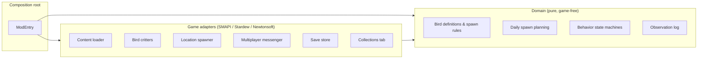
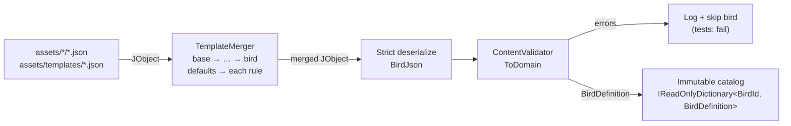
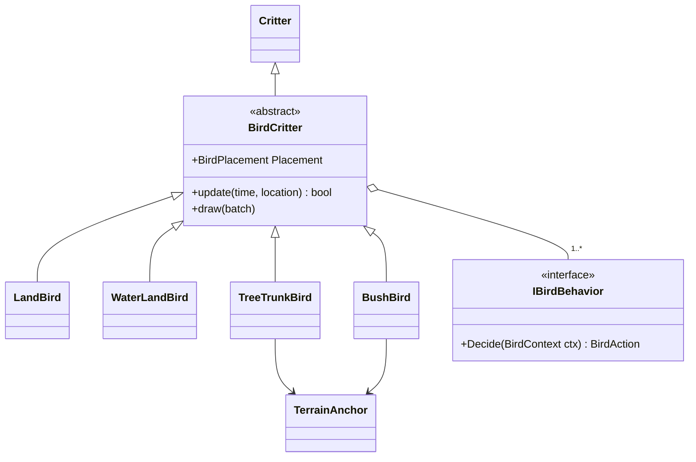
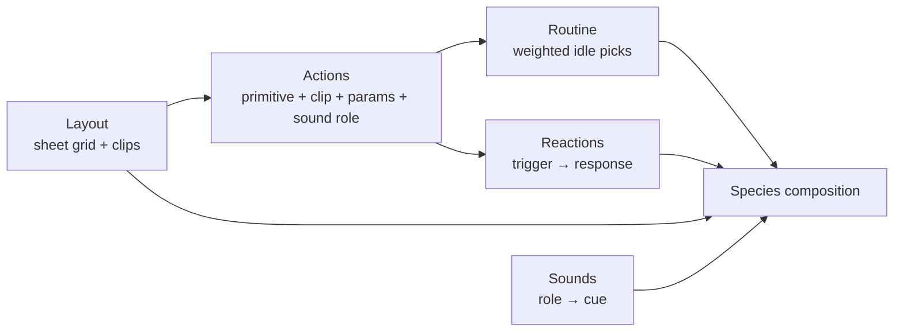
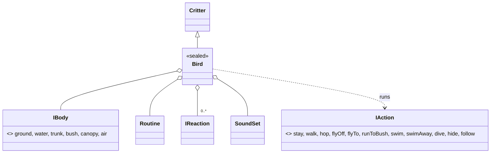
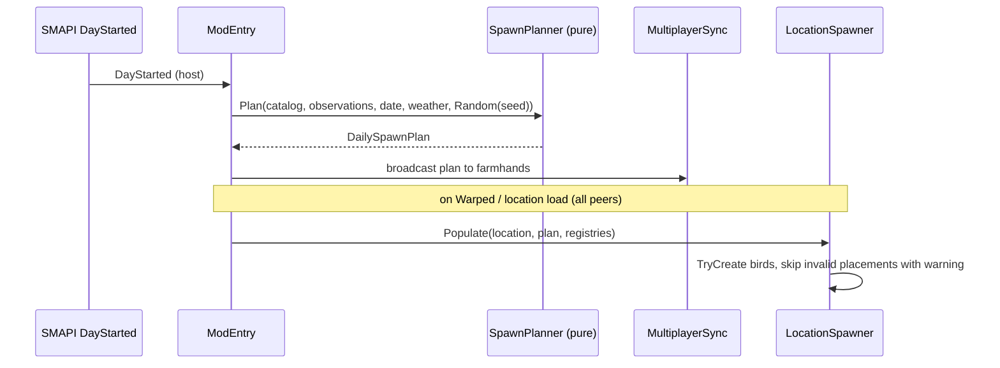

# Goal Architecture

Target design for Birds Everywhere after the refactor described in [REFACTOR.md](REFACTOR.md). Coding rules come from the global C# standards and [birdseverywhere.instructions.md](../.github/instructions/birdseverywhere.instructions.md); this document only covers structure, data flow, and ownership.

The current code is legacy. Where it conflicts with this document, this document wins.

## Principles

- **Functional core, imperative shell.** Decisions (what to spawn, where, whether a bird is valid, what an observation changes) are pure functions over records. Game and SMAPI access happens in thin adapters around them.
- **Data in, domain out.** JSON is merged, validated, and converted to immutable domain records once at load. Nothing after load sees raw JSON or nullable config fields.
- **Explicit wiring.** `ModEntry` builds every object, owns all long-lived state, and passes dependencies down. No static fields, singletons, reflection-based discovery, or process-wide settings.
- **Host is authoritative.** The host owns spawn plans and save data. Farmhands request; the host decides and broadcasts.
- **Fail safe in game, fail loud in tests.** Invalid content is rejected at load with a precise message. At runtime, a missing tree or unknown ID logs a warning and despawns the bird; it never crashes the game.

## Layers

Dependencies only point inward.



| Layer | May reference | Must not reference | Tests |
|---|---|---|---|
| Domain | BCL, `System.Collections.Immutable` | `Game1`, SMAPI, MonoGame, Newtonsoft | arm64, fast, no fakes for most |
| Game adapters | Domain, SMAPI, Stardew, MonoGame, Newtonsoft | other adapters' internals | x64, or via domain + fakes |
| Composition root | everything | business logic | in-game only |

`Vector2`/`Point` from MonoGame are the one tolerated exception in domain code if replacing them costs more than it gains; prefer a domain `readonly record struct Tile(int X, int Y)`.

## Target folder layout

Feature folders, one top-level type per file, namespaces mirror folders. One mod project and one test project.

```text
BirdsEverywhere/
  ModEntry.cs                 composition root: build, subscribe, delegate
  Content/                    JSON boundary
    BirdJson.cs, SpawnRuleJson.cs
    TemplateMerger.cs         JObject merge, rule expansion, cycle detection, provenance
    ContentValidator.cs       JSON model -> domain, errors with file/field/chain
    ContentPaths.cs           all asset path construction
  Domain/
    BirdDefinition.cs, SpawnRule.cs, SpawnConditions.cs, IntRange.cs, Tile.cs
    Season.cs, Weather.cs
    Ids.cs                    BirdId, BirdTypeId, SpawnPatternId, BehaviorId
  Spawning/
    SpawnPlanner.cs           pure: rules + date + weather + Random -> DailySpawnPlan
    DailySpawnPlan.cs
    TileSelection.cs          pure tile/feature selection over ILocationQuery
    LocationSpawner.cs        adapter: plan + GameLocation -> critters
  Birds/
    BirdCritter.cs            the one mod-owned abstract layer under Critter
    LandBird.cs, WaterLandBird.cs, TreeTrunkBird.cs, BushBird.cs (sealed)
    Behaviors/                IBirdBehavior + small behavior implementations
    TerrainAnchor.cs          location + tile + feature kind
                              Phase 10: one sealed Bird + Bodies/, Actions/, Reactions/, Routine, SoundSet, Layouts/ (clip playback)
  assets/layouts|actions|routines|reactions/   Phase 10: shared composition definitions, <id>.json
  schemas/                    editor/test JSON schemas, one per file kind + common.schema.json
  Registries/
    BirdTypeRegistry.cs, SpawnPatternRegistry.cs
  Observations/
    ObservationLog.cs         pure: TryApply (new log copy, version + 1) and Check (delta status)
    DeltaStatus.cs            Duplicate / Next / Gap
  Multiplayer/
    Messages.cs               versioned message records (IMessage.CurrentVersion)
    MultiplayerSync.cs        adapter over Helper.Multiplayer
  Persistence/
    SaveData.cs               versioned save record
    SaveStore.cs              adapter over Helper.Data, migrations
  UI/
    CollectionsPageWithBirds.cs
  Diagnostics/
    ConsoleCommands.cs        in-game checks (spawn, list, validate)
```

## Key types

All domain types are records with read-only collections.

| Type | Role | Replaces |
|---|---|---|
| `BirdDefinition` | Validated species: id, names, description, `IReadOnlyList<SpawnRule>` | `BirdData` (config half) |
| `SpawnRule` | Fully merged rule: id, `SpawnConditions`, expanded location names, `SpawnPatternId`, `BirdTypeId`, group count and size (`IntRange`, inclusive), texture weights, selection weight | `SpawnData` |
| `SpawnConditions` | Seasons, weathers, day ranges, time ranges; an empty set means "any" | `SpawnData` weather/day/time fields |
| `DailySpawnPlan` | Per location: chosen bird, chosen rule, planned bird placements. Built once per day by the host | `DailySpawner` + `BirdData.currentSpawnData` |
| `BirdPlacement` | Bird id, rule, `Tile` or `TerrainAnchor`, texture, seed | `SingleBirdSpawnParameters*` |
| `TerrainAnchor` | Location name, tile, feature kind (`Tree`/`Bush`) | stored collection index |
| `BirdState` | Serializable snapshot of a live bird (placement, position, behavior state, animation) | reflection-based converter output |
| `ObservationLog` | Seen birds and observation details | `SaveData` contents |
| `SaveData` | `int Version` + `ObservationLog` | `SaveData` |

IDs are `readonly record struct` wrappers over `string` so a bird id cannot be passed where a spawn pattern id is expected.

## Content pipeline



Format, merge rules, and validation are specified in [Bird configuration](#bird-configuration). Defaults have three layers: C# fallbacks only for technically safe optional fields, base templates for gameplay defaults, bird files for species overrides. No gameplay defaults in property initializers.

## Bird configuration

Goal: a new species that behaves like an existing group of birds is a file with only identity fields and a `template`. Behavior that differs by season, weather, day, or time is data on rules, never code.

### Files

| File | Contains | Must not contain |
|---|---|---|
| `assets/templates/<id>.json` | optional `template`, `defaults`, `rules` | identity fields |
| `assets/<bird_id>/<bird_id>.json` | `id` (equals file name), `name`, `scName`, `description`, optional `template`, `defaults`, `rules` | — |
| `assets/regions.json` | `{ "<region>": { "ratio": 0.6, "species": ["<bird_id>", ...], "groups": { "<group>": ["<GameLocationName>", ...] } } }`; `species` is ordered most to least frequent, `ratio` (default 0.6) is the weight factor per rank | nested groups, per-bird location lists |
| `assets/compat/<modUniqueId>.json` | same format, existing regions only; species and group members are appended when that mod is loaded | new regions, `ratio`, nested groups |

Only templates can be parents. Location groups are the only place that lists locations in bulk; birds are not listed per area anywhere (no second source of truth).

### Rule fields

A rule is one situation in which the bird can appear. `defaults` has the same fields and is merged into every rule.

| Field | Type | Meaning |
|---|---|---|
| `when.seasons` | `["spring" \| "summer" \| "fall" \| "winter"]` | missing = any |
| `when.weather` | `["sun" \| "rain" \| "storm" \| "snow" \| "wind" \| "greenRain"]` | today's weather at day start; festival and wedding days count as `sun`; missing = any |
| `when.days` | `[[min, max], ...]` | day of month, 1–28, inclusive; missing = any |
| `when.times` | `[[min, max], ...]` | game time `HHMM`, 600–2600, inclusive; gates spawning only; missing = any |
| `locations` | `["Forest", "Farm_Riverland", "Forest:River", "@coast", ...]` | location names or `@group` references, expanded at load; `Farm_<type>` = Farm on that farm type; `:Name` = fish area of the location |
| `spawnPattern` | registry id | where birds are placed, e.g. `SpawnableGroundSpawner` |
| `birdType` | registry id | critter class, e.g. `LandBird` |
| `spawnParams.shoreDistance` | `[min, max]` | tiles (0–20) to the nearest opposite kind (ground for water tiles, water for ground tiles); planning-time only; missing = any |
| `groupCount`, `groupSize` | `[min, max]` | inclusive |
| `textures` | `{ "<variant>": weight }` | `""` is the base sprite; other keys are texture variants |
| `weight` | number > 0 | selection weight among eligible rules; C# fallback `1` |
| `body`, `layout`, `actions`, `routine`, `reactions`, `sounds`, `stages` | ref or inline | planned, [Bird composition](#bird-composition-config-driven-behavior); replace `birdType` and the reserved `routineWeights`/`threatResponse` |
| `group`, `groupSpacing`, `near`, `avoid`, `space`, `packing`, `speciesDistance` | see [Spawning v2](#spawning-v2-groups-stages-spacing) | planned; same merge rules apply |

Required after merging: `locations`, `spawnPattern`, `birdType`, `groupCount`, `groupSize`, `textures`.

### Merge algorithm

One merge function, applied in two steps. Objects merge key by key, arrays replace, a JSON `null` removes the inherited key (a `null` rule removes the whole rule).

1. **Vertical:** merge the template chain, most general first: `base_bird → … → template → bird`. This yields one `defaults` object and one `rules` object.
2. **Horizontal:** for every rule id, `effective = merge(defaults, rules[id])`.

Resulting precedence, lowest to highest:

```text
template defaults  <  bird defaults  <  template rules[id]  <  bird rules[id]
```

**Rules beat defaults at every level.** A rule is situational and therefore more specific; template situations (e.g. larger flocks in winter) survive in every inheriting bird unless that bird overrides that rule. A bird's `defaults` only changes values that no inherited rule sets. To change a situational value, override the rule by id. The validator reports every bird `defaults` value that an inherited rule shadows.

Consequences:

- Rules are keyed by id, so a bird can override, extend, or remove a single inherited rule.
- Weight maps (`textures`, later `routineWeights`) merge per key; remove a variant with `"female": null`.
- Lists replace, so adding one location means restating the list; use `@groups` to keep that short.
- To drop all inherited situations, inherit a template without rules; there is no replace-all syntax.
- Rule ids are part of a template's contract. Renaming one breaks bird overrides, which validation reports.

### Rule selection

- **Day start (host):** for each bird, eligible rules are those whose `seasons`, `weather`, and `days` match today. One is picked by `weight` with the seeded day `Random`. No eligible rule: the bird is absent today. The chosen rule goes into the `DailySpawnPlan`.
- **Spawning:** when a peer enters a location in the rule's `locations`, or a `times` window opens while a player is in it, birds spawn if the current time is inside `times`.
- **After spawning** a bird stays until it flees, the location unloads, or the day ends. A closing `times` window never removes birds, so players can still observe them or call others over in co-op.

### Validation

Structure is enforced by Newtonsoft during deserialization of the merged object: `MissingMemberHandling.Error` rejects unknown keys (typos), `[JsonProperty(Required = Required.Always)]` rejects missing required fields, and type mismatches fail. Settings are passed per call. Everything else is a hand-written `Validate` returning `IReadOnlyList<ValidationIssue>` with file, bird or template id, JSON path, and template chain. `TemplateMerger` records the source file of every merged value for these messages.

| Severity | Checks | Runtime | Tests |
|---|---|---|---|
| Error | unknown key, missing required field, wrong type; identity field in a template; missing template or cycle (full chain); `id` ≠ file name; unknown season or weather; `min > max`; days outside 1–28; times outside 600–2600; `weight` or texture weight ≤ 0; unknown `spawnPattern`, `birdType`, or `@group`; missing texture file; a bird `rules.<id>` without `when` that matches no inherited rule (likely typo) | `Error` log, bird skipped, other birds load | fail |
| Warn | bird `defaults` value shadowed by an inherited rule; bird with no rules | `Warn` log | fail unless allow-listed |
| Info | bird `rules.<id>` with `when` that matches no inherited rule (new rule); season/weather combinations with no eligible rule | `Info` log | ignored |
| Runtime only | location name unknown to the game | `Warn`, location dropped from the rule | — |

The same code runs in `ContentTests` over every shipped file and on `GameLaunched` for player-edited files. A `birds_dump <id>` console command prints every effective rule with the source file of each value.

### Examples

`assets/regions.json`

```json
{
  "valley_gardens": ["Farm", "Town", "Forest", "BusStop", "Backwoods"],
  "coast": ["Beach"],
  "inland_water": ["Forest", "Mountain", "Town"]
}
```

Base template shared by all birds, `templates/base_bird.json`:

```json
{
  "defaults": {
    "when": { "times": [[600, 2000]] },
    "groupCount": [1, 2],
    "groupSize": [1, 3],
    "textures": { "": 1 }
  }
}
```

Common garden birds (tits, finches, sparrows, blackbirds), `templates/garden_resident.json`. Active during the day, absent at summer noon, juveniles in summer, flocks in winter:

```json
{
  "template": "base_bird",
  "defaults": {
    "locations": ["@valley_gardens"],
    "spawnPattern": "SpawnableGroundSpawner",
    "birdType": "LandBird",
    "groupSize": [1, 4]
  },
  "rules": {
    "spring_fall": { "when": { "seasons": ["spring", "fall"] } },
    "summer": {
      "when": { "seasons": ["summer"], "times": [[600, 1100], [1500, 2000]] },
      "groupSize": [2, 6],
      "textures": { "juvenile": 1 }
    },
    "winter": {
      "when": { "seasons": ["winter"] },
      "groupCount": [1, 1],
      "groupSize": [4, 10]
    }
  }
}
```

Pure inheritance, `blue_tit/blue_tit.json`:

```json
{
  "id": "blue_tit",
  "name": "Blue Tit",
  "scName": "Cyanistes caeruleus",
  "description": "...",
  "template": "garden_resident"
}
```

Effective `summer` rule of `blue_tit` (source in comments):

```jsonc
{
  "when": {
    "seasons": ["summer"],                  // garden_resident.rules.summer
    "times": [[600, 1100], [1500, 2000]]    // garden_resident.rules.summer (replaces base_bird list)
  },                                        // weather, days missing: any
  "locations": ["Farm", "Town", "Forest", "BusStop", "Backwoods"], // @valley_gardens expanded
  "spawnPattern": "SpawnableGroundSpawner", // garden_resident.defaults
  "birdType": "LandBird",                   // garden_resident.defaults
  "groupCount": [1, 2],                     // base_bird.defaults
  "groupSize": [2, 6],                      // garden_resident.rules.summer
  "textures": { "": 1, "juvenile": 1 },     // base_bird.defaults + rules.summer, merged per key
  "weight": 1                               // C# fallback
}
```

Species tweak, `house_sparrow/house_sparrow.json`. `defaults.groupSize` alone only applies to `spring_fall`, because the template's `summer` and `winter` rules set their own `groupSize`; without the two rule overrides the validator warns about the shadowing:

```json
{
  "id": "house_sparrow", "name": "House Sparrow", "scName": "Passer domesticus", "description": "...",
  "template": "garden_resident",
  "defaults": { "groupSize": [3, 8] },
  "rules": {
    "summer": { "groupSize": [4, 12] },
    "winter": { "groupSize": [10, 25] }
  }
}
```

Extra texture variant, `blackbird/blackbird.json`. Every rule gets `female`; summer gets `""`, `female`, and `juvenile`:

```json
{
  "id": "blackbird", "name": "Blackbird", "scName": "Turdus merula", "description": "...",
  "template": "garden_resident",
  "defaults": { "textures": { "female": 1 } }
}
```

Winter visitor reusing the template, `fieldfare/fieldfare.json`. Removes two inherited rules, keeps `winter`, adds a late-fall arrival rule:

```json
{
  "id": "fieldfare", "name": "Fieldfare", "scName": "Turdus pilaris", "description": "...",
  "template": "garden_resident",
  "rules": {
    "spring_fall": null,
    "summer": null,
    "late_fall": { "when": { "seasons": ["fall"], "days": [[15, 28]] }, "groupSize": [3, 8] }
  }
}
```

Seasonal water birds, `templates/winter_waterbird.json`, and two species using it:

```json
{
  "template": "base_bird",
  "defaults": {
    "locations": ["@inland_water"],
    "spawnPattern": "WaterSpawner",
    "birdType": "WaterLandBird",
    "groupSize": [2, 8]
  },
  "rules": {
    "migration": { "when": { "seasons": ["fall"], "days": [[15, 28]] } },
    "winter": { "when": { "seasons": ["winter"] }, "groupCount": [1, 3] }
  }
}
```

```json
{ "id": "tufted_duck", "name": "Tufted Duck", "scName": "Aythya fuligula", "description": "...", "template": "winter_waterbird" }
```

```json
{
  "id": "goldeneye", "name": "Common Goldeneye", "scName": "Bucephala clangula", "description": "...",
  "template": "winter_waterbird",
  "defaults": { "groupSize": [1, 4], "textures": { "female": 2 } }
}
```

Weather-dependent behavior, `herring_gull/herring_gull.json`. On a stormy winter day all three rules are eligible and picked 25 / 50 / 25 %:

```json
{
  "id": "herring_gull", "name": "Herring Gull", "scName": "Larus argentatus", "description": "...",
  "template": "base_bird",
  "defaults": {
    "spawnPattern": "WaterOrGroundSpawner",
    "birdType": "WaterLandBird",
    "groupSize": [2, 10]
  },
  "rules": {
    "coast": { "locations": ["@coast"] },
    "storm_inland": { "when": { "weather": ["rain", "storm"] }, "locations": ["@valley_gardens"], "weight": 2 },
    "winter_inland": { "when": { "seasons": ["winter"] }, "locations": ["@inland_water"] }
  }
}
```

Night birds, `templates/nocturnal.json` (its `when.times` replaces the base list) and `tawny_owl/tawny_owl.json`:

```json
{
  "template": "base_bird",
  "defaults": {
    "when": { "times": [[2000, 2600]] },
    "spawnPattern": "TreeTrunkSpawner",
    "birdType": "TreeTrunkBird",
    "groupCount": [1, 1],
    "groupSize": [1, 1]
  },
  "rules": { "all_year": {} }
}
```

```json
{
  "id": "tawny_owl", "name": "Tawny Owl", "scName": "Strix aluco", "description": "...",
  "template": "nocturnal",
  "defaults": { "locations": ["Forest", "Backwoods"] }
}
```

Validation messages for typical mistakes:

```text
Error  great_tit.json: $.defaults.groupSzie: unknown key
Error  fieldfare.json: $.rules.wintr: no inherited rule 'wintr' and no 'when' (chain: fieldfare → garden_resident → base_bird)
Warn   house_sparrow.json: $.defaults.groupSize [3, 8] is shadowed in rules 'summer' (garden_resident.json), 'winter' (garden_resident.json)
Info   fieldfare.json: $.rules.late_fall: new rule
Error  herring_gull.json: $.rules.coast.groupSize: min 10 > max 2
```

## Registries

Plain `IReadOnlyDictionary<TId, Func<..., T>>` built in `ModEntry`. No reflection, attributes, or static dictionaries.

```csharp
var birdTypes = new Dictionary<BirdTypeId, BirdFactory>
{
    [BirdTypeIds.Land] = (placement, ctx) => new LandBird(placement, ctx),
    [BirdTypeIds.Bush] = (placement, ctx) => new BushBird(placement, ctx),
};
```

- Content validation checks every referenced id against the registry keys before gameplay starts.
- Lookups use `TryGetValue`; an unknown id at runtime logs a warning and skips the bird.
- Adding a bird type or spawn pattern is: implement, register once, reference from JSON, test.
- Spawn patterns only decide where birds are placed; conditions (season, weather, time, day) are `SpawnRule` data and never justify a new pattern class.

## Birds and behaviors

The game requires birds to be `Critter` subclasses. The hierarchy is capped at one mod-owned layer:



- `BirdCritter` owns identity, position, sprite, lifecycle, and an ordered behavior list. Concrete birds are `sealed` and mainly choose behaviors and anchoring.
- Behaviors (wander, peck, hop, swim, perch, flee, despawn) are small classes behind `IBirdBehavior`. Their decision logic is a pure function over a `BirdContext` record (position, nearest farmer distance, anchor still valid, elapsed time, `Random`) so it can be tested without the game.
- Behavior order and conflict rules live in one ordered list per bird type (`BirdBehaviors`); the first behavior returning an action wins. The bird applies the action (state, animation, movement).
- Idle options and weights become data: defaults per bird type, overrides per species in JSON. An action is only listed for species whose sprite sheet has its frames, so the sheet needs a fixed frame layout per action.
- Terrain-feature birds resolve their `TerrainAnchor` by location and tile each update. If the feature is gone or changed kind, the bird despawns cleanly.
- Each bird owns a `Random` seeded from its placement seed. Only the location owner advances its RNG and animation callbacks; replicas render its sequenced snapshots, since seed alone cannot keep frame-dependent behavior synchronized.
- Shared bird animation does not require rollback: the location owner commits choices, and peers play visuals locally. The owner prepares a short, bounded queue of future idle cues using a separate per-bird schedule RNG. Each cue has an owner tick, action and chosen parameters; the owner follows it only while eligible. An external change (flee, changed anchor, despawn) replaces the pending queue with a higher revision. Peers discard old revisions and never apply observations, sound or world changes from predicted visuals.
- Committed movement (flight or bush run) carries its starting pose, direction, velocity and animation. Replicas advance it between messages; the owner remains responsible for the end/despawn. Snapshot arrival must not restart an ongoing animation. If the queue runs out during a long pause, a peer holds a harmless idle loop until the next authoritative update. A late flee starts promptly on receipt from the peer's displayed position, with no rewind; occasional sequenced snapshots correct drift and recover late joins.

Implemented so far: land and water-land stopped routines prepare one cue up to 120 ticks ahead with an isolated schedule RNG, tick, revision, action and visual seed. Cues can fire immediately when a bird becomes idle, preserving the prior per-tick action chance; short-lead cues may occur before the next six-tick snapshot reaches a peer. Replicas advance flight and bush-run motion and animation locally, correcting drift against six-tick snapshots. Walking, hopping and collisions remain owner-driven and are not predicted. In-game multiplayer timing, lag and owner handoff still need verification.

The migration is gradual: inheritance stays where it is simple and stable; composition replaces it only where combining behaviors would otherwise need more subclasses. The end state is [Bird composition](#bird-composition-config-driven-behavior), implemented in [REFACTOR.md → Phase 10](REFACTOR.md#10-fully-modular-config-driven-birds).

## Bird composition (config-driven behavior)

Planned design for [Phase 10](REFACTOR.md#10-fully-modular-config-driven-birds). Goal: a species' animation, idle routine, reactions, sounds, spawn grouping and life stages are JSON; C# provides a small, closed vocabulary of verbs and nouns.

**Rule of thumb:** a new noun or verb (primitive, trigger, body, effect, target search, condition key) needs code; a new combination of existing ones is config. There is no expression language or scripting in JSON.

### Layers

Five layers, each referenced by name or defined inline (see [Ref or inline](#ref-or-inline)). All use the same merge rules as [TemplateMerger](#merge-algorithm): objects merge key by key, arrays replace, `null` removes.



#### 1. Layout (sheet grid and clips)

A layout describes one sprite-sheet arrangement and the named clips played from it. Clips are tied to the art, so the layout is the reusable unit; textures (male, female, juvenile variants) share a layout.

```json
"land_32": {
  "frameSize": [32, 32],
  "clips": {
    "stand": [[0, 1000]],
    "walk":  { "frames": [[0, 100], [1, 100]], "loop": true },
    "peck":  {
      "frames": [[2, 480], [3, 170], [4, 170]],
      "repeat": { "frames": [[3, 70], [4, 100, "peck"]], "count": [1, 4] },
      "end":    [[3, 100], [2, 70], [1, 70], [0, 500]]
    },
    "sleep": [[5, 0]],
    "fly":   { "frames": [[6, 70], [7, 60, "flap"], [8, 70], [7, 60]], "loop": true }
  }
}
```

- `frameSize` is `[width, height]` in source pixels. Frame index = cell counted left to right, top to bottom, exactly like `AnimatedSprite` (which wraps by texture width).
- A clip is either a frame list or an object `{ frames, repeat?, end?, loop? }`. Played sequence: `frames`, then `repeat.frames` rolled `repeat.count` times, then `end`. `loop: true` repeats the whole sequence until the action ends.
- A frame is `[cell, ms]` or `[cell, ms, event]`. `ms` is an integer or a [range](#ranges), e.g. `[6, [500, 3999]]`.
- An event string names a sound role (played via the species' `sounds`) or a code-registered effect (`hop`, later `splash`, `feathers`, `hide`). A name may not be both; unknown names fail validation.
- Clip end is reported to the running action (replaces legacy `DonePecking`-style callbacks).
- **Sheet rule:** append new poses at the end of a sheet; never insert or reorder cells, so every existing clip stays valid. A different cell size is a new layout, usually one that `extends` an existing one.

#### Ranges

`[min, max]` inclusive, or `[min, max, step]`. Rolled as `rng.Next(min / step, max / step + 1) * step` (step defaults to 1), i.e. one `Next` call, so legacy `VisualRng.Next(5, 15) * 100` is exactly `[500, 1400, 100]` and `VisualRng.Next(1, 5)` is `[1, 4]`. Same convention for every range in this section.

#### 2. Actions

An action binds a code primitive (`do`) to a clip, parameters and an optional sound role.

```json
"peck":   { "do": "stay", "clip": "peck" },
"forage": { "do": "walk", "clip": "walk", "durationMs": [500, 1500] },
"sing":   { "do": "stay", "clip": "sing", "sound": "song" },
"dive":   { "do": "dive", "clip": "dive", "hiddenMs": [2000, 5000], "resurfaceTiles": [1, 3] }
```

- Primitives are a closed C# vocabulary: `stay`, `walk`, `hop`, `flyOff`, `flyTo`, `runToBush`, `swim`, `swimAway`, `dive`, `hide`, `follow`.
- Common fields: `clip`, `sound` (role played when the action starts), `soundChance`, and how the action ends: clip end (default for non-looping clips), `durationMs`, or `endChance` (per-tick chance, legacy `Wake`/`StopWalking`).
- Primitive-specific fields (`speed`, `impulse`, `turn`, `hiddenMs`, `target`, `speedFactor`, ...) are validated per `do`.
- Action ids are strings. They replace the `BirdAction` enum, and `IdleCue.Action` becomes the action id.

#### 3. Routine (idle)

```json
"garden_ground": {
  "chance": 0.008,
  "pick": { "peck": 4, "forage": 2, "hop": 1, "stand": 2, "sing": 1 },
  "next": { "forage": { "peck": 3, "stand": 1 } },
  "cooldown": { "sing": 10000 },
  "rare": { "wormPull": { "weight": 0.05, "when": { "weather": ["rain"] } } }
}
```

- `chance`: per-tick chance to schedule an idle cue while eligible (legacy 0.008 land, 0.003 water-land).
- `pick`: integer weights; one roll `Next(sum)` walked cumulatively in key order after merging. A list with a duplicate (legacy `Walk, Walk`) becomes weight 2 and consumes the RNG identically.
- `next`: sparse follow-up weights when a specific action ends; actions without an entry fall back to idle scheduling. Not an N×N transition matrix, and no frame-level probabilities.
- `cooldown`: minimum ms between two starts of an action.
- `rare`: probability-weighted extras with optional `when` [conditions](#context-conditions), rolled before `pick`. Shipped birds have no `rare` entries, so their RNG consumption is unchanged.

#### 4. Reactions

```json
"skittish_ground": {
  "threat": {
    "alert": { "radius": 6, "do": "stay", "clip": "alert", "sound": "alarm" },
    "flee":  { "radius": 3, "do": "flyOff", "sound": "alarm" }
  },
  "playerEnters": { "chance": 0.3, "sound": "call" }
},
"relocating_tree": {
  "threat": { "flee": { "radius": 5, "do": "flyTo", "target": "otherTree", "maxRelocations": 2, "then": "flyOff" } }
}
```

- Triggers are code: `threat`, `playerEnters`, `treeShaken`, `toolUsed`, `timeOfDay` (legacy felled-tree flee becomes a trunk-body trigger feeding `flee`).
- Two-radius threat response: inside `alert.radius` the bird freezes (head-up clip), inside `flee.radius` it responds, and it resumes idling a short while after the threat leaves the outer radius.
- A running farmer counts as closer (optional `runningMultiplier` in JSON; C# fallback in code).
- `BirdContext` carries the threat distance instead of a bool. Decision order: `Flee(inner) → Alert(outer) → Wake → IdleRoutine`.
- The observation registers on any visible response (alert, flee, relocate), not only flee.
- `flyTo` uses a target search (`otherTree`, `otherBush`, `water`, `groupRole:<role>`), backed by `TileSelection`/`ILocationQuery`; on arrival the bird updates its `TerrainAnchor`. After `maxRelocations`, `then` applies.

#### 5. Species composition

```json
{
  "id": "great_tit",
  "template": "garden_resident",
  "body": "ground",
  "layout": "songbird_32",
  "routine": "garden_ground",
  "reactions": ["skittish_ground"],
  "sounds": { "call": "great_tit_call", "song": "great_tit_song", "alarm": "great_tit_alarm", "flap": "batFlap", "peck": "shiny4" }
}
```

- Composition fields live on rules (and therefore `defaults` and templates), so they merge and can vary by rule like every other rule field.
- Sound roles are indirect: clips, actions and reactions name a role; the species maps roles to cues. A missing role is silent, not an error.
- Cues are vanilla cue names or mod cues registered via SMAPI `Data/AudioChanges` with `<ModId>_` ids, played through `Game1.playSound`. Prototype audio: jsfxr/ChipTone or synthesized tones; real recordings only with a compatible license (Freesound CC0; many Xeno-canto clips are CC BY-NC). Mono `.ogg`/`.wav`.
- Sound features: distance-based volume, per-role cooldowns, a volume setting in `ModConfig`, and a player-enters-location hook (`playerEnters` trigger).

### Ref or inline

Every composable field (`layout`, `routine`, each `reactions` entry, each action, `stages` overrides) is either a string reference to a shared definition or an object with optional `extends` plus overrides. The schema is the same for shared files and inline objects.

```json
{
  "id": "black_woodpecker",
  "body": "trunk",
  "layout": {
    "extends": "trunk_16",
    "frameSize": [48, 32],
    "clips": { "drum": { "frames": [[5, 40]], "repeat": { "frames": [[6, 30, "drum"], [5, 30]], "count": [8, 20] } } }
  },
  "actions": { "drum": { "do": "stay", "clip": "drum", "sound": "drumroll" } },
  "routine": { "extends": "trunk_feeder", "pick": { "drum": 1 }, "cooldown": { "drum": 15000 } },
  "sounds": { "drumroll": "BirdsEverywhere_black_woodpecker_drum" }
}
```

- The floor of customization is code: primitives, triggers, effects, bodies, target searches, condition keys.
- Promote an inline definition to a shared file only when a second species needs it (WET first).
- Inline definitions are local to their species; they cannot be referenced from elsewhere. An inline name that shadows a shared one is reported at `Info`.
- Large species files may split definitions into files next to them (`assets/<bird>/layout.json`, `routine.json`), merged as if inline.
- `birds_dump <bird> [<rule>]` prints the resolved composition with the source file of each value (same provenance as merge diagnostics).

Shared definitions live in `assets/layouts/`, `assets/actions/`, `assets/routines/`, `assets/reactions/`, one id per file (`<id>.json`).

### Code shape



- One sealed `Bird : Critter` composed of an `IBody` (anchoring, drawing offsets, movement physics, collision, body triggers), a `Routine`, `IReaction`s, a `SoundSet`, and `IAction` primitives created from action definitions.
- Bodies, primitives, triggers, effects, target searches, condition keys and formations are registered by string id in `ModEntry` (same registry pattern, no reflection). No combinatorial subclasses (no `FlyingWaterBirdWithSongAndCallWhichIsShy`).
- Capabilities are derived from data: a bird can fly if its layout has a `fly` clip and it has a `flyOff` action.
- Migration: the four current classes first become bodies with hardcoded compositions (behavior unchanged), then the compositions move into JSON.
- `BirdState` serializes body kind, current action id, action progress, clip index and anchor; old saves map legacy `birdTypeName` values to bodies.

### Config vs code

| Config (JSON) | Code (C#) |
|---|---|
| clips, frame timings, repeat counts | primitives (`stay`, `walk`, `flyOff`, ...) |
| routine weights, `next`, cooldowns, rare actions | physics, collision, movement |
| reaction radii, chances, targets, responses | trigger detection (`threat`, `treeShaken`, ...) |
| sound role → cue mappings | target searches (`otherTree`, `groupRole:*`) |
| conditions (`when`, `if`) using fixed keys | bodies and their anchoring/drawing |
| composition, stages, groups, formations, spacing | effects (splash, feathers, hide sprite) |
| | multiplayer, observations, despawn |

### Multiplayer

- The owner picks the next action id plus a seed (the existing `IdleCue(Tick, Action, Seed)`); peers replay the clip deterministically from the seed. Clip ranges roll on the cue's visual RNG; routine and reaction decisions roll on the owner's RNGs only.
- Committed movement (`flyOff`, `flyTo`, `runToBush`, `swimAway`, `follow`) carries start pose, direction and velocity, as today.
- Today replicas advance frames without running frame callbacks, so peers play no frame sounds. **Open decision:** make sounds owner-committed (sent with the cue) or local cosmetic events fired by peers from replayed clips.

### Spawning v2: groups, stages, spacing

A rule may gain a `group` block; without it a rule spawns as today (`groupCount` × `groupSize`).

```json
"group": {
  "formation": "cluster",
  "radius": 2,
  "members": {
    "parent":   { "count": [1, 2], "stage": "adult" },
    "duckling": { "count": [3, 8], "stage": "duckling" }
  }
}
```

**Stages** are richer variants of a species: a stage overrides any composition field. The existing `textures` weights still pick plumage within a stage.

```json
"stages": {
  "adult": {},
  "duckling": {
    "layout": "duckling_16",
    "routine": { "extends": "dabbling", "pick": { "dive": null } },
    "reactions": [{ "threat": { "flee": { "radius": 3, "do": "follow", "target": "groupRole:parent", "speedFactor": 1.4 } } }]
  }
}
```

#### Context conditions

Reactions (and routine `rare.when`) can branch on context. A list of alternatives; the first match wins.

```json
"threat": [
  { "if": { "groupHasRole": "duckling" }, "flee": { "radius": 4, "do": "swimAway", "sound": "alarm" } },
  { "flee": { "radius": 5, "do": "flyOff", "sound": "alarm" } }
]
```

Condition keys are a fixed C# vocabulary: `groupHasRole`, `nearWater`, `season`, `timeOfDay`, `weather`, `stage`. Keys in one object are ANDed; there is no OR/NOT inside an object (use separate alternatives).

#### Group runtime

- Each bird carries `groupId` and `role` (also in `BirdState`).
- Group-level reactions are possible (one member's flee triggers the group).
- The owner of the group leader owns the whole group.
- `follow` is committed movement relative to the leader; later reused for cattle egrets on farm animals (moving anchor).

#### Placement controls

| Field | Meaning |
|---|---|
| `group.formation` | `cluster`, `scattered`, `line`, `perched` (registered by id) |
| `group.radius` | tiles around the group center |
| `groupSpacing` | `[min, max]` tiles between groups of the same rule |
| `near` / `avoid` | `[{ "kind": "tree", "within": 3 }, { "kind": "water", "within": 1 }, { "kind": "crop" }]`; kinds backed by `ILocationQuery` |
| `spawnParams.shoreDistance` | unchanged |
| `space` | per-species body radius in tiles; C# fallback 0.5 (gull ≈ 1, heron ≈ 1.5) |
| `packing` | factor < 1 lets clusters pack tighter than `space` |
| `speciesDistance` | gap to groups of other species; default `TileSelection.MinSpeciesDistance` (8), now overridable per rule |

- Two birds A and B are valid neighbours when their distance is at least $(r_A + r_B) \cdot packing$.
- Placement is rejection sampling (Poisson-disk style) with N tries per bird and no spatial index. Partial placement is accepted; below the rule's minimum count, the existing feasibility fallback applies.
- Formation, spacing, `near`/`avoid` and `space` are pure planner logic over `ILocationQuery`, testable on arm64.
- `birdType` is mostly replaced by `body` plus behavior refs. The validator checks body vs spawn-pattern compatibility (e.g. `trunk` needs `TreeTrunkSpawner`).

### Validation

`ContentValidator` (runtime) checks the resolved composition:

- every clip referenced by an action exists in the layout; every action referenced by a routine, `next`, reaction or stage exists;
- frame indices fit the texture: e.g. `layout land_32 clip peck: frame 9 outside 9-cell sheet great_tit.png`;
- each primitive fits the body (`dive` needs a water-capable body; `flyTo otherTree` needs a tree anchor);
- unknown sound roles, effects, primitives, triggers, condition keys, formations and `near` kinds; unreachable `next` entries;
- `extends` targets exist and have no cycles; texture and sound files exist.

Error format and severity follow [Validation](#validation).

### Schemas

- One schema per file kind in `schemas/`: existing `bird`, `template`, `rule`, `regions`, `compat`, plus `layout`, `routine`, `reaction` and possibly `action`. `common.schema.json` holds shared `$defs`: `range`, `weightMap` (values may be `null`), `refOrInline`, `condition`, `soundRole`.
- Schemas describe partial files: no `required` on mergeable fields, and `null` allowed wherever merging allows removal.
- Primitive-specific fields use `if`/`then` on the `do` discriminator instead of deep `oneOf`, so editor errors stay readable.
- Editor mapping via `.vscode/settings.json` `json.schemas` globs. Assets get no `$schema` key, because strict deserialization (`MissingMemberHandling.Error`) would reject it.
- JsonSchema.Net stays test-only; never `Newtonsoft.Json.Schema` (AGPL).
- `SchemaTests`:
  - `AssetFiles` becomes a folder → schema table;
  - a guard test fails when any `assets/**/*.json` matches no schema;
  - `SchemaEnums_MatchCode` becomes a per-registry table (bodies, primitives, triggers, effects, conditions, target searches, formations, `near` kinds, spawn patterns);
  - an agreement table runs the same JSON through schema and `ContentValidator` and expects the same verdict.
- Duplication between schemas and the `*Json` records is accepted and guarded by the drift and agreement tests.

### Art workflow

- Artists get a per-layout reference: cell size plus a cell → pose list, generated from the layout JSON, or a numbered template PNG.
- Preview: `birds_anim <bird> <clip>` console command in game, and later the browser preview from the [Backlog](REFACTOR.md#backlog). Optional later: Aseprite tag export to clips.
- Developer effort: about 15 lines of JSON per new layout; one line per species that reuses one.

### Preserving shipped birds

The first extraction is pure: zero behavior change, PNGs unchanged. Target layouts, extracted 1:1 from the current classes:

| Layout | Cells | Clips (cell, ms; events) |
|---|---|---|
| `land_32` | 0–8 | stand 0; walk 0/1 @100 loop; peck 2(480) 3(170) 4(170), repeat [1,4] × [3(70), 4(100, `peck`)], end 3(100) 2(70) 1(70) 0(500); sleep 5; fly 6(70) 7(60, `flap`) 8(70) 7(60) loop |
| `waterland_32` | 0–13 | walk 0/1 @200 loop; peck 2(100) 3(100) 4(200) 5(200), repeat [0,4] × [4(200), 5(200)]; rest 6([500,3999]); hop 6(500) 7(100, `hop`) 8(100), repeat [0,2] × [7(100), 8(100)]; swim 9 (static, body bobs ±2 px per second with ripple); fly 10/11/12(80) 13(100) loop |
| `trunk_16` | 0–4 | peck repeat [2,7] × [0(100), 1(100, `peck`)], end 0(200); fly 2(70) 3(60, `flap`) 4(70) 3(60) loop |
| `bush_32` | 0–5 (4 unused) | run 0/1/2(40) 3(100) 5(70) 5(40) loop |

| Shipped type | Composition after extraction |
|---|---|
| Land | routine chance 0.008, pick `{sleep:1, peck:1, hop:1, turnAndHop:1, walk:2}` (legacy list order); `sleep` endChance 0.003; `peck` `next {peck:1, stop:1}` rolled on `Rng`; walk 1 px/tick, `durationMs [500,1400,100]`; hop impulse 2 (`turnAndHop` flips first); flee radius 4, `flyOff` ±6 px, climb 2 + spawn jitter, sound role `alarm` = `SpringBirds` at 0.85; `flap` = `batFlap`, `peck` = `shiny4` (on screen only) |
| WaterLand | routine chance 0.003, pick `{peck:1, rest:1, hop:1, walk:1}`; walk 2 px/tick, endChance 0.005; `hop` effect impulse 4; swims when stopped on water; flee radius 4, `flyOff` ±4 px, climb 2, `alarm` = `seagulls` at 0.25 |
| TreeTrunk | owner-only peck loop, clip repeat rolled on `Rng` (legacy), then wait `[1000,2999]` ms on `Rng`; flee radius 6 or tree felled, `flyOff` ±6 px, climb 1; `flap` = `batFlap`, `peck` = `Cowboy_gunshot` |
| Bush | flee radius = anchor distance − 1, only on screen; `runToBush` at 6 px/tick, then the bush's use action and despawn |

- Keep the same RNG streams (`Rng`, `VisualRng`, schedule RNG) and call order. Legacy `DonePecking` 50% becomes a `next` rule rolled on `Rng`.
- Legacy frame callbacks become frame events mapped to the same vanilla cues and effects.
- Legacy passes the bird's `flip` on some frames and `false` on others; check in game whether `AnimationFrame.flip` is visible for critters before deciding whether clips need it.
- A characterization test records each bird type's generated frame sequence (cell, ms, event, flip) for fixed seeds before the extraction; the extracted clips must reproduce it exactly. `BirdBehaviorTests` stay green; then in-game checks per type.

## Vanilla critters

- Only vanilla birds that we replace are removed: `Birdie`, `Seagull`, `Owl`, `Woodpecker`. All other critters (butterflies, fireflies, rabbits, squirrels, frogs, crabs, clouds, etc.) stay untouched.
- `Crow` stays vanilla because it is part of the crop-eating mechanic. Seeing one registers an observation of Carrion Crow (*Corvus corone*).
- Ginger Island `PerchingBird` / `OverheadParrot` stay vanilla and are registered on observation as a real Central American species chosen to match the sprite (candidates: *Ara macao*, *Amazona autumnalis*, *Brotogeris jugularis*). Walnut and Leo's parrots are not critters and are ignored.
- Observe-only birds are normal catalog entries (name, scientific name, description, bird-list image) with no spawn rules; validation allows this explicitly. Detection maps a vanilla critter type to a bird id and runs at the existing 200 ms / time-change cadence, never per tick.
- Our placements keep a minimum distance from existing critters and never share their tile.

## Daily spawn flow



- The planner receives everything as parameters: catalog, observations, date, weather, and a `Random` seeded from game state at the boundary.
- Selection uses inclusive ranges and handles empty candidate lists by returning no placement.
- Farmhands never plan; they receive the plan. Placements carry everything needed to recreate a bird, so farmhands do not need per-day mutable state in the catalog.

## Multiplayer ownership

| Message | Sender → receiver | Validated by | Persisted by |
|---|---|---|---|
| `SpawnPlanMessage` | host → farmhands (DayStarted, PeerConnected) | host builds it | not persisted |
| `ObservationRequest` (bird id, details) | farmhand → host | host: bird exists, not a duplicate | host only |
| `ObservationAccepted` (log version, bird id, details) | host → all | — | host already saved |
| `ObservationLogRequest` | farmhand → host (on load, or after a gap) | host | not persisted |
| `ObservationLogSnapshot` (full log) | host → peer (PeerConnected, on request) | farmhand: from host only | farmhand memory only |
| `LocationBirdsRequest` (location, requester, request id) | entering peer → peer in location, forwarded to owner | responder: is in that location | not persisted |
| `LocationBirdsState` (location, visit id, sequence, birds JSON, request id) | location owner → peers in location | recipient: matching location, owner and newer sequence; first snapshot matches request id | not persisted |
| `LocationBirdsHandoff` (location, next owner, visit id, sequence, birds JSON) | departing owner → remaining peers | recipient: current owner and visit, newer sequence | not persisted |

- All messages are records with a `Version` field. Unknown or older versions are logged and dropped.
- Observation updates send deltas plus a monotonic log version. A stale delta is ignored and the peer re-requests the full log.
- The host applies observations via the pure `ObservationLog.TryApply`, so simultaneous discoveries merge instead of overwriting each other. The first sighting wins; later requests for the same bird are dropped.
- `SaveData.logVersion` counts accepted observations (saves from before it load as 0). Farmhands send an `ObservationRequest` and only change their log when the host's `ObservationAccepted` or snapshot arrives; a pending set prevents repeat requests.
- Late joiners receive the current plan and full observation log on `PeerConnected`.
- The host remains authoritative for the plan, observations, and XP. The first visitor simulates birds in a location; every other peer renders position/pose snapshots at six-tick intervals without running bird logic. Threat checks include all farmers in the location. An owner warp sends a handoff; disconnect elects the lowest remaining player ID from the latest replicated state. Ownership and sequence are scoped to a visit, not persisted. In-game multiplayer verification is still required.
- Playback uses a per-visit owner tick and per-bird revision. A snapshot seeds the next idle schedule and committed movement; subsequent snapshots are corrections, not commands to restart playback. Peers never choose a new behavior independently. Long network stalls can delay new owner decisions but must not freeze an already committed movement. Test normal play, delayed packets, queue exhaustion, flee during queued idle, late join, and owner handoff in a two-player SMAPI session.

## Persistence

- `SaveData` carries an explicit `Version`. `SaveStore` loads, migrates older versions step by step, and writes only the current version.
- Only the host reads and writes `Helper.Data` save data.
- `BirdState` serialization uses explicit records, not reflection over critter properties. Animation state is captured from `sprite.CurrentAnimation`.
- Newtonsoft settings are passed per call (`JsonSerializer.Create(settings)`), never via `JsonConvert.DefaultSettings`.

## Error policy

| Situation | Behavior |
|---|---|
| Invalid shipped content | Unit test fails; at runtime the bird is skipped with an `Error` log naming file/field |
| Unknown registry id at runtime | `Warn`, skip bird |
| Missing asset texture | `Warn`, skip bird |
| Terrain anchor gone or wrong kind | `Trace`, despawn bird |
| Invalid or old-version message | `Warn`, drop message |
| Unexpected exception in an event handler | `Error` with context, keep game running; never swallow silently |

Logging goes through `IMonitor`, at state transitions only, never per tick or per critter scan.

## Testing strategy

No mocking library. Stardew types (`GameLocation`, `Farmer`, `Tree`) are concrete and largely non-virtual, so mocking frameworks cannot intercept them anyway. Instead:

1. **Pure domain tests (arm64):** content merge and validation over every shipped asset, spawn planning with seeded `Random`, behavior decisions over `BirdContext`, observation log merging, message and save round-trips. This is most of the suite.
2. **Seams with hand-written fakes:** small mod-owned interfaces where adapters need game state, e.g. `ILocationQuery` (tile passable/water/spawnable, terrain feature at tile) and `IMessageSender`. Fakes are a few lines each; revisit only if they start duplicating each other.
3. **x64 integration tests:** anything that must touch real game types (`SDate`, `AnimatedSprite`, SMAPI JSON settings).
4. **In-game checks:** debug mode and console commands in `Diagnostics/`, the offline planner playground (see [REFACTOR.md → debug tooling](REFACTOR.md#prerequisite-debug-tooling)), and the manual checklist in [REFACTOR.md](REFACTOR.md#9-verify-in-game-behavior-after-each-phase).

Tests assert observable outcomes (a bird flees when a farmer is near), not class names or private state. NUnit with `[TestCase]` / `TestCaseSource` tables.

## Future design goals

Goals, not designs, unless marked implemented. Composition, groups and spacing are designed in [Bird composition](#bird-composition-config-driven-behavior).

### Spawn selection: luck, rarity, experience

- The daily roll at `DayStarted` takes `Game1.player.DailyLuck` as a planner input (multiplayer: host or average, decide later). It stays seeded per save and day: random, but reproducible.
- Unseen birds in the main region: usually 1 per day, a small chance of 2, a tiny chance of 3. Luck raises or lowers these chances.
- Implemented (`SpawnPlanner`, `BirdingProgress`): regions in `assets/regions.json` rank their species by frequency. A species' weight is `(ratio^rank * highest eligible rule weight)^e` with `e = clamp(1 - 5 * luck - 0.05 * level, 0.3, 1.5)`, so luck and birding level flatten the curve and bad luck steepens it. Unseen birds: 1 per region and day, with luck/level-raised chances of 2 and 3 (`UnseenCount`). Seen birds: 1 per location plus extras up to `MaxBirdsPerLocation` (3), with `clamp(0.15 * area / 3000 + 0.5 * luck + 0.02 * level, 0, 0.9)` chance divided by the current count (`LocationCount`). Species keep at least 8 tiles apart (`TileSelection.MinSpeciesDistance`). A bird, rule or location whose placement comes back empty is skipped (feasibility fallback).
- Birding XP is farm-wide and lives in `SaveData`: a new species gives 100, re-sighting a seen species 10 once per species and game day; level = `floor(sqrt(xp / 100))`. The `birds_xp` console command shows it. Weights, seen/unseen split and counts are visible in the CLI (`plan`, `odds`, `weights`) and in-game `rules`.
- Luck and birding level are generic "birding modifiers"; further ones plug into `Exponent` and the count chances.
- A bird's spawn chance combines its position in the rarity order with a per-rule weight modifier in config, e.g. very likely at peak migration and rare on the days around it.
- Seen birds use the same rarity and weight model but have no 1-per-day limit: one or more species per area is fine when the rules fit. Groups of different species in one location keep a minimum distance; the daily plan records each group's area so placements don't overlap.
- Special spawn events (e.g. migrations) can be triggered like TV weather forecasts, or by dialogue or quests. Events are data-defined and act by changing rule weights or eligibility.

### Config-driven placement

- A small set of general spawn patterns (ground, tree trunk, tree canopy, bush, fence or other placed object, water, shore, flying), parameterized from JSON via a `spawnParams` field on `SpawnRule`.
- Patterns search the map for the kind of spot wanted (tile properties, object or feature kind, proximity, or a coarse map region such as "bottom edge"). Never hardcode coordinates; they break when the game or map mods change.
- Water habitat comes from game data, not map geometry. A habitat key is a location, a farm type, or either plus a fish area: `Town`, `Farm_Riverland`, `Farm_Meadowlands:River`. All farms are the `Farm` location at runtime, but each farm type has its own `Data/Locations` entry `Farm_<type key or ID>` (the game falls back to `Farm_Standard`), which is the habitat key. Fish areas are the `FishAreas` of a `Data/Locations` entry: named areas with tile rectangles that the game uses for fish and crab pots. Map mods maintain them, so a tile's area is a rectangle lookup with no coordinates in our code. Unverified: which entries define areas, and their ids (expected: `Forest` with `River`/`Lake`, Meadowlands with separate lake and river). Check with a `birds_fishareas` console command before relying on them. A location without areas is one habitat. Fallback if an area is missing: the pond is the water body whose tiles are not connected to the map edge.
- Location groups name habitats and are the extension point for map mods (SVE, Deep Woods) and future farm types: a new area joins `@forest_lake` or `@big_lake` instead of every bird file listing it. Group by species-relevant habitat, not by water in general. Starting set:

  | Group | Members |
  |---|---|
  | `@river` | `Town`, `Farm_Hilltop`, `Farm_Meadowlands:River` |
  | `@mountain_lake` | `Mountain` |
  | `@forest_lake` | `Woods`, `Farm_Forest` |
  | `@big_lake` | `Farm_Wilderness`, SVE Immersive Farm |
  | `@farm_pond` | `Farm_Standard`, `Farm_Meadowlands:Lake` (mallard only) |
  | `@rich_wetland` | `Forest`, `Farm_Riverland` (many species, easiest place for otherwise rare birds) |
  | `@coast` | `Beach`, `Farm_Beach` |

  A group with one member is fine when map mods are expected to add to it. Within `Forest` all water counts as one habitat.
- Popular map mods without their own patch get a shipped compat file, `assets/compat/<modUniqueId>.json`, merged only when `ModRegistry.IsLoaded(modUniqueId)`.
- Regions and their groups are loaded from `assets/regions.json` (plus compat files) at `SaveLoaded`; the game-asset route (`Mods/<ModId>/LocationGroups`, Content Patcher `EditData`) is not implemented yet. Other mods add their areas with a Content Patcher `EditData` patch in their own content pack (or `IAssetEditor` code); compat files are only for mods that don't. Because Content Patcher conditions can depend on the save, groups are read at `SaveLoaded` and re-read on `AssetsInvalidated`; `@group` references are validated at load but expanded per day. Members for locations or areas that don't exist are ignored silently, because they usually come from a mod that isn't installed.
- Distance to shore is the one geometric filter: `shoreDistance: [min, max]` in tiles from the nearest walkable ground (for water tiles) or nearest water (for ground tiles). It splits the beach into sand, shore land, shallow water and open sea, and keeps water birds within sight of walkable ground: the deep sea in the middle of the Beach and the whole sea along the bottom of the Forest are excluded.
- Remote areas players rarely visit early (e.g. the southern Forest, selected as a coarse map region) get a low weight that rises with birding progression, so unseen birds don't spawn where players won't look.
- Candidate spots too close to vanilla critters are rejected (see [Vanilla critters](#vanilla-critters)).
- Each pattern has a cheap feasibility check (e.g. "this location has no fences") that runs before the candidate search. On failure the planner tries the bird's next rule or location, then the next bird, so an unseen bird always spawns if any can be placed, though not necessarily the first one tried.

### Behaviors: alert and foraging

Designed in [Bird composition → Reactions](#4-reactions) and implemented in [Phase 10](REFACTOR.md#10-fully-modular-config-driven-birds) steps 4 and 5.

- Threat response has two radii instead of instant flee: inside the outer radius the bird freezes (`Alert` state, head-up frame), inside the inner radius it flees, and it resumes idling a short while after the threat leaves the outer radius. A running farmer counts as closer, so sneaking pays off. `BirdContext` carries the threat distance instead of a bool; order becomes `Flee(inner) → Alert(outer) → Wake → IdleRoutine`.
- Rare forage events are data-selected behaviors: worm pull (e.g. blackbird), fish strike near water (e.g. egret, reusing the vanilla splash sprite), and diving while swimming (ducks, grebes: hide, then resurface on a nearby water tile).

## Out of scope for now

- Public mod API for other mods, Content Patcher integration beyond the regions asset. Editor-only JSON schemas live in `schemas/`; they are not deployed and not used at runtime.
- Spatial indexing or other performance work without a profile showing the need.

These are tracked in the [REFACTOR.md Backlog](REFACTOR.md#backlog) under Technical improvements.
