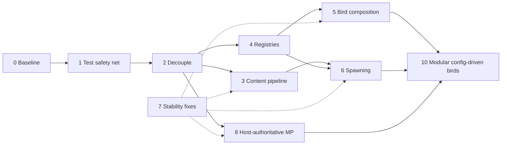

# Refactor Roadmap

Modernize the mod without changing its intended gameplay: make it safe to refactor, easier to test, free of global state, reliable in multiplayer, and simpler to extend with new species, spawn rules, and behaviors. The target design is [ARCHITECTURE.md](ARCHITECTURE.md).

> First protect existing behavior with tests; then improve the architecture in small, verified steps.

A phase is work we actually implement, in order. Phases 0–9 cover structure and correctness; Phase 10 makes birds fully config-driven. Everything else (feature ideas, technical improvements, observed bugs not yet tied to a phase) lives in the [Backlog](#backlog), in priority order where stated. New phases are pulled from the Backlog.

## Phase order

Phase 7 is not a separate step: each defect is fixed in the phase that touches its code (see [Known defects](#known-defects)). Phase 9 (in-game verification) runs at the end of every phase.

Each phase lands as several small commits that each build, pass tests, and keep the game playable.

---

## 0. Upgrade and establish a baseline

**Done:** .NET SDK 10 pinned via `global.json`, mod on net6.0, Stardew Valley 1.6.15, SMAPI 4.5.2, ModBuildConfig 4.4.0, NUnit 5 test project, analyzers and `.editorconfig` enforced in build.

**Remaining**

- Clear the legacy analyzer warnings so Release builds (warnings as errors) pass. `dotnet format whitespace` applied (~480 → 413); `dotnet format style` crashes (NotSupportedException), so fix the rest per file as phases touch it. Suppress nothing globally.
- (Skipped by decision; tests used instead.) Record the in-game baseline with SMAPI before any behavior change:
  - mod loads without errors in the SMAPI log;
  - each shipped bird spawns in its expected locations over several in-game days and seasons;
  - birds animate, move, flee, and despawn;
  - collection tab shows birds, hover text, and seen state;
  - save, quit, reload keeps observations;
  - host + farmhand: same birds visible, observation by farmhand appears for host.
- Write down observed quirks (e.g. group sizes never reaching max) as baseline facts, so later changes to them are deliberate.

**Exit:** Release build green; baseline checklist recorded in this file or an issue.

---

## 1. Build the test safety net

Characterization tests that pin what the mod does today, asserting observable outcomes rather than class names or private state.

**Tooling**

- Keep NUnit 5. Use `[TestCase]` / `TestCaseSource` tables.
- No mocking library: game types are concrete and mostly non-virtual. Pure logic gets plain tests; game-facing logic gets small mod-owned interfaces with hand-written fakes in Phase 2.
- Pure tests run on arm64; tests touching game types run with `--arch x64` (see [AGENTS.md](../AGENTS.md)).
- Replace the test-only copies of production logic (`MockBirdData`, `MockBirdTemplate`) with tests against the real loader once Phase 3 makes it game-free. Until then they are acceptable characterization tests.
- ~~Delete or fix tests that assert nothing (`BirdData_serialize`, `SendAnimatedSprite`) and stop tests writing files into the repo.~~ Done.

**Done:** `ContentTests` (shipped birds: JSON valid, textures exist, biome membership, locations, merged spawn data snapshot), `RandomTests`, `GameTypeRegressionTests` (x64: animation capture, `WaterSpawner` condition, spawn params keep pattern, known patterns/types).

**Characterization tests (now)**

- Every shipped bird JSON loads; effective merged values match today's output (snapshot of the current `inspect_output` data).
- Template defaults and global defaults fill values as today.
- `SaveData` round-trips, including the legacy SMAPI 3 `SDate` format.
- Daily selection with a fixed seed produces stable results once randomness is injectable (Phase 2).

**Coverage targets as phases land**

| Area | Tests |
|---|---|
| Content | every bird and template loads; template chain merge order; rules beat defaults at every level; arrays replace; weight maps merge; `null` removes keys and rules; unknown keys rejected; cycle reports full chain; ids unique; `min <= max`; time/day ranges valid; referenced bird types, spawn patterns, locations, textures exist; invalid values give file + field + chain |
| Registries | every registered bird type and spawn pattern creates; unknown id fails with a clear result; every content reference resolves; test-only registration works without editing a switch |
| Behaviors | wander/peck/hop transitions; flee when a farmer is within range; flee ends in despawn; behavior order; anchor removed → despawn |
| Spawning | eligibility by season/weather/day/time; inclusive group ranges; empty candidate lists return nothing; seeded plan is deterministic |
| Serialization | `BirdState` round-trip incl. animation; old or invalid save data migrates or fails safely; every message round-trips |
| Multiplayer | farmhand sends a request, does not mutate; host validates, records once, broadcasts; simultaneous discoveries both persist; stale/unknown versions rejected; late joiner gets current state |

**Exit:** content, save, and selection behavior pinned; suite green on arm64 (pure) and x64 (game).

---

## 2. Improve testability and reduce coupling

Make logic constructible without the game or static state.

**Changes**

- Remove the public static fields on `ModEntry` (`modInstance`, `environmentData`, `saveData`, `dailySpawner`, `eligibleLocations`, `birdDataCollection`). `ModEntry` owns them as private instance state and passes what each object needs via constructors or parameters.
- `ModEntry` only: subscribe SMAPI events, build objects and registries, load/save, delegate. Move the collections-tab construction, vanilla-bird removal, and message routing out into their features.
- Cache the `IReflectedField` handles in `CollectionsPageWithBirds` once instead of fetching them on every hover.
- Introduce small seams where adapters need game state, each 1–2 members:
  - `ILocationQuery`: tile is ground/water/spawnable, terrain feature at tile, map size;
  - `IMessageSender`: send to host / all / one peer;
  - `IMonitor` is already an interface; pass it in.
- Pass `Random` explicitly. Seed it at the boundary from game state (e.g. `Game1.uniqueIDForThisGame` + days played + location) so a day's plan is reproducible.
- Stop setting `JsonConvert.DefaultSettings`; create a `JsonSerializer` with explicit settings where needed and stop marking errors as handled.

Avoid a single `IBirdService` that exposes everything; tests should only fake what they use.

**Exit:** no `ModEntry.` references outside `ModEntry`; no `Game1.random` in spawning or selection; planner and content code constructible in tests.

**Done:** `ModEntry` statics removed; state is private and passed in. Seams: `ILocationQuery`/`GameLocationQuery`, `MessageSender` (interface dropped until a fake needs it), `BirdServices` (monitor, content, id source, observation callback) for birds. Day `Random` seeded from `StableHash(uniqueIDForThisGame|DaysPlayed)`. Extracted `VanillaBirds`, `BirdCollectionsTab`, `MessageTypes`; `CollectionsPageWithBirds` takes its dependencies. Host→peer messages on connect are targeted at that peer. Behavior changes: spawnable check is deterministic (no random 10% behind-tree), `WaterOrGround` is ground ∪ water, `TileSpawner` group target is per group. Tests: `SpawningTests` (fake `ILocationQuery`: seeded determinism, ground-only placements, shuffle determinism, pinned `StableHash`).

---

## 3. Make configuration DRY, explicit, and validated

Replace constructor-time merging and reflection-based default filling with a load pipeline. See [ARCHITECTURE.md → Content pipeline](ARCHITECTURE.md#content-pipeline) and [Bird configuration](ARCHITECTURE.md#bird-configuration).

**Changes**

1. Load bird and template JSON as `JObject`.
2. Resolve the `template` chain, detect cycles, merge most general → specific, then merge `defaults` into each id-keyed rule. Objects merge per key, arrays replace, `null` removes.
3. Deserialize the merged object strictly (`MissingMemberHandling.Error`, required fields) into boundary records (`BirdJson`, `SpawnRuleJson`).
4. Convert to domain records (`BirdDefinition`, `SpawnRule`) via `ToDomain`, collecting every error with file, id, field, expected value, and chain.
5. Build an immutable catalog. Invalid birds are skipped and logged at runtime; tests fail on any error.

**Defaults:** C# fallbacks only for technically safe optional fields; gameplay defaults move into base templates; species values stay in bird files. Remove `SpawnData.getDefaultSpawnData()` and `insertDefaults` once templates carry those values.

**Format migration:** convert shipped JSON to the new format: `defaultSpawnData` → `defaults`, `allSpawnData` season dictionary → id-keyed `rules` with `when.seasons`, `min/maxGroupCount` and `min/maxGroupSize` → `[min, max]`, `weather`/`daysRanges`/`timeOfDayRanges` → `when`. Replace `environmentData.json` biome bird lists with `regions.json` (regions with ranked species and location groups). Add `base_bird` with today's global defaults. The `ContentTests.Bird_MergedSpawnData` snapshot changes for birds that relied on global defaults shadowing template values (the tits); document that as the bug fix.

**Removes:** `[JsonConstructor]` merge logic in `BirdData`/`BirdTemplate`, `Reflection.CopyProperties`, `Utils.MergeDictionaries`, runtime state on config (`currentSpawnData`, texture rotation index), and `inspect_output` writes on every load (replace with a console command).

**Exit:** all shipped content passes validation in tests; characterization snapshot unchanged unless a difference is documented as a bug fix.

**Implemented (code and tests):** `JObject` template resolution with per-field provenance, including deleted default fields and removed/re-added rules; strict boundary deserialization and domain validation; id-keyed seasonal rules and location groups; immutable validated catalog; invalid birds skipped with diagnostics; `birds_dump <id>`; legacy models, reflection filling, mock loader, and old fixtures removed. The shipped six-bird snapshot now checks the effective spawn rules. The tit group-size snapshot follows template values instead of the former global-default shadowing, as intended. Day-start selection handles sun, rain, storm, snow, wind, and green rain, with the groups `any`, `clear`, `precipitation` expanded at load; the base template no longer restricts weather (the old sun/rain default had excluded windy, snow and storm days); the first player entering a location retries pending time-window placements on time changes.

**Verification:** shipped content and full x64 tests pass (67 tests); compile-only Debug and focused formatting pass. Release warnings-as-errors is still blocked by analyzer/style diagnostics in legacy game code. Runtime spawning, day transitions, multiplayer visits, and the dump command still need in-game verification via SMAPI. Visit ownership is not transferred if the first player leaves while another remains; shared multiplayer spawn state belongs to Phase 8.

---

## 4. Replace brittle factories with registries

**Changes**

- `BirdTypeRegistry` and `SpawnPatternRegistry`: `IReadOnlyDictionary<TId, factory>` built in `ModEntry`. No static dictionaries, reflection, or attributes.
- Typed ids (`BirdTypeId`, `SpawnPatternId`) instead of raw strings.
- Content validation checks every referenced id against registry keys before gameplay, including each pattern's `spawnParams` ([future placement goals](ARCHITECTURE.md#config-driven-placement)).
- `TryCreate` instead of indexing that throws or `null` returns; unknown ids log a warning and skip.
- Delete the string `switch` in `CustomBirdTypeConverterReader`, the static maps in `BirdFactory` and `SpawnerFactory`, and the `className` discriminator strings once Phase 7 serialization lands.

**Exit:** adding a bird type or spawn pattern touches one implementation file and one registration line.

**Implemented (code and tests):** `Registries/SpawnPatternRegistry` and `Registries/BirdTypeRegistry` wrap id-keyed factory dictionaries, are created once in `ModEntry`, and expose `Ids` (content validation) and `TryCreate`. `DailySpawner` takes them as method parameters because it is serialized for multiplayer. Unknown patterns or types at runtime warn and skip the bird. A terrain bird type paired with a tile placement also fails `TryCreate`. `BirdFactory` and `SpawnerFactory` are deleted. Still open until Phase 10 step 3: the `className` switch in `CustomBirdTypeConverterReader` and the string fields on `SingleBirdSpawnParameters`. `spawnParams` validation waits for parameterised patterns.

**Verification:** compile-only Debug and full x64 tests pass (69 tests). Spawning still needs in-game verification via SMAPI.

---

## 5. Move toward composition-based bird logic

**Changes**

- Introduce `BirdCritter`, the one mod-owned abstract layer under `Critter`: identity, position, sprite, lifecycle, ordered `IBirdBehavior` list. Concrete birds become `sealed`.
- Extract behaviors (wander, peck, hop, swim, perch, flee, despawn) with pure decision logic over a `BirdContext` record.
- Behavior order and conflict rules in one place.
- Collapse `CustomBirdTypeTerrainFeature` into a `TerrainAnchor` component (see Phase 7).

**Migration**

1. Move `LandBird` first; verify against tests and in game.
2. Then `WaterLandBird`, `TreeTrunkBird`, `BushBird`, one per change.
3. Keep inheritance where it is simple and stable. Composition is a tool, not a goal.

**Exit:** new species reusing existing behaviors are JSON-only; a new capability is one behavior class.

**Implemented (step 1, LandBird):** `CustomBirdType` renamed to `BirdCritter`. `BehaviorStatus` is now a top-level enum, and `PollThreat` holds the shared 200 ms threat check. `BirdTypes/Behaviors/` contains the pure `IBirdBehavior.Decide(in BirdContext) -> BirdAction` contract, `Flee`, `Wake` and `IdleRoutine` behaviors, and `BirdBehaviors.Land`, the single ordered list where the first non-`None` result wins. `LandBird` is sealed, builds a `BirdContext` each tick, and applies the action it gets back. Animation and movement stay in the bird. The behaviors keep the legacy random-call order.

**Implemented (step 2, remaining birds):** `WaterLandBird`, `TreeTrunkBird` and `BushBird` are sealed `BirdCritter`s. New lists: `BirdBehaviors.WaterLand` (`Flee`, `StopWalking(0.005)`, `IdleRoutine(0.003, [Peck, Rest, Hop, Walk])`) and `BirdBehaviors.FleeOnly` (tree trunk: threat or felled tree; bush: run into the bush). `Flee` also ignores birds that are already `Running`. `CustomBirdTypeTerrainFeature` and the stale `CustomBirdType.cs` are deleted. `TerrainAnchor(LocationName, Index)` resolves the tree or bush with bounds and type checks, and a terrain bird whose anchor is gone despawns instead of throwing. It still stores the collection index so saves stay compatible; switching to tile-based anchors is Phase 7. Small timing differences from legacy: the water-land idle roll now skips airborne birds, and the bush bird polls for threats every 200 ms instead of every tick once its first timer runs out. Still open: JSON-selected behavior lists.

**Verification:** compile-only Debug and full x64 tests pass (103 tests, including `BirdBehaviorTests` for the Land, WaterLand and FleeOnly lists). Every bird type still needs in-game verification via SMAPI: land (flee, sleep/wake, peck, hop, walk), water-land (swim, walk, peck, rest, hop, flee), tree trunk (peck, flee, flee from a felled tree), and bush (run, disappear into the bush, despawn after the bush is removed).

---

## 6. Refactor spawning into clear responsibilities

**Changes**

Split today's `DailySpawner` / spawners / `SingleBirdSpawnParameters` into:

| Responsibility | Where |
|---|---|
| Eligibility by location, season, weather, day, time | pure `SpawnPlanner` |
| Rule selection by `weight` per bird and location (incl. seen/unseen weighting) | pure `SpawnPlanner` |
| Group count/size, tile or terrain-feature selection | pure `TileSelection` over `ILocationQuery` |
| Creating critters from placements | `LocationSpawner` adapter via registry |
| Despawn / still-valid checks | bird behaviors + anchor resolution |
| Sharing the plan with farmhands | `MultiplayerSync` (Phase 8) |

- The plan is a record built once per day by the host; placements carry rule, texture, and seed, so farmhands never need `currentSpawnData`.
- Empty candidate lists return no placement instead of throwing.
- Replace index-based shuffles (`Enumerable.Range(...).OrderBy(Game1.random...)`) with a seeded shuffle over candidates.
- Remove the unused `stillValidTime` and the unused `state` in `WaterOrGroundSpawner`, or wire them in deliberately.
- General patterns with `spawnParams` (first: water and ground with `shoreDistance`); water kind via location groups, not river detection. See [Config-driven placement](ARCHITECTURE.md#config-driven-placement).
- Design the planner for [luck, rarity, and experience inputs](ARCHITECTURE.md#spawn-selection-luck-rarity-experience) and per-rule weight modifiers, and fall back to the next rule, location, or bird when a pattern's [feasibility check](ARCHITECTURE.md#config-driven-placement) fails.

**Exit:** spawn planning fully unit-tested with seeded `Random` and a fake `ILocationQuery`; in-game spawn frequency matches baseline.

**Progress:** `SpawnPlanner.Plan` (pure bird/rule/location assignment, deterministic bird order) is extracted from `DailySpawner` and tested. `TileSelection` (unique tiles from random walks, empty result on tiny maps; seeded `Utils.Shuffle` over feature candidates, empty candidates give nothing) now backs all spawners. `DailySpawnPlan` (location → `BirdPlacement` records with rule id, texture, times, optional feature index, and seed) replaces `DailySpawner`/`SingleBirdSpawnParameters`/`SpawnConverter`; `LocationSpawner` creates critters from it (time window, pattern re-check via `Spawner.IsStillValid`, registry) and seeds each bird from its placement. `spawnParams.shoreDistance` (planning-time filter, 0–20 tiles to the nearest opposite kind), habitat keys (`Farm_<type>`, `Location:FishArea`, checked via `Game1.GetFarmTypeKey()` and `Data/Locations` fish areas), a luck-weighted unseen count (1–3) and rule weights, and a feasibility fallback (a bird, rule or location that places nothing is skipped for the next) are implemented and tested; not verified in game.

---

## 7. Fix known stability and data-integrity risks

Fixed in the phase that rewrites the affected code; urgent crash fixes may land earlier as isolated commits with a regression test.

**Terrain-feature birds:** store a `TerrainAnchor` (location name, tile, feature kind) instead of a collection index. Resolve by tile each update; if missing or a different kind, despawn cleanly.

**Serialization:** replace the reflection-based `CustomBirdTypeConverterWriter`/`Reader` with explicit `BirdState` records. Capture animation from `sprite.CurrentAnimation`. Add `Version` to save data and messages; migrate older save versions in `SaveStore`.

**Defensive handling:** `TryGetValue` for every external or content-driven lookup; validate content before runtime; unknown ids, missing assets, invalid locations, and missing features log a warning and skip or despawn.

### Known defects

Verified in the current code. "Phase" is where the fix lands. Struck-through rows are fixed.

Observed: birds without `defaultSpawnData` get global defaults (Forest, 1–2 groups of 1–5) that shadow the template's values (the tits); pinned in `ContentTests.Bird_MergedSpawnData`. Fix in Phase 3.

| Defect | Location | Phase |
|---|---|---|
| ~~Animation never serialized: constructor checks the uninitialized field `currentAnimation` instead of `sprite.CurrentAnimation`, and a local shadows the field~~ | [CurrentAnimatedSprite.cs](../Birding/CurrentAnimatedSprite.cs#L28) | 7 (early fix OK) |
| ~~`WaterSpawner` declares `protected new TileSpawnCondition condition`, hiding the base field; base `condition` stays null → NRE~~ | [TileSpawner.cs](../Birding/Spawning/Spawners/TileSpawner.cs#L37) | 7 (early fix OK) |
| ~~Farmhands never set `currentSpawnData`; `stillValidSpawnPosition` reads it from the global catalog → crash on farmhand~~ (placements carry `SpawnPattern`) | [DailySpawnPlan.cs](../Birding/Spawning/DailySpawnPlan.cs) | 6 |
| ~~`getRandomElementFromList` uses `Next(0, Count - 1)`: never picks the last element~~ | [Utils.cs](../Birding/Utils.cs#L43) | 6 (early fix OK) |
| ~~`shuffleByWeights` draws a new random value inside the `Sort` comparator: biased order, and `List.Sort` may throw on the inconsistent comparer~~ (keys drawn once per item) | [Utils.cs](../Birding/Utils.cs#L12) | 6 (early fix OK) |
| ~~Group count/size use exclusive `Next(min, max)`: never reach configured max~~ (now inclusive) | [TileSpawner.cs](../Birding/Spawning/Spawners/TileSpawner.cs#L85), [TerrainFeatureSpawner.cs](../Birding/Spawning/Spawners/TerrainFeatureSpawner.cs#L37) | 6 (gameplay decision) |
| ~~Tree birds stored by `terrainFeatures.Pairs.ElementAt(index)` (unstable dictionary order), unchecked `as Tree`~~ fixed: anchored by tile | [TreeTrunkBird.cs](../Birding/BirdTypes/TreeTrunkBird.cs) | 10 step 3c |
| ~~Bush birds stored by `largeTerrainFeatures[index]`, unchecked `as Bush`~~ fixed: anchored by tile | [BushBird.cs](../Birding/BirdTypes/BushBird.cs) | 10 step 3c |
| ~~Any peer broadcasts the whole `SaveData`; every receiver (incl. host) replaces its copy → last writer wins, lost discoveries~~ (host-authoritative `ObservationLog`) | [CustomBirdType.cs](../Birding/BirdTypes/CustomBirdType.cs#L97), [ModEntry.cs](../Birding/ModEntry.cs#L171) | 8 |
| ~~`chooseOneSpawnData` result written into shared `BirdData.currentSpawnData` (runtime state on config)~~ (`SpawnPlanner` returns assignments) | [SpawnPlanner.cs](../Birding/Spawning/SpawnPlanner.cs) | 3/6 |
| Template merge in `[JsonConstructor]` loads files via `ModEntry.modInstance`; `MergeDictionaries` shares list references with the template | [BirdData.cs](../Birding/Data/BirdData.cs#L46), [Utils.cs](../Birding/Utils.cs#L102) | 3 |
| `timeOfDayRanges` never checked: `isTimeOfDayPossible` is unused, `possibleSpawnDataToday` ignores time | [SpawnData.cs](../Birding/Data/SpawnData.cs#L42), [LocationSpawner.cs](../Birding/Spawning/LocationSpawner.cs) | 3/6 |
| `CopyProperties` treats `0`/`false` as unset, so a bird cannot override a template value with 0 or false | [Reflection.cs](../Birding/Data/Reflection.cs) | 3 |
| ~~Process-wide `JsonConvert.DefaultSettings`; `OnJsonError` marks every error handled → silent bad data~~ (messages use `MessageJson` with explicit settings) | [MessageJson.cs](../Birding/MessageJson.cs) | 2 |
| Bush birds spawn beside small bushes and trigger by distance only, so a farmer approaching from the bush side makes the bird run through them | [TerrainFeatureSpawner.cs](../Birding/Spawning/Spawners/TerrainFeatureSpawner.cs), [BushBird.cs](../Birding/BirdTypes/BushBird.cs) | 10 step 9 H |
| Debug output written to `assets/inspect_output/` on every save load | [ModEntry.cs](../Birding/ModEntry.cs#L108) | 3 |
| ~~`Player_Warped` logs `e.NewLocation.Name` before the null check~~ | [ModEntry.cs](../Birding/ModEntry.cs) | 2 |
| ~~Vanilla-bird removal logs every critter on every `TimeChanged`~~ | [ModEntry.cs](../Birding/ModEntry.cs) | 2 |
| ~~`Game1.random` used throughout spawning → not reproducible or testable~~ (seeded `Random` passed in) | [Spawning/](../Birding/Spawning) | 2/6 |

**Exit:** every row fixed with a regression test (or a documented in-game check where a test is impossible).

---

## 8. Make multiplayer host-authoritative

See [ARCHITECTURE.md → Multiplayer ownership](ARCHITECTURE.md#multiplayer-ownership).

**Changes**

- Farmhands send `ObservationRequest`; only the host validates, applies via pure `ObservationLog.Apply`, saves, and broadcasts `ObservationAccepted` (delta + log version).
- The host sends the daily plan and full observation log on `DayStarted` and `PeerConnected`.
- All messages are versioned records; unknown or stale versions are logged and dropped, and a peer with a stale log re-requests it.
- Replace the single `if` chain in `OnModMessageReceived` with a `switch` on message type that delegates to `MultiplayerSync`.

**Exit:** two simultaneous discoveries both persist; a late joiner sees current observations and birds; multiplayer tests from Phase 1 green.

**Done:** `Multiplayer/Messages.cs` (versioned records, one `IMessage.CurrentVersion`), `MultiplayerSync` (typed send/read, drops malformed or unsupported versions with `Warn`), `Observations/ObservationLog` (`TryApply`, `Check`), `SaveData.logVersion`. `ModEntry` switches on `nameof(message)`; observation messages are accepted only from the host on farmhands and only on the host for requests. Live critter transfer is now `LocationBirdsRequest`/`LocationBirdsState` with the location name checked on both sides. `MessageSender`/`MessageTypes` removed; the whole-`SaveData` broadcast defect is fixed. 135 x64 tests pass (new `ObservationLogTests`).

**Not verified in game:** two-player discovery, late join, gap recovery, and live critter synchronization need a SMAPI multiplayer session.

---

## 9. Verify in-game behavior after each phase

Automated tests protect logic; rendering, timing, and real multiplayer need the game. Build and test results never count as in-game verification.

### Prerequisite: debug tooling

Reach specific cases without waiting for RNG, and inspect planning offline.

### Prerequisite: shared bird simulation

Players in the same location must see the same birds doing the same things. A one-time snapshot on arrival is not enough: after it, each peer's frame timing, RNG draws, threat checks and animation callbacks diverge.

- One simulation owner per occupied location decides every bird action; other peers only render the owner's state.
- The owner sends a full snapshot to arriving peers and periodic sequenced state updates (position, state, animation frame, flip, offsets) keyed by bird id; birds missing from an update are removed.
- The owner checks threats against every farmer in the location, so any player can flush a bird.
- When the owner leaves, a remaining peer takes over from the latest state it received.
- Rollback is not needed: non-owners may see a reaction one network delay late, but every peer sees the same decision.

**Exit:** in a two-player SMAPI session, both players see the same birds, poses, flights and despawns; either player's approach flushes a bird for both; ownership survives the owner leaving.

**Implemented (compile/test verified, not tested in game):** the first visitor owns bird simulation. Incoming peers request a correlated snapshot; six-tick sequenced snapshots replace or update replicas by bird id, and replicas interpolate position without running bird logic or animation callbacks. Threat checks cover all farmers. A warp sends the latest birds and transfers ownership; on disconnect, remaining peers elect a new owner from their last snapshot. The new owner resumes spawning without reintroducing birds already despawned in the current time window. Verify two-player join, approach, warp, disconnect, day transition, and debug commands in SMAPI before marking this prerequisite complete.

**Next: lag-tolerant visual playback (no rollback).** Replace frozen snapshot-only replicas with an owner-picked, bounded queue of future idle cues. Use a separate schedule RNG; send owner tick, per-bird revision, action and animation parameters so peers can play ahead without deciding gameplay. The owner consumes a cue only when eligible and supersedes the queue on flee, state changes or despawn. Peers do not execute observations or world effects; when cues run out they remain in a safe idle loop. For committed flight and bush runs, send the start pose and velocity, advance locally until an authoritative end, and treat six-tick snapshots as drift correction/late-join recovery instead of restarting the animation. A delayed flee starts locally on receipt (no rewind); the host still owns plans and observations. Add tests for queued playback, stale revisions, uninterrupted flight and correction; verify packet delay, owner transfer and both-player approach in SMAPI.

**Code progress:** land and water-land stopped routines queue one visual cue at a time (up to 120 ticks ahead) using a separate RNG and serializable tick/revision/action/seed. An immediately eligible action may precede the next snapshot; this preserves the original per-tick idle chance but cannot be preplayed on the peer. Replicas advance flight and bush-run movement and animations locally, with snapshot drift correction. Walking and hopping are not predicted. Full x64 suite and Release compile pass; two-player SMAPI lag, timing and handoff checks remain mandatory.

**Implemented (compile/test verified, not tested in game):** `birds_debug`, `birds_plan`, `birds_spawn`, `birds_replan`, `birds_clear`, `birds_reload`, `birds_rules`, `birds_check`, and `birds_live`; a debug-mode label (`name / state`) above each bird; plan logging/HUD on day start when debug is on; selector/target logic and an offline REPL with simulated plans and odds. Run the playground with `dotnet run --project Birding.Playground/Birding.Playground.csproj`. `birds_reload` reloads JSON but does not invalidate cached texture assets. Forced fallback to a free tile is currently limited to the player's location. Planner simulations assume every selected tile is feasible; they do not reproduce a real save's map-dependent RNG draws.

In the playground, type `help` for command syntax and examples. `dotnet run` builds the referenced mod, so its existing compiler/analyzer warnings can appear before the prompt. After the initial build, use `dotnet run --project Birding.Playground/Birding.Playground.csproj --no-build` for quiet repeat sessions; rebuild after source changes.

**Still pending:** richer overlays (rule, time window), candidate-tile and terrain/radius visualization, behavior stepping, true remote-location forced fallback, and separating planner RNG from placement RNG. Verify the commands and multiplayer rebroadcast in SMAPI before checking this prerequisite off.

**Shared game-free pieces** (mod project, unit-tested, used by console commands and the playground)

- `BirdSelector`: parses `<bird> [<ruleId>] [-l <location>] [-f]` with a small hand-written flag parser; bird aliases resolve to canonical IDs.
- `SpawnTarget.Resolve(bird, ruleId?, location?, force, currentLocation, conditions, habitatExists, random)`: picks rule and location, returns a target or an error.
- Day-condition and seed builders (season, weather, `StableHash` seed) extracted from `OnDayStarted`.
- `HabitatExists` extracted from `DailySpawnPlan.Build` and passed in.
- One formatter for plans and assignments (bird, rule, location, tile, time window).

**Debug mode**

- `config.json` via `Helper.ReadConfig<ModConfig>()` holds global settings, including `Debug` (default off); `birds_debug on|off` toggles it for the session.
- Extra log detail uses SMAPI verbose logging (`Monitor.VerboseLog`, enabled per mod in `smapi-internal/config.user.json`); `Debug` controls on-screen output.
- On `DayStarted` (including day 1 of a new save): log the full plan at `Info` and show a HUD message per placement.
- Log why birds, rules, and locations were skipped (no eligible rule, habitat missing, pattern placed nothing → fallback).
- Overlays via `Display.RenderedWorld`: label above each bird (id, rule, current action, time window), candidate and chosen tiles, `shoreDistance` band, terrain anchors, flee and alert radii.

**Console commands** (`Diagnostics/ConsoleCommands.cs`, registered from `Entry`; require `Context.IsWorldReady`; plan changes host-only and rebroadcast to farmhands)

| Command | Behavior |
|---|---|
| `birds_plan` | Print today's plan. |
| `birds_spawn <bird> [<ruleId>] [-l <location>] [-f]` | Rule: given, or weighted among today's eligible rules. Location: `-l`, else the current location if the rule lists it, else a random existing habitat. Placements get no time window and merge into the plan; populate now if the player is there, otherwise log a `debug warp` line. |
| `birds_replan [seed]` | Rebuild today's plan, optionally with a fixed seed. |
| `birds_clear` | Remove the mod's birds from the current location and reset the spawner's visit state. |
| `birds_reload` | Reload content JSON and invalidate textures without restarting. |
| `birds_rules <bird>` | Print each rule (conditions, habitats, pattern → bird type and initial state, count bounds, textures, params) with ✅/❌ for today's eligibility. Same output as the playground `rules`. |
| `birds_check <bird> [<ruleId>] [-l <location>]` | Host only. Per rule and habitat: eligibility, whether the habitat exists, candidate tiles/trees/bushes, and a dry-run placement count. Does not change the plan. |
| `birds_live` | List live birds here: name, type, texture, tile, water/ground, state, anchor, and the plan rule they came from. |

`-f` skips today's rule conditions (season, weather, day) and the habitat-list check, but the location must still exist. If the pattern finds no tile, the bird is placed on a free tile next to the player. Without `-f`, a pattern that finds no tile is reported as an error.

**Playground** (`Birding.Playground`, net10.0 console app, never shipped; references the mod project like the test project)

- REPL over immutable state (season, day, weather, luck, seed, seen birds) that calls `SpawnPlanner.Plan` with a stub `habitatExists` (all true, or filtered by farm type and compat mods) and a `place` callback that always succeeds.
- Commands: `state`, `set season|weather|luck|seed|farm <value>`, `plan`, `observe <birdId>`, `next` (advance day), `rules <birdId>` (eligible rules and weights now).
- `odds [<birdId> [<ruleId>] [-l <location>]] [-n N]`: Monte Carlo over N seeds using `BirdSelector`. With no selector, top N birds; otherwise a breakdown over the unspecified parts (rule, location).
- The odds are upper bounds, since tile feasibility is assumed. To reproduce a real save's order, give placement its own derived `Random` so planner draws don't depend on map geometry.
- Behavior stepping: run `IBirdBehavior.Decide` over a scripted `BirdContext` timeline (e.g. a farmer approaching) and print the actions.

**Exit:** a chosen bird and rule can be spawned and inspected in game in under a minute; day 1's plan is visible in the log; the playground reproduces the planner's assignments for a given seed and conditions.

**Smoke test (every phase)**

- Mod loads without new SMAPI errors or warnings.
- Birds appear in expected locations with correct sprites, frames, and depth.
- Birds wander, peck, hop, swim, perch, flee, and despawn; none stuck in walls, water, or terrain.
- Removing a tree or bush with a bird on it despawns the bird safely.
- Vanilla birds (crows, seagulls, owls, woodpeckers) are removed; other critters (butterflies, frogs) remain.
- Collection tab opens; hover text, icons, seen state, and counts correct.
- Save, quit, reload, continue without lost observations.

**Full pass (before release)**

- Spawn frequency and group sizes match baseline unless deliberately changed.
- Host and farmhand see compatible birds; no obvious desync on move, flee, despawn.
- Farmhand discovery reaches host, then all players; duplicate discoveries do not lose data.
- Late join and disconnect/reconnect keep valid state without crashes.

Use the debug mode and console commands from the prerequisite above to reach specific cases quickly. Changes to characterization outcomes are accepted only when documented here or in the commit message.

---

## 10. Fully modular, config-driven birds

**Goal:** a species' animation, idle routine, reactions, sounds, spawn grouping and life stages are JSON; C# is a small closed vocabulary of primitives, triggers, bodies, effects, target searches and condition keys. Completes Phase 5's open item (JSON-selected behavior lists) and replaces the reserved `routineWeights`/`threatResponse` fields. The full design, with examples, is [ARCHITECTURE.md → Bird composition](ARCHITECTURE.md#bird-composition-config-driven-behavior); this section is the order and the exit criteria.

**Principles**

- A new noun or verb needs code; a new combination is config. No expression language or scripting in JSON.
- Every composable field is a ref or an inline object with `extends`; promote inline definitions to shared files only on their second user.
- Framework before art: a step ships the code, schemas, validation and shared definitions (layouts, actions, routines, reactions) even when no shipped species can use them yet. Without matching art, a feature is proven by **test fixtures**: JSON under the test project that reuses a shipped sheet or a placeholder layout with numbered cells. Shipped birds stay unchanged; real species adopt a feature once their art exists (tracked in the [Backlog](#backlog)).
- Prove every step against the three dissimilar shipped species where their art allows: great tit (ground), herring gull (water-land), black woodpecker (trunk).
- Risks to avoid: a general system before there is content, too many layers up front, and indirection that hurts debugging (`birds_dump` shows the resolved composition with sources).

**Every step includes**

- JSON records + `TemplateMerger` support (same merge rules; `extends` resolution with cycle detection and provenance).
- `ContentValidator` checks for the new fields ([Validation](ARCHITECTURE.md#validation-1)).
- The matching schema in `schemas/` and `SchemaTests` updates ([Schemas](ARCHITECTURE.md#schemas)).
- Pure tests on arm64 where possible; x64 tests for anything touching `AnimatedSprite`.
- Docs updated; in-game verification per [Phase 9](#9-verify-in-game-behavior-after-each-phase).

### Step 1: schema and test infrastructure

- `schemas/common.schema.json` with `$defs` `range`, `weightMap` (nullable values), `refOrInline`, `condition`, `soundRole`. Existing schemas refer to it.
- `SchemaTests`: `AssetFiles` becomes a folder → schema table; a guard test fails if an `assets/**/*.json` file matches no schema; `SchemaEnums_MatchCode` becomes a per-registry table; add the schema/`ContentValidator` agreement table.
- `.vscode/settings.json` with `json.schemas` glob mappings. No `$schema` keys in assets.

**Exit:** all existing assets map to a schema; adding a file kind without a schema fails a test.

**Implemented (compile/test verified):** `common.schema.json` (`range`, `stepRange`, `intOrStepRange`; the other `$defs` arrive with the steps that use them), `layout.schema.json`, `rule.schema.json` refers to `common`. `SchemaTests`: folder → schema mapping over every `assets/**/*.json`, guard test `EveryAssetJson_HasASchema`, per-registry enum table, and a schema/`LayoutLoader` agreement table. `.vscode/settings.json` maps the schemas.

### Step 2: layouts and clips (pure extraction, zero behavior change)

- Add the layout model: `frameSize`, clips (`frames`, `repeat`, `end`, `loop`), frame events, ranges. A clip player builds `AnimatedSprite` frame lists and reports clip end.
- Before touching code: a characterization test that records each bird type's generated frame sequence (cell, ms, event, flip) for fixed seeds.
- Extract `land_32`, `waterland_32`, `trunk_16`, `bush_32` 1:1 into `assets/layouts/` ([table](ARCHITECTURE.md#preserving-shipped-birds)); PNGs unchanged. Bird classes play clips by name instead of building frame lists.
- Frame callbacks become events mapped to the same vanilla cues/effects (`peck`, `flap`, `hop`); `DonePecking` becomes clip end. Same RNG streams and call order.
- Validator: clip names, frame indices within the texture's cell count, known events. `birds_anim <bird> <clip>` for preview.
- Done early: `layouts/*.json` for the four layouts, `LayoutLoader` (parse only; not yet used by the bird classes), and the Playground `layout` command (cell → pose list, SVG template).
- Characterization baseline: `AnimationCharacterizationTests` (x64) pins every legacy frame list (cell, ms, flip, callback position, loop), the RNG draws behind repeat counts and durations, `DonePecking` rolls, and the idle schedules. Animation starters are `internal` seams for it.

**Exit:** characterization test identical before and after; `BirdBehaviorTests` green; every shipped bird looks and sounds unchanged in game.

**Implemented (compile/test verified, not tested in game):** layouts load at `Entry` (`LayoutLoader.LoadAll`) and reach birds through `BirdServices.Layouts`. `BirdCritter.PlayClip` builds frames via `ClipPlayer` (frames, rolled repeat, end; fixed ranges draw no RNG) and `ShowPose` sets a static cell (`stand`, `sleep`, `swim`). Every frame list in the four bird classes now comes from `land_32`, `waterland_32`, `trunk_16`, `bush_32`; events map to the legacy callbacks per class (`ClipEvent`); `DonePecking` is the clip-end callback. The bird-type → layout mapping (`BirdTypeProfiles.ByBirdType`, originally `LayoutValidator.ByBirdType`) is the hardcoded composition until step 3. `LayoutValidator.ValidateBird` runs per bird at load: layout present, required clips, known events, and cells fit each texture (PNG header); a failing bird is skipped. `birds_anim <bird> <clip>` plays a clip on owned live birds. `AnimationCharacterizationTests` pass unchanged. Legacy per-frame flip is kept as a `"flip"` frame tag, because `AnimatedSprite` may still read `AnimationFrame.flip`; drop the tags if the in-game check shows no visible effect.

**In-game check before step 3:** each shipped bird animates as before (peck, walk, hop, rest, sleep, swim, fly, bush run); peck/flap/hop sounds and the water-land hop impulse still fire; `birds_anim` works; a broken layout file logs an error and skips the affected birds instead of crashing.

### Step 3: actions, routines and sound roles

- Action definitions (`do`, `clip`, `sound`, end condition, primitive parameters) with primitives `stay`, `walk`, `hop`, `flyOff`, `runToBush`, `swim` covering current behavior.
- `Routine` (`chance`, `pick`, `next`, `cooldown`, `rare`) replaces `IdleRoutineBehavior` options; `BirdAction` and `IdleCue.Action` become string action ids (save/message migration for stored cues).
- Shipped compositions expressed in JSON with legacy weights ([table](ARCHITECTURE.md#preserving-shipped-birds)): duplicates become weights, `DonePecking` 50% becomes `next`, rolled on the same RNGs.
- Sound roles: species `sounds` map roles to vanilla cues first; then custom audio via `Data/AudioChanges` (`<ModId>_` ids). Distance volume, cooldowns, `ModConfig` volume. Decide the open multiplayer sound question (owner-committed vs local cosmetic).
- Bodies own anchoring: `trunk` and `bush` resolve a tile-based `TerrainAnchor` instead of a collection index (closes the two Phase 7 anchor defects).
- `BirdState` records replace the reflection converter and its `className` switch (closes the Phase 4 leftover); legacy `birdTypeName` maps to a body.
- Migration within the step: the four classes become bodies (`ground`, `water`, `trunk`, `bush`) inside one sealed `Bird`, first with hardcoded compositions, then loaded from JSON. `birdType` maps to `body` for existing content and saves.
- `birds_dump <bird> [<rule>]`.

**Exit:** a fixture species with different idle weights and its own sound roles is JSON-only (shipped sheet, no new code); shipped birds unchanged (characterization and in-game); saves with legacy anchors and `birdTypeName` load.

**Sub-steps**

- **3a. Routines and sound roles as data (implemented, compile/test verified, not tested in game).** Rule fields `routine` (shared id in `assets/routines/<id>.json` or inline object) and `sounds` (role → cue, merged over the bird type's defaults; `""` silences). `ContentValidator` resolves them into `SpawnRule.Composition` (`BirdComposition`): missing `routine` falls back to the bird type's default (`land_idle`, `waterland_idle`), pick actions and `next` follow-ups are checked against `BirdTypeProfiles`, unknown sound roles warn. Placements carry the composition, `LocationSpawner` sets it on the bird, and it is serialized with plans and bird snapshots. `BirdCritter.AdvanceIdle` rolls `Routine.Roll` (one `Next(total)`, same RNG use as the legacy list); `LandBird` `DonePecking` uses `next.peck`; all `Game1.playSound` calls go through `PlaySound(role)`. `routineWeights`/`threatResponse` removed from schema and records. Tests: `CompositionTests` (JSON-only fixture species, defaults for shipped species, validation, follow-up, plan/snapshot round trip), routine schema/loader agreement, and the idle-schedule goldens now run through the shipped routine files unchanged. Meets the step 3 exit criterion's first part (fixture species with own weights and sounds).
- **3b. Action parameters as data (implemented, compile/test verified, not tested in game).** Action sets per bird type in `assets/actions/` (`land_actions`, `waterland_actions`, `trunk_actions`, `bush_actions`; schema `action.schema.json`): `do` primitive (`stay`, `walk`, `hop`, `flyOff`, `runToBush`, `swim`), `clip`, `sound`/`soundChance`, `durationMs`, `endChance`, `speed`, `climb`, `impulse`, `turn`, `pauseMs`. Rule field `actions` overrides single fields per action id (merged like templates; `null` removes a field). `ContentValidator` resolves the merged set into `BirdComposition.Actions`, checks each id's primitive against `BirdTypeProfiles.ActionPrimitives` and the primitive's required fields; `LayoutValidator` checks every action clip exists in the layout. The classes read every former constant from actions: sleep pose and wake chance, walk clip/speed/duration (land) and stop chance (water-land; both endings work on both types), hop impulse and turn, flee clip/speed/climb/alarm chance, trunk peck pause, bush run speed. `BirdBehaviors.Land/WaterLand` are built per bird from routine and action chances. Characterization and behavior tests unchanged; new `CompositionTests` for overrides, errors and shipped sets, plus a schema/loader agreement table for actions. Custom action ids (e.g. `sing`) and string `IdleCue.Action` move to 3c, where the single `Bird` dispatches by primitive instead of by enum.
- **3c. Bodies and state (partly implemented, compile/test verified, not tested in game).** Done: tile-based `TerrainAnchor(LocationName, Tile)` for trunk and bush birds (`BirdPlacement.FeatureTile`, resolved by tile with type checks); explicit `BirdState` snapshots (`BirdSnapshots`) replace the reflection converter and its `className` switch (`CustomJSONConverters.cs` deleted, bird classes carry no JSON attributes); `IdleCue.Action` is a string id; rules on routine-driven bird types (Land, WaterLand) may add custom `stay` actions with a clip (e.g. `sing`) that their routine picks; the unreachable `IdleRoutineBehavior` is removed (idle actions only come from the scheduled cue); `birds_dump <bird> [<rule>]` prints each rule's resolved composition. Deferred by decision: merging the four classes into one sealed `Bird` with bodies and moving `BirdTypeProfiles` to JSON. Both would only move code while the classes still hardcode what each built-in action id means; they land with the first new body (canopy, step 4 prototype) that needs them.
- **3d. Custom audio (implemented, compile/test verified, not tested in game).** `assets/audio/<name>.ogg|.wav` is registered as cue `<ModId>_<name>` through `Data/AudioChanges` and referenced in `sounds` as `audio:<name>` (validator: file must exist). Bird sounds play with `Game1.sounds.PlayLocal` at the bird's tile in its own location (distance volume, silent elsewhere), scaled by `ModConfig.SoundVolume` (0 mutes). Rule field `soundCooldownMs` (role → ms) gates repeats per bird. Multiplayer decision: sounds are local cosmetic. Replicas play frame events (peck/flap) of clips they build themselves (end callbacks dropped), the flee alarm when a snapshot switches them to fleeing, and alert and custom-action sounds, each with the visual RNG; snapshot-delivered sprites never run callbacks.

**Prototype species once art exists** ([table](#backlog)): black woodpecker `drum` clip.

### Step 4: reactions (alert, then relocate)

- `BirdContext` carries threat distance; order `Flee(inner) → Alert(outer) → Wake → IdleRoutine`; running farmer counts as closer; observation on any response.
- Reactions with triggers `threat`, `playerEnters`, then `treeShaken`, `toolUsed`, `timeOfDay` as content needs them.
- Relocate: `flyTo` with target searches through `TileSelection`, `TerrainAnchor` update on arrival, committed movement for replicas, `maxRelocations` and `then`.

**Exit:** a skittish and a relocating composition defined only in JSON (shared reactions + fixtures; a shipped species may adopt them where its art fits); behavior-stepping tests for approach/retreat timelines; verified in game, including two-player, on a fixture or shipped bird.

**Implemented (compile/test verified, not tested in game):** rule field `reactions` (shared id in `assets/reactions/<id>.json` or inline; schema `reaction.schema.json`), resolved over the bird type's default flee radius (land and water-land 4, trunk 6; bush keeps its bush distance and takes no reactions). `threat.fleeRadius`, `threat.runningMultiplier` (a running, moving farmer counts closer), `threat.alert` (land and water-land: inside `radius` a grounded, non-swimming bird enters `Alert`, shows `clip`, plays `sound`, registers the observation, and returns to `Stopped` after `calmMs` without a threat in the ring; flee still wins inside the flee radius) and `threat.relocate` (trunk: fly in an arc to a free eligible tree within `maxDistance` and away from the threat, re-anchor, up to `maxRelocations`; then flee as before). Replicas get the relocation target and anchor from snapshots and fly towards it as committed movement. Shared fixtures `wary` (alert) and `tree_hopper` (relocate); shipped birds use neither, so their behavior and goldens are unchanged. Tests: alert/calm decisions and an approach/retreat timeline, relocation target pick and arc, validation, schema/loader agreement, snapshot and replica fields. Open: `playerEnters`, `treeShaken`, `toolUsed`, `timeOfDay` triggers (with the species that need them), relocate targets other than `otherTree`.

**Prototype species once art exists** ([table](#backlog)): Eurasian bullfinch (canopy body, `treeShaken`), European robin (tame, `toolUsed`), tawny owl (`timeOfDay`, night).

### Step 5: forage primitives

- `dive` (hide, resurface on a nearby water tile), fish strike with the vanilla splash effect, worm pull. Routine `rare` with `when` conditions.

**Exit:** each primitive has a shared action definition, a fixture that uses it (placeholder layout where no art exists) and tests; validator rejects primitives the body cannot do.

**Implemented (compile/test verified, not tested in game):** routine `rare` (`{"<id>": {"chance": 0.05, "when": {seasons, weather, days, times}}}`): tried in order before the weighted pick on the schedule RNG, conditional entries read the current world through `BirdServices.World` (never fire without one); routines without `rare` draw exactly as before. Shared forage actions in `assets/actions/forage.json` (`wormPull`, `fishStrike` as `stay` clips, `dive`); a rule's new action id can `"extends": "forage.dive"` and override fields. Primitive `dive` (water-land, picked only while swimming; other actions only while standing): plays its clip, hides for `hiddenMs`, resurfaces on a random water tile within `radius` with a splash; diving birds ignore threats and alerts; `Hidden`/`DiveTimer`/`DiveRadius` sync to replicas, which snap to the resurface tile. Clip event `splash` (land and water-land) adds the vanilla water splash for fish strikes. `BirdTypeProfile.CustomPrimitives` (land `stay`; water-land `stay`, `dive`) rejects primitives a bird type cannot do. Tests: rare/condition/filter choice and RNG parity, schema/loader agreement for `rare` and `dive`, fixture diver (extends, validation, replica dive cycle). No real forage clips exist yet, so worm pull and fish strike are framework only.

**Prototype species once art exists** ([table](#backlog)): common blackbird (worm pull), grey heron (fish strike), black-necked grebe (dive).

### Step 6: spawning placement

- `group.formation` (`cluster`, `scattered`, `line`, `perched`), `group.radius`, `groupSpacing`, `near`/`avoid` kinds via `ILocationQuery`, per-species `space`, `packing`, per-rule `speciesDistance`.
- Rejection sampling with N tries, no spatial index; partial placement allowed, below minimum → existing feasibility fallback.
- Validator: body vs spawn pattern compatibility.

**Exit:** pure planner tests (arm64) for each formation and spacing rule; spawn frequency in game unchanged for rules without the new fields.

**Implemented (compile/test verified, not tested in game):** `spawnParams.group` (`formation` `cluster`/`scattered`/`line`, `radius`, `spacing`, `groupSpacing`) for tile patterns: a valid start tile per group (respecting `groupSpacing` to earlier groups), then rejection sampling within the radius (cluster biased to the centre, scattered uniform by area) or a straight row in one of four directions; members keep `spacing`; partial groups allowed, an empty plan still falls back. `spawnParams.speciesDistance` replaces the fixed 8-tile distance to other species (tile and terrain patterns). Rules without `group` keep the legacy random walk and RNG use. Validator: bird type vs spawn pattern (trunk ↔ `TreeTrunkSpawner`, bush ↔ `BushSpawner`, others need a tile pattern), no `group` on terrain patterns, ranges. `birds_rules` shows group and species distance. Deferred: `perched` (needs fence/perch anchors), `near`/`avoid` kinds, per-species `space`, `packing`.

### Step 7: families, stages and group runtime

- `group.members` with roles and `stage`; `stages` overriding composition fields; context conditions (`groupHasRole`, `nearWater`, `season`, `timeOfDay`, `weather`, `stage`), first match wins.
- `groupId`/`role` on birds and in `BirdState`; group-level reactions; the leader's owner owns the group; `follow` as committed movement.

**Exit:** a duck-family fixture (parents + young that follow and swim away together, placeholder layouts) is JSON-only, passes pure tests, and syncs in two-player SMAPI.

**Implemented (compile/test verified, not tested in game):** `group.members` assigns roles and stages with stable, location-unique group IDs; staged compositions override routine, actions, reactions, sounds and layout. Stage routines can extend shared routines without dropping inherited rare actions. Stage layouts are validated for clips, events and texture capacity; live sprites use their selected frame size. JSON-only family fixtures cover parent/young placement, following and coordinated swim-flee; group metadata, committed movement and sprite dimensions survive snapshots, and replicas replay them. A location has one simulation owner, so family members share ownership on handoff. Rules without family fields retain their old placement RNG behavior. The shipped species and art are unchanged.

**Still open:** verify the duck-family fixture's appearance, behavior and two-player synchronization in SMAPI. The exit criterion and Phase 10 steps 3–7 checkbox remain unchecked until that in-game check is recorded.

**Prototype species once art exists** ([table](#backlog)): mallard (male, female, ducklings; eclipse plumage in late summer).

### Step 8: condition clauses, time anchors and family polish (implemented; compile/test verified, not tested in game)

Design: [ARCHITECTURE.md → Condition clauses and time anchors](ARCHITECTURE.md#condition-clauses-and-time-anchors-step-8). Needed for seasonal behaviors such as singing (spring all day, summer only after sunrise and around dusk) and for mallard families that must always include a parent.

**A. Condition clauses (`when.any`)**

- `ConditionClause(Seasons, Weathers, Days, Times)`; `SpawnConditions(Any)`; `MatchesDay`, `TimesOn(season, weather, day, anchors)`, `RareAction.Matches(IdleWorld)` over clauses; `ConditionParser` is the single parser. A plain `when` is one clause.
- `DailySpawnPlan.Place` sets placement `Times` from `TimesOn`; `TileSpawner` stops reading `When.Times`; `RuleText` prints `OR`.
- `ContentValidator`/`RoutineLoader`: one clause parser for rules and `rare.when`; `any` plus top-level fields is an error (including inherited ones); stage `extends` round-trips rare clauses.
- Schemas: shared `dayClause`, `dependentSchemas` for the mixing rule.

**B. Time anchors**

- `times` bounds accept `HHMM` or `"sunrise|dusk|dark[+|-minutes]"`. `dusk` and `dark` resolve per location from `Game1.getStartingToGetDarkTime`/`getTrulyDarkTime`; `sunrise` is fixed at 0600.
- Both method signatures confirmed against 1.6.15 (`GameLocation` in, `int` out). Resolved at evaluation time (spawn check, `rare` roll), not at load, via `GameTimeAnchors.For(location)`.
- Night birds use `[["dark", 2600]]` (no shipped `nocturnal` template exists); day-1 coverage reports an `Info` for windows that resolve empty.

**C. Family polish**

- Group member `required: true`: required roles placed first, group dropped if one cannot be placed; validator requires `count` min ≥ 1.
- Member `textures` weight map (falls back to the rule's `textures`; same RNG order when absent).
- Action targets as typed `kind:arg` with a closed kind list and an unknown-kind error.

**D. Housekeeping**

- Every species sets a verified eBird `shorthand` (`blawoo1`, `blutit`, `coatit2`, `grypar`, `euhgul1`, plus `gretit1`); validator checks format and uniqueness; `ContentTests` asserts it.
- `action.schema.json` gains `follow`, `swimAway`, `target`, `speedFactor`, covered by the schema/loader agreement table.

**Tests:** OR matching and overlap counting; combined `TimesOn` (open-all-day clause wins); mixing error including an inherited `times`; seasonal `sing` rare entry with two clauses; anchor parsing, per-location resolution with a fake location and offset arithmetic (`sunrise+120` = 0800); required-role drop; role-texture fallback and unchanged RNG; unknown target kind; shorthand uniqueness; schema agreement cases for each new field.

**Exit:** the tests above pass; existing goldens unchanged for rules without the new fields; a fixture species sings only in the configured windows. Verification stays separate: compile-only mod and playground builds, `dotnet test Birding.sln --arch x64`, a playground check of `any` output, then in-game and two-player checks recorded in [MANUAL_TESTS.md](MANUAL_TESTS.md) (never claimed from builds or tests). No shipped species has song audio yet, so shipped behavior does not change.

### Step 9: natural escape and coordination (planned)

Design: [ARCHITECTURE.md → Escape options](ARCHITECTURE.md#escape-options-planned-step-9), [Behavior coordination](ARCHITECTURE.md#behavior-coordination-planned-step-9) and [Group cohesion](ARCHITECTURE.md#group-cohesion-step-9). The goal is for birds to stay in the location and react to the player believably instead of flying offscreen.

**0. Escape pipeline extraction** (prerequisite of A–I; no behavior change)

- Split escapes into scan → decide → move ([Code shape](ARCHITECTURE.md#code-shape)). The pure decide step (`EscapePlanner`, returning an `EscapeChoice`) owns occupied-tile building and target search for surface and trunk relocation; bird classes keep only movement.
- Same RNG call order. **Exit:** goldens unchanged; the three duplicated relocation paths are gone.
- **Implemented (compile/test verified, not tested in game):** `Relocation` became `EscapePlanner` (`Surface`, `Tree`, `Choose`, `Pick`); shared relocation state and movement live in `BirdCritter`. Goldens unchanged.

**A. Escape options and eligibility**

- `threat.escape` is a weighted list of `{target, weight, maxDistance}` plus `maxRelocations`. Legacy `relocate` and the `any` target are removed (unreleased mod); shipped JSON (`tree_hopper`, `herring_gull`) is migrated and an explicit `offscreen` option replaces `chance`. Goldens that change are re-recorded on purpose and named in the commit.
  - **Implemented (compile/test verified, not tested in game):** `ThreatReaction.Escape`/`MaxRelocations`, `EscapeOption`, `EscapePlanner.Choose` (weight roll only when several options are open), loader/schema/validator, migrated `tree_hopper` and `herring_gull`. No golden changed. The `tree` item below remains planned.
- Shared eligibility in `EscapePlanner`: free tile, at least `fleeRadius + 1` from every farmer in the location, farmer-passable ground or open water, within `maxDistance`. `ILocationQuery` gains farmer positions, `IsPassable(tile)` and mature trees.
  - **Implemented (compile/test verified, not tested in game):** `ILocationQuery` gained `IsPassable`, `FarmerTiles`, `MatureTrees`; `TileRules.CanLand` (`IsGroundTile` + passable; not the stricter `Spawnable` flag) and `TileRules.IsOpenWater` (`ShoreDistance ≥ 2`) feed `EscapePlanner.Surface`; `Eligible` keeps `> fleeRadius + 1` from every farmer plus the threat; `TreeTrunkBird` uses `MatureTrees`. `Relocations` resets after 30 s (`RelocationCalmMs`) without a flee or alert threat, checked in `ScanThreats`. Spawners still use their own stricter predicates.
- One escape loop for land, water-land and trunk birds, replacing today's three separate relocation paths.
- Open water means `shoreDistance ≥ 2`; pier, dock and bridge tiles count as land.
- The relocation budget applies per threat episode: `Relocations` resets after a calm period (about 30 s with no farmer in the alert or flee radius). Today it is a lifetime counter with `maxRelocations` defaulting to 1, so a single hop uses it up for good.

**B. Canopy hide**

- Target `tree`, status `Hiding`, `hideFor`. The bird returns to the ground near the tree once no farmer has been within `fleeRadius` of the tree for `hideFor` ms.
- `treeShaken` trigger, plus a felled-tree check on the hide anchor. Both flush the bird: it relocates to another leafy canopy, else the ground, else flies off (`EscapePlanner.Flush`, compile and unit tests only).
- `BirdState` carries `Hiding`, the timer and the anchor. Replicas don't draw a hidden bird.
- great tit (`garden_flock` or a shared `tree_hider` reaction): `tree` weight 3, `ground` weight 1.
- **Leaves (compile/test verified, not tested in game):** the `tree` target searches only `CanopyTrees()` (mature, not a stump, `IsLeafy()`), so nothing hides in a bare tree in winter, and a hider whose tree loses its leaves or becomes a stump is flushed. Trunk birds only exclude stumps.
- **Implemented (compile/test verified, not tested in game):** `tree` target with `hideForMs` (1000-120000, default 10000, `tree` only), `EscapeChoice`, `EscapePlanner.Landing`, `Hiding` and `HideTimer` in `LandBird`/`BirdState` (anchor = tree), shared `reactions/tree_hider.json` on the three tits. A hide costs one relocation; the return to ground is uncounted. A tree that is shaken, felled or a stump makes the bird flee offscreen (checked by polling the tree each tick, not by a `treeShaken` event). Manual cases C01-C05.

**C. Directional trunk relocation**

- `otherTree` candidates are limited to a cone (±60°) away from the threat.
- black woodpecker adopts `tree_hopper`.
- **Implemented (compile/test verified, not tested in game):** `EscapePlanner.InCone` filters `otherTree` candidates to ±60° around the direction from the threat through the bird (any tree qualifies if the threat stands on the bird's tile). `black_woodpecker.json` sets `reactions: tree_hopper`. Manual cases W01-W02.

**D. Water preference**

- herring gull starting from water: `escape` `water` weighted above `ground`. Swimming after landing already works.
- Escapes from land: a water-land bird on land can fly to other ground or back to water (land → land, land → water), not only offscreen.
- Shore safety: swimming, drift and `swimAway` stay in open water. A blocked `swimAway` step escalates to the escape list instead of falling back to `Swimming`, and `swimAway` is not re-selected while blocked.
- **Implemented (compile/test verified, not tested in game):** `WaterLandBird` tests `TileRules.IsOpenWater` (cached per tile) for each `swimAway` step and for `Drift`; a blocked step, or a `swimAway` that would start toward shore, calls `StartFlee` with the `flyOff` alternative so the escape list runs (water, ground, offscreen). `herring_gull.json` `flyOff` gets `maxRelocations: 2` so a gull can hop water → land → elsewhere; the existing `water` 0.4 > `ground` 0.3 weights already prefer water. Land → land and land → water use the same list, now with a budget above 1. Manual cases G01-G03.

**F. Departures and return**

- Design: [Departures and return](ARCHITECTURE.md#departures-and-return-step-9).
- `LocationSpawner` skips departed placements in both the Warped and the TimeChanged `Populate` until `DepartureDelay` has passed, and only on a new visit. A returning bird is re-placed via its spawn pattern near the planned spot, away from farmers; a group that fled together returns together.
- Messages `BirdDeparted` (owner → host) and `DeparturesSnapshot` (host → all). Cleared daily, not saved.
- **Implemented (compile/test verified, not tested in game):** `DepartureTable` (location + seed → minute, `DelayMinutes` 40, about 30 real seconds; birds also fly in while a farmer is present, see ARCHITECTURE) and `ReturnTiles` in `Spawning/DepartureTable.cs`. `BirdCritter.UpdateAndReportDeparture` reports a replica-free bird that is removed while `FlyingAway`, `SwimmingAway` or `Running` through `BirdServices.Departed`; `BushBird` reports on reaching a bush. `LocationSpawner.Populate` skips departed placements unless the visit just started and the delay has passed; a returning `TileSpawner` placement is re-placed by `ReturnTiles.Find` (60 attempts, radius 6 around the planned tile, or radius 3 around a live group mate; the placement's own condition, not the old tile, at least 10 tiles from every farmer), and a failed search keeps it away. Feature-tile birds (trunk, bush) return to their planned feature. Host validates `BirdDeparted` (sender in that location, seed in the plan) and broadcasts `DeparturesSnapshot` (also on DayStarted and PeerConnected). `DepartureTests`; manual cases F01-F04.

**G. Reachability and Beach bridge progression**

- Design: [Config-driven placement → Reachability, Gated areas](ARCHITECTURE.md#config-driven-placement).
- `ILocationQuery` reachable set:
  - flood fill over farmer-passable tiles from the warp arrival tiles;
  - water tiles count within `shoreDistance` of reachable land;
  - cached per location per day; invalidated when `Beach.bridgeFixed` changes.
- `TileSelection` filters spawn candidates, escape targets and return placement through the set.
- Spawn `when` key `bridgeFixed` (bool) in `ConditionParser`/`ConditionClause`, plus schema.
- Derived habitat key `Beach:East`: the reachable set minus the set computed with the bridge treated as broken. Unknown derived keys are load errors.
- One east-only shorebird rule with `when.bridgeFixed: true` once art exists.
- **Implemented (compile/test verified, not tested in game):** `Spawning/Reachability.cs` (pure flood fill from warp-adjacent tiles and farmer tiles, then water within 20 tiles of reachable land), `ILocationQuery.IsReachable`/`InArea` default members overridden by `GameLocationQuery` (static cache keyed by location, `Beach.bridgeFixed` and bridge-blocked, cleared on SaveLoaded and DayStarted). `TileSpawner.TileCondition` and `TileRules.CanLand`/`IsOpenWater` require reachability. `Spawning/GatedAreas.cs` holds the derived `Beach:East` and the bridge span (58..61 × 13..14). `when.bridgeFixed` is parsed, described, serialised and schema-checked; `MatchesDay`/`Matches`/`TimesOn`/`EligibleRules`/`SpawnPlanner` take an optional `bridgeFixed`, passed by the daily plan and debug commands. `GameHabitat.Exists` accepts `Beach:East`. Not done: the east-only species rule (no art yet), reachability for trunk and bush spawners, and a load error for unknown derived keys (other fish-area keys cannot be checked at load time). `ReachabilityTests`; manual cases G01-G03.

**H. Bush birds: cover and approach side**

- Design: [Config-driven placement → Bush birds](ARCHITECTURE.md#config-driven-placement).
- `BushSpawner` and `HasStraightPathToBush`: large bushes only (`Bush.size == 2`); distance 2–5 tiles; side facing the nearest warp arrival tile; reject spots with any arrival tile inside the alert radius (`BushPlacement`); `birds_inspect` counts large bushes.
- `AlertReaction`: optional generic `fleeAfterMs` (absent = never), in loader and schema; the timer resets when the alert ring is empty.
- `BushBird`: `CanAlert: true`, a profile-default threat, no preset file needed (alert radius 12, `fleeRadius` about 3, `clip` `stand`, `fleeAfterMs` 3000), replacing the anchor-distance trigger. No path-blocked fallback. Ground-only, no new sprites.
- Bush spawn goldens change on purpose.
- Implemented (compile and unit tests only; in-game check in [MANUAL_TESTS.md](MANUAL_TESTS.md) H01–H04). `FleeAfterMs` lives in `BirdCritter.ScanThreats`, so any bird with an alert can use it. `BushBird.FlightDistance` is gone.

**I. Group cohesion** (after A, D and F; it reuses the escape loop and departures)

**Implemented (compile/test verified, not tested in game):** cohesion slot, presets, `GroupAlarm`, flight-line rule, `fan`, calm-gated rejoin and group-aware return (done in F). Rejoin is not a routine action: `update` starts a non-counted relocation when `Regroup` and `Rally` > 0. Alarm delays are runtime-only. Shipped: tits `tight_flock`, herring gull `loose_flock`; finch, sparrow, crow and mallard have no assets yet.

- Design: [Group cohesion](ARCHITECTURE.md#group-cohesion-step-9). No leader-following: cohesion decides whether and when a member responds, never where it lands.
- `assets/reactions/<id>.json` presets (`tight_flock`, `loose_flock`) with ref-or-inline plus `extends`, loaded by `ReactionLoader` into the named slot `reactions.cohesion`; a `cohesion` definition in `schemas/reaction.schema.json`; validator checks ranges and `rally` ≤ `maxDistance`.
- Escape eligibility gains the flight-line rule (line from bird to spot at least 2 tiles from every farmer). It applies to all escapes, so goldens for ungrouped birds stay unchanged only if the existing picks already satisfy it; any change is made on purpose.
- Owner-side `GroupAlarm`: neighbour wave in bird-id order with per-bird seeds, runtime-only delays, `sameOutcome` reorder of the escape options, greedy rally anchors per sub-flock.
- `fan` (lateral side bias applied before rally) in the cohesion slot, schema and validator.
- Routine action `rejoin` for `regroup`, with a per-bird `rejoinDelayMs` wait, the escape eligibility rules on its target (every farmer) and a restart when a farmer enters the alert radius; and group-aware return in departures (return near a remaining mate).
- Shipped content: tit, finch and sparrow `tight_flock`; crow and gull `loose_flock`; mallard family `tight_flock` for the parents.
- Tests: `fan` 0 changes no pick and `fan` 1 sends birds on opposite sides of a farmer to opposite sides; two farmers with one free side flee there, and with none fall through to offscreen; `rejoin` target rejected near a second farmer and delayed within `rejoinDelayMs`; wave reach and determinism for fixed seeds and a fixed id order; `spread` 0 behaves as today with no RNG drift; `spread` 1 informs the whole connected group and not a distant one beyond `linkRadius`; delay scaling; `sameOutcome` 1 and 0; eligibility with a farmer in the middle of a group (no flight line through the farmer, birds on opposite sides go opposite ways, two anchors); rally anchor reuse and fallback to own pick; skipped fleeing, hiding and departed birds; `rejoin` only when calm, only once per calm period; preset `extends` and unknown-key errors; schema/loader agreement. Each rule is asserted in one layer only.

**I2. In-flight retarget** (after I; it reuses rally anchors and the flight-line rule). **Implemented** (compile and unit tests): `EscapePlanner.NeedsRetarget` is covered by `FlockTests`; the farmers-on-both-sides escalation relies on `Choose` returning null, already covered by the planner tests; in-game checks are I06–I08 in `MANUAL_TESTS.md`.

- Design: [Group cohesion → In-flight retarget](ARCHITECTURE.md#group-cohesion-step-9).
- One shared check in the escape code, run on the owner about every 300 ms for `Relocating` birds of every type: landing spot unsafe (farmer within `fleeRadius + 1`, flight line within 2 tiles of a farmer) or no longer eligible. On a hit it re-plans from the current tile with the normal eligibility rules, preferring a rally anchor, and escalates to offscreen when nothing is eligible.
- Counts against the relocation budget; at most two retargets per flight. No new `BirdState` field (`RelocateTarget` already syncs); the retarget timer is runtime only. Replicas unchanged.
- Tests: no retarget while the spot stays safe; retarget when a farmer walks onto the spot or the line; second farmer from the other side leaves no spot and escalates to offscreen; the two-retarget cap and no zigzag over N ticks; budget accounting; prefers a rally anchor; trunk and water-land birds use the same path; replica unaffected. Each rule is asserted in one layer only.

**E. Exclusive actions and sex roles** (implemented, compile and unit tests only; great tit roles and song not tested in game)

- Action fields `exclusive` and `exclusiveCooldownMs`. A per-location lock table owned by the location owner: not saved, reset on ownership change, released on action end, flee, hide or despawn.
- Routine `rare.if` with context condition keys, plus a new `role` key.
- great tit: `male` (`required`, one in spring to fall, one or two in winter) and `female` (0–2, 1–3 in winter) members sharing textures; group sizes are unchanged. Non-required roles may have a count minimum of 0 (schema and validator). A male-only `sing` rare entry in the shared `songbird_idle` routine (chance 0.03; spring, and summer 0600–0900) is the great tit's own `sing` action: it plays the 0.5 s syllable of `audio/great_tit_song.ogg` 3–4 times (`soundRepeat` `[3, 4]`, `soundIntervalMs` 500, both on the species, since they belong to this recording) while it holds the `stand` pose, under the `song` lock (5 s cooldown, so the next singer or the same bird can follow after a short pause). The `song` sound role carries (see [Sound carry](ARCHITECTURE.md#behavior-coordination-planned-step-9)): full volume on screen, fading to 20% at 30 tiles, never silent in the location. No song pose art exists; the action holds the `stand` pose. Not done: panning (the game's cue API has none).

**Tests:** weighted option pick; `relocate` key rejected; the all-farmers distance rule with two farmers; passability rejection; offscreen fallback when nothing is eligible; directional cone; hide → return timeline and flush on shake or fell; snapshot and replica fields for `Hiding`; lock acquire, skip, release and cooldown with two birds, with no RNG drift in other picks; the `role` condition; required-male placement; open-water rejection next to land and pier tiles; blocked `swimAway` escalates to flight with no state oscillation over N ticks; relocation budget reset after calm; land → land and land → water picks for a water-land bird; departure skip in both populate paths, return only on a new visit after the delay, re-placed tile eligible and not the old one, group returns together, departure message validation and day reset; flood fill on a synthetic map with a blocked island (land excluded, water within `shoreDistance` of reachable land kept), cache invalidation when the bridge flag flips, the `bridgeFixed` condition, `Beach:East` resolution (empty while broken); bush size filter, 2–5 tile placement with a clear path, side preference and rejection with several arrival tiles; `fleeAfterMs` fires, never fires when absent and resets when the ring empties; bush alert → calm → idle and the `fleeRadius` dash. Schema/loader agreement covers `escape`, `exclusive`, `rare.if` and `fleeAfterMs`. Each rule is asserted in one layer only.

**Exit:** the tests above pass; goldens are unchanged for rules without the new fields. In game (recorded in [MANUAL_TESTS.md](MANUAL_TESTS.md)): a great tit hides in a nearby tree and comes back down, a gull resettles on water, takes off before reaching the pier and later hops land → water, a fled bird is absent on immediate re-entry and returns to a new spot later, a woodpecker moves to a trunk ahead, two singers never overlap, a sparrow flock leaves together while a crow flock leaves in pieces and regroups, running through a flock splits it into two sides that never fly through the player, a fresh save has no beach birds east of the broken bridge while east-only species appear after the repair, bush birds sit only beside large bushes, idle until a farmer is within about 12 tiles, freeze, then calm down or run into the bush and never run through a farmer, and a two-player check of hiding, the lock handoff and a bush bird approached from both sides.

**Prototype species once art exists** ([table](#backlog)): great tit song pose (the clip currently reuses the stand cell).

---

### Step 10: bird voices (planned)

Design: [ARCHITECTURE.md → Bird voices](ARCHITECTURE.md#bird-voices-planned-step-10). Sounds are per bird and one-shot today. This step adds a voice cap, sound during an action, group chatter and category volumes. Order, each compile and unit-test verified:

1. **Voice cap** (implemented, compile and unit tests only). `soundVoices` (role → `max`, `minGapMs`) and a default of 3 voices and 120 ms; a per-peer `VoicePool` in `BirdServices` keyed by location and cue; applied in `PlaySound`. `ICue.IsPlaying` for custom cues is unchecked in game.
2. **Sound during an action** (implemented, compile and unit tests only). `soundDuring` (`role`, `chance`, `everyMs`) on flee, walk and swim actions; `SoundDuringTimer` ticks from each bird type's update on every peer with a local random. Gulls call in flight with a placeholder cue.
3. **Group chatter.** `join` (`radius`, `chance`, `delayMs`, `scope`, `if`) on an action; owner sets the neighbours' `IdleCue`, one generation. Needs 1.
4. **Category volumes.** `SongVolume`, `VoiceVolume`, `EffectVolume` in `ModConfig`, applied in `PlaySound`.
5. **Ambience** ([design](ARCHITECTURE.md#bird-voices-planned-step-10)). 5a: generalize `SoundCarry` to a per-role `carry` flag. 5b: `assets/ambience/*.json` with schema, loader, validator and a per-peer ticker; needs the audio tool to accept non-Xeno-canto sources first, and location groups for Ginger Island and the farm types in `regions.json`.

**Tests:** the cap drops the over-limit voice and respects `minGapMs` without changing other birds' RNG; `soundDuring` rolls on the right RNG and stops with the action; `join` picks only free neighbours in radius, honours `if`, never starts a second generation and respects the lock and the cap; category volumes multiply and 0 mutes; the schema/loader agree on all new fields. Each rule is asserted in one layer only.

**Exit:** the tests above pass; goldens are unchanged for rules without the new fields. In game (recorded in [MANUAL_TESTS.md](MANUAL_TESTS.md)): a fleeing gull flock never stacks more than the cap and calls now and then in flight, a sparrow group chats in short bursts that spread and fade, two males answer each other without overlapping, and each category volume can be turned down alone.

**Backlog for this area** (not scheduled): cue variants, pitch/volume jitter and per-bird song repertoire; quiet after alarm; dawn chorus and weather tuning (data only); duller far sounds; heard-only observations; species-specific sounds (woodpecker drumming and flight call, gull long call and mews, female mallard quack, duckling begging, tit contact calls). More recordings mean more licences: prefer CC0 or CC BY where possible (the BY-NC-SA song carries non-commercial and share-alike terms) and keep `tools/audio.toml` the single source of credits.

## Open items and definition of done

The refactor is done when every box is checked. Phase sections hold the details; this list is the single place to track them.

- [ ] Phase 0: Release build passes with warnings as errors (legacy analyzer warnings cleared per file).
- [x] Phase 4: `className` switch in `CustomBirdTypeConverterReader` removed (Phase 10 step 3c, `BirdState`).
- [x] Phase 7: tree and bush birds anchored by tile, not collection index (Phase 10 step 3c).
- [ ] Phase 7: remaining [known defects](#known-defects) rows fixed or struck through with a regression test.
- [ ] Phase 9: in-game verification recorded in [MANUAL_TESTS.md](MANUAL_TESTS.md) for Phases 3–8 (content and spawning, registries, behaviors per bird type, observations, two-player sync, ownership handoff, late join, disconnect, day change) and the debug commands.
- [ ] Phase 10 step 2: in-game check (see step 2), including whether the `"flip"` frame tags are visible.
- [ ] Phase 10 steps 3–7: exit criteria met.
- [ ] Phase 10 step 8: implemented (compile and unit tests pass); in-game and two-player checks still to be recorded.
- [ ] Phase 10 step 9: escape options, canopy hide, exclusive actions, departures and return, group cohesion, in-flight retarget, reachability and Beach bridge progression, bush cover and approach side. Steps 9.0, A–D, E–I2 implemented (compile and unit tests); great tit male/female roles and song deferred.
- [ ] Phase 10 step 10: bird voices (voice cap, sound during actions, group chatter, category volumes, ambience); planned.
- [ ] Phase 9 smoke test and full pass recorded before release.

---

## Backlog

Not scheduled into a phase. Spawning and placement goals are in [ARCHITECTURE.md → Future design goals](ARCHITECTURE.md#future-design-goals). Items marked "→ Phase 10" are covered there and stay listed only for their content.

**Technical improvements** (priority order)

1. **Content tooling:** console command or CI job that validates all content and reports ids, templates, spawn patterns, locations, unresolved references, and inheritance chains. Schemas are covered by Phase 10 step 1; runtime validation stays in `ContentValidator`.
2. **Docs:** keep [ARCHITECTURE.md](ARCHITECTURE.md) current for merge rules, save format, and multiplayer ownership.
3. **Lifecycle audit:** event subscriptions, cached references, and long-lived collections cleaned up on save change and location unload. `IDisposable` only where the code owns subscriptions or unmanaged resources.
4. **Performance:** profile bird-heavy scenes first. If proximity checks dominate, centralize farmer-position lookup; a spatial grid only if the profile demands it.
5. **Public API:** small, versioned `IBirdingApi` via `Helper.ModRegistry` for registering bodies, primitives, spawn patterns, and validated definitions. Decide separately on Content Patcher support for data-only birds.

**Observed bugs** (verify in game, then fix with Phase 10 or earlier with a regression test)

- Bush birds sometimes misbehave when running into bushes: possibly skip small bushes, and accept any bush on the path, not only the anchored one, so they don't run out of bounds.
- Bush birds idle before running into the bush; flight distance is off.
- A woodpecker can be placed on a trunk that is hidden behind another tree's crown and is drawn on top of that crown (seen in game: a woodpecker on a cherry-blossom crown, standing on the trunk of a pine behind it). Cause: `TreeTrunkSpawner`, `IsEligibleTreeAt` and the `otherTree` search (`MatureTrees()`) only check the tree itself, not whether another tree or bush covers it. Fixed (compile and unit tests only): `Condition.IsTrunkVisible` rejects a trunk when another grown tree stands within one tile sideways and one to five tiles south of it (`TrunkVisibility.IsCovered`, since vanilla `isBehindTree` also matches the trunk's own tree), when a large bush covers it (`isBehindBush`), or when a `Front`/`AlwaysFront` map tile is on it. It is used by `TreeTrunkSpawner.SpawnBirds`, `IsStillValid`/return placement (`IsEligibleTreeAt`) and the new `ILocationQuery.TrunkTrees()` that the `otherTree` escape searches (canopy hiding keeps `CanopyTrees()`). The crown reach (5 tiles) is an estimate from the tree art; check it in game with W03.
- Gulls swim up to land (e.g. the Beach pier), then rapidly flip left/right, appear to stand on the pier and barely react to the player. Suspected cause (`WaterLandBird`): when blocked, `SwimmingAway` falls back to `Swimming`; the radius-6 `swimAway` alternative is re-selected in the same blocked direction; `Drift` flips at every non-water step; and the water check has no shore margin. → Phase 10 step 9 D.
- Gulls fly water → land, but then never fly land → land or land → water, only offscreen. Suspected cause: `Relocations` is a lifetime counter and `maxRelocations` defaults to 1, so the first hop uses up the budget. → Phase 10 step 9 A/D.
- A bird that flew offscreen is back on its planned tile when the player re-enters immediately. → Phase 10 step 9 F.
- Beach birds spawn on the east side before the bridge is repaired (unreachable for the player). → Phase 10 step 9 G (implemented, not tested in game).

**Bird types and behaviors** (as Phase 10 composition where possible; a new body only when anchoring or drawing differs)

- Birds flying into trees (hidden canopy hide). → Phase 10 step 9.
- Water birds that swim away. On land `swimAway` falls back to flight. Not needed for families that spawn only on water (e.g. mallards); land/water-aware escapes and shore safety → Phase 10 step 9 D.
- Singing: seasonal `rare` `sing` entries with `when.any` and time anchors (step 8); needs song clips and `audio:` cues per species. One singer per location and male-only via `exclusive` and roles. → Phase 10 step 9 (implemented, not tested in game); calls, chatter and group sound → Phase 10 step 10.
- Nests and fledglings in canopies; shadow-only flyovers (swifts) heard and noticed but never drawn; heard-only canopy birds revealed by shaking or felling the tree; visible canopy sitters (needs perch points per tree type); groups in one tree (goldfinch); tree species per bird (`treeTypes`); dive on approach and resurface elsewhere. → [ARCHITECTURE.md](ARCHITECTURE.md#canopy-and-aerial-birds-ideas-not-scheduled).
- Sheltering from rain under trees; playing a bird's sound when it is clicked in the collection tab. → [ARCHITECTURE.md](ARCHITECTURE.md#more-behavior-and-polish-ideas-not-scheduled).
- Visible birds in tree canopies that fly off when the tree is shaken.
- Shore birds.
- Flyovers: migrating birds passing through, predators circling.
- Raptors, in stages ([shared simulation](#prerequisite-shared-bird-simulation) first, so every player sees the same event):
  1. Feeding raptor: an ordinary placement on the ground, mantling over prey (prey hidden under the wings, a few feathers, no blood). Flees on approach and leaves the prey behind. Needs a `Feed` idle action and 2–4 frames.
  2. Hunt: the raptor dives onto a small bird in the location, the other birds startle, feathers puff, then it feeds as in stage 1. The simulation owner picks the victim and outcome.
  3. Not planned: carrying prey away (needs carry frames) or a full patrol/alarm/miss script.
- Birds that relocate to another spot instead of fleeing the location. → Phase 10 step 4.
- Tame birds that don't flee: a reactions definition without `flee`. → Phase 10 step 4.
- Special animations, e.g. hunting or display dances: clips plus actions. → Phase 10 steps 2–3.
- Cattle egrets on farm animals (moving anchor): via `follow`, after Phase 10 step 7.
- Alert behavior: freeze in an outer radius, flee in an inner one ([design](ARCHITECTURE.md#4-reactions)). → Phase 10 step 4.
- Data-driven idle routines: per-type defaults, per-species weights in JSON. → Phase 10 step 3.
- Rare forage behaviors: worm pull, fish strike, diving. → Phase 10 step 5.

**Prototype species** (art needed; one species per feature so each can be tested in game; until the art exists, features are covered by test fixtures and placeholder layouts)

| Feature | Species | Phase | New body / clips |
|---|---|---|---|
| Worm pull | Common blackbird (*Turdus merula*) | 10 step 5 | ground; append `wormPull` (lean, tug, gulp) after `land_32` cells; also reference `alert`/`sing` poses |
| Fish strike | Grey heron (*Ardea cinerea*) | 10 step 5 | wading in shallow water; tall `stand`, slow `walk`, `strike`, `fly`; vanilla splash |
| Diving | Black-necked grebe (*Podiceps nigricollis*) | 10 step 5 | water; `swim`, `dive`, `surface`, `fly` |
| Family, stages, `follow`, `swimAway` | Mallard (*Anas platyrhynchos*): male, female, ducklings | 10 step 7 | water + ground; ducklings as their own small layout without `fly`. Eclipse plumage: a late-summer rule maps the male role to a female-like texture (or spawns only females) |
| Canopy body, `treeShaken` | Eurasian bullfinch (*Pyrrhula pyrrhula*) | 10 step 4 (body) | canopy; `perch`, `hop`, `fly` |
| Tame bird, `toolUsed` | European robin (*Erithacus rubecula*), suggested | 10 step 4 | ground; reactions without `flee` in a small radius; comes to freshly hoed or dug tiles |
| Night bird, `timeOfDay` | Tawny owl (*Strix aluco*), suggested | 10 step 4 | trunk or canopy; `nocturnal` template; call at dusk; replaces the vanilla owl |
| Shore body | Common ringed plover (*Charadrius hiaticula*), suggested | backlog, after 10 | shore at `shoreDistance [0, 1]`; run–stop–peck routine along the waterline (short fast runs, freeze, peck), low flights |
| Air body, fence perch | Barn swallow (*Hirundo rustica*), suggested | backlog, after 10 | air (hawking over fields/water) + `perched` on fences |
| Flyovers, `line` formation | Common crane (*Grus grus*), suggested | backlog | air only; V/line skein crossing the map during migration days |
| Raptor feeding and hunt | Eurasian sparrowhawk (*Accipiter nisus*) | backlog (raptor stages) | ground `feed` (mantling); hunt dive on a small bird; needs a location-level `predator` trigger so other birds startle |
| Fishing raptor | Osprey (*Pandion haliaetus*) | backlog | air; plunge dive from flight into water, splash, carry-off optional (not planned) |
| Cattle egret on animals | Western cattle egret (*Bubulcus ibis*) | after 10 step 7 | `follow` with a farm animal as moving anchor; can reuse heron clip structure |
| Drumming | Black woodpecker (shipped) | 10 step 3 | append `drum` cells to its sheet (already the inline layout example) |

**Vanilla critters** ([policy](ARCHITECTURE.md#vanilla-critters))

- Register vanilla `Crow` as Carrion Crow (*Corvus corone*) on observation; needs observe-only bird data and a bird-list image.
- Register Ginger Island parrots as a matching Central American species on observation.
- Keep spawn placements away from existing critters.
- Optional later phase: audit whether vanilla critters already sync; if not, consider syncing a narrow allowlist through the bird owner. Keep `Crow` and all gameplay-affecting critters outside that scope.

**Spawning content**

- Ginger Island: mostly Central American, Colombian and Caribbean species, ideally many that migrate to North America (warblers, Baltimore Oriole, Ruby-throated Hummingbird, Swainson's Hawk).
- Couples (breeding season) and juveniles: group members, roles and stages. → Phase 10 step 7.
- Species that often appear together (affinity between species).

**Items and attraction**

- Bird food: grown or processed by the player, or bought at Pierre's or JojaMart. Using it scatters it on a tile and attracts birds nearby for a while.
- Bird feeder: craftable placed object like the bee house; holds food, birds appear in nearby trees and fly to it.
- Both need a runtime attraction point (tile, radius, expiry, food-to-species affinity) next to the daily plan; how it combines with the plan is undecided.
- Birds approaching food or a feeder need a `food:<id>` action target, a consume effect and sync; step 8 only reserves the typed target format.

**Progression and story**

- Perks per birding level. XP and levels are implemented ([birding XP](ARCHITECTURE.md#spawn-selection-luck-rarity-experience)); open: the perks themselves (e.g. rarer birds, new locations or biomes, closer approach), whether they follow vanilla skills (profession choice at 5 and 10), a skills-page entry, and feeder use as an XP source.
- Letters, events, and dialogue around birding with Demetrius and Professor Snail.

**Dev tooling**

- Web UI for the playground: minimal API in the playground project plus a React/Vite (or Blazor) frontend for plan views, odds charts, and a day stepper with observe buttons.
- Sprite and animation preview in the browser: frame lists become data in Phase 10 step 2 (layouts; in-game `birds_anim`), then play them on a canvas at 4× nearest-neighbour over a game screenshot. Movement, collision, and depth stay in-game only.

**Release**

- Translation (i18n).
- Sounds: per-species sound roles and custom audio. → Phase 10 step 3.
- First release.
