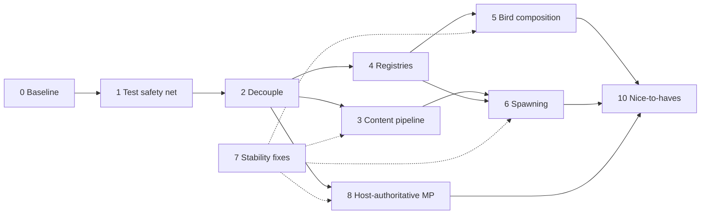

# Refactor Roadmap

Modernize the mod without changing its intended gameplay: make it safe to refactor, easier to test, free of global state, reliable in multiplayer, and simpler to extend with new species, spawn rules, and behaviors. The target design is [ARCHITECTURE.md](ARCHITECTURE.md).

> First protect existing behavior with tests; then improve the architecture in small, verified steps.

Feature work (new species, bird types, progression) stays in [TODO.md](../TODO.md). This roadmap covers structure and correctness only.

## Phase order

Phase 7 is not a separate step: each defect is fixed in the phase that touches its code (see [Known defects](#known-defects)). Phase 9 (in-game verification) runs at the end of every phase.

Each phase lands as several small commits that each build, pass tests, and keep the game playable.

---

## 0. Upgrade and establish a baseline

**Done:** .NET SDK 10 pinned via `global.json`, mod on net6.0, Stardew Valley 1.6.15, SMAPI 4.5.2, ModBuildConfig 4.4.0, NUnit 5 test project, analyzers and `.editorconfig` enforced in build.

**Remaining**

- Clear the legacy analyzer warnings so Release builds (warnings as errors) pass. `dotnet format whitespace` applied (~480 → 413); `dotnet format style` crashes (NotSupportedException), so fix the rest per file as phases touch it. Suppress nothing globally.
- (Skipped by decision; tests used instead.) Record the in-game baseline with SMAPI before any behavior change:
  - mod loads without errors in the SMAPI log;
  - each shipped bird spawns in its expected locations over several in-game days and seasons;
  - birds animate, move, flee, and despawn;
  - collection tab shows birds, hover text, and seen state;
  - save, quit, reload keeps observations;
  - host + farmhand: same birds visible, observation by farmhand appears for host.
- Write down observed quirks (e.g. group sizes never reaching max) as baseline facts, so later changes to them are deliberate.

**Exit:** Release build green; baseline checklist recorded in this file or an issue.

---

## 1. Build the test safety net

Characterization tests that pin what the mod does today, asserting observable outcomes rather than class names or private state.

**Tooling**

- Keep NUnit 5. Use `[TestCase]` / `TestCaseSource` tables.
- No mocking library: game types are concrete and mostly non-virtual. Pure logic gets plain tests; game-facing logic gets small mod-owned interfaces with hand-written fakes in Phase 2.
- Pure tests run on arm64; tests touching game types run with `--arch x64` (see [AGENTS.md](../AGENTS.md)).
- Replace the test-only copies of production logic (`MockBirdData`, `MockBirdTemplate`) with tests against the real loader once Phase 3 makes it game-free. Until then they are acceptable characterization tests.
- ~~Delete or fix tests that assert nothing (`BirdData_serialize`, `SendAnimatedSprite`) and stop tests writing files into the repo.~~ Done.

**Done:** `ContentTests` (shipped birds: JSON valid, textures exist, biome membership, locations, merged spawn data snapshot), `RandomTests`, `GameTypeRegressionTests` (x64: animation capture, `WaterSpawner` condition, spawn params keep pattern, known patterns/types).

**Characterization tests (now)**

- Every shipped bird JSON loads; effective merged values match today's output (snapshot of the current `inspect_output` data).
- Template defaults and global defaults fill values as today.
- `SaveData` round-trips, including the legacy SMAPI 3 `SDate` format.
- Daily selection with a fixed seed produces stable results once randomness is injectable (Phase 2).

**Coverage targets as phases land**

| Area | Tests |
|---|---|
| Content | every bird and template loads; template chain merge order; rules beat defaults at every level; arrays replace; weight maps merge; `null` removes keys and rules; unknown keys rejected; cycle reports full chain; ids unique; `min <= max`; time/day ranges valid; referenced bird types, spawn patterns, locations, textures exist; invalid values give file + field + chain |
| Registries | every registered bird type and spawn pattern creates; unknown id fails with a clear result; every content reference resolves; test-only registration works without editing a switch |
| Behaviors | wander/peck/hop transitions; flee when a farmer is within range; flee ends in despawn; behavior order; anchor removed → despawn |
| Spawning | eligibility by season/weather/day/time; inclusive group ranges; empty candidate lists return nothing; seeded plan is deterministic |
| Serialization | `BirdState` round-trip incl. animation; old or invalid save data migrates or fails safely; every message round-trips |
| Multiplayer | farmhand sends a request, does not mutate; host validates, records once, broadcasts; simultaneous discoveries both persist; stale/unknown versions rejected; late joiner gets current state |

**Exit:** content, save, and selection behavior pinned; suite green on arm64 (pure) and x64 (game).

---

## 2. Improve testability and reduce coupling

Make logic constructible without the game or static state.

**Changes**

- Remove the public static fields on `ModEntry` (`modInstance`, `environmentData`, `saveData`, `dailySpawner`, `eligibleLocations`, `birdDataCollection`). `ModEntry` owns them as private instance state and passes what each object needs via constructors or parameters.
- `ModEntry` only: subscribe SMAPI events, build objects and registries, load/save, delegate. Move the collections-tab construction, vanilla-bird removal, and message routing out into their features.
- Cache the `IReflectedField` handles in `CollectionsPageWithBirds` once instead of fetching them on every hover.
- Introduce small seams where adapters need game state, each 1–2 members:
  - `ILocationQuery`: tile is ground/water/spawnable, terrain feature at tile, map size;
  - `IMessageSender`: send to host / all / one peer;
  - `IMonitor` is already an interface; pass it in.
- Pass `Random` explicitly. Seed it at the boundary from game state (e.g. `Game1.uniqueIDForThisGame` + days played + location) so a day's plan is reproducible.
- Stop setting `JsonConvert.DefaultSettings`; create a `JsonSerializer` with explicit settings where needed and stop marking errors as handled.

Avoid a single `IBirdService` that exposes everything; tests should only fake what they use.

**Exit:** no `ModEntry.` references outside `ModEntry`; no `Game1.random` in spawning or selection; planner and content code constructible in tests.

**Done:** `ModEntry` statics removed; state is private and passed in. Seams: `ILocationQuery`/`GameLocationQuery`, `MessageSender` (interface dropped until a fake needs it), `BirdServices` (monitor, content, id source, observation callback) for birds. Day `Random` seeded from `StableHash(uniqueIDForThisGame|DaysPlayed)`. Extracted `VanillaBirds`, `BirdCollectionsTab`, `MessageTypes`; `CollectionsPageWithBirds` takes its dependencies. Host→peer messages on connect are targeted at that peer. Behavior changes: spawnable check is deterministic (no random 10% behind-tree), `WaterOrGround` is ground ∪ water, `TileSpawner` group target is per group. Tests: `SpawningTests` (fake `ILocationQuery`: seeded determinism, ground-only placements, shuffle determinism, pinned `StableHash`).

---

## 3. Make configuration DRY, explicit, and validated

Replace constructor-time merging and reflection-based default filling with a load pipeline. See [ARCHITECTURE.md → Content pipeline](ARCHITECTURE.md#content-pipeline) and [Bird configuration](ARCHITECTURE.md#bird-configuration).

**Changes**

1. Load bird and template JSON as `JObject`.
2. Resolve the `template` chain, detect cycles, merge most general → specific, then merge `defaults` into each id-keyed rule. Objects merge per key, arrays replace, `null` removes.
3. Deserialize the merged object strictly (`MissingMemberHandling.Error`, required fields) into boundary records (`BirdJson`, `SpawnRuleJson`).
4. Convert to domain records (`BirdDefinition`, `SpawnRule`) via `ToDomain`, collecting every error with file, id, field, expected value, and chain.
5. Build an immutable catalog. Invalid birds are skipped and logged at runtime; tests fail on any error.

**Defaults:** C# fallbacks only for technically safe optional fields; gameplay defaults move into base templates; species values stay in bird files. Remove `SpawnData.getDefaultSpawnData()` and `insertDefaults` once templates carry those values.

**Format migration:** convert shipped JSON to the new format: `defaultSpawnData` → `defaults`, `allSpawnData` season dictionary → id-keyed `rules` with `when.seasons`, `min/maxGroupCount` and `min/maxGroupSize` → `[min, max]`, `weather`/`daysRanges`/`timeOfDayRanges` → `when`. Replace `environmentData.json` biome bird lists with `locationGroups.json`. Add `base_bird` with today's global defaults. The `ContentTests.Bird_MergedSpawnData` snapshot changes for birds that relied on global defaults shadowing template values (the tits); document that as the bug fix.

**Removes:** `[JsonConstructor]` merge logic in `BirdData`/`BirdTemplate`, `Reflection.CopyProperties`, `Utils.MergeDictionaries`, runtime state on config (`currentSpawnData`, texture rotation index), and `inspect_output` writes on every load (replace with a console command).

**Exit:** all shipped content passes validation in tests; characterization snapshot unchanged unless a difference is documented as a bug fix.

**Implemented (code and tests):** `JObject` template resolution with per-field provenance, including deleted default fields and removed/re-added rules; strict boundary deserialization and domain validation; id-keyed seasonal rules and location groups; immutable validated catalog; invalid birds skipped with diagnostics; `birds_dump <id>`; legacy models, reflection filling, mock loader, and old fixtures removed. The shipped six-bird snapshot now checks the effective spawn rules. The tit group-size snapshot follows template values instead of the former global-default shadowing, as intended. Day-start selection handles sun, rain, storm, snow, wind, and green rain; the first player entering a location retries pending time-window placements on time changes.

**Verification:** shipped content and full x64 tests pass (67 tests); compile-only Debug and focused formatting pass. Release warnings-as-errors is still blocked by analyzer/style diagnostics in legacy game code. Runtime spawning, day transitions, multiplayer visits, and the dump command still need in-game verification via SMAPI. Visit ownership is not transferred if the first player leaves while another remains; shared multiplayer spawn state belongs to Phase 8.

---

## 4. Replace brittle factories with registries

**Changes**

- `BirdTypeRegistry` and `SpawnPatternRegistry`: `IReadOnlyDictionary<TId, factory>` built in `ModEntry`. No static dictionaries, reflection, or attributes.
- Typed ids (`BirdTypeId`, `SpawnPatternId`) instead of raw strings.
- Content validation checks every referenced id against registry keys before gameplay.
- `TryCreate` instead of indexing that throws or `null` returns; unknown ids log a warning and skip.
- Delete the string `switch` in `CustomBirdTypeConverterReader`, the static maps in `BirdFactory` and `SpawnerFactory`, and the `className` discriminator strings once Phase 7 serialization lands.

**Exit:** adding a bird type or spawn pattern touches one implementation file and one registration line.

---

## 5. Move toward composition-based bird logic

**Changes**

- Introduce `BirdCritter`, the one mod-owned abstract layer under `Critter`: identity, position, sprite, lifecycle, ordered `IBirdBehavior` list. Concrete birds become `sealed`.
- Extract behaviors (wander, peck, hop, swim, perch, flee, despawn) with pure decision logic over a `BirdContext` record.
- Behavior order and conflict rules in one place.
- Collapse `CustomBirdTypeTerrainFeature` into a `TerrainAnchor` component (see Phase 7).

**Migration**

1. Move `LandBird` first; verify against tests and in game.
2. Then `WaterLandBird`, `TreeTrunkBird`, `BushBird`, one per change.
3. Keep inheritance where it is simple and stable. Composition is a tool, not a goal.

**Exit:** new species reusing existing behaviors are JSON-only; a new capability is one behavior class.

---

## 6. Refactor spawning into clear responsibilities

**Changes**

Split today's `DailySpawner` / spawners / `SingleBirdSpawnParameters` into:

| Responsibility | Where |
|---|---|
| Eligibility by location, season, weather, day, time | pure `SpawnPlanner` |
| Rule selection by `weight` per bird and location (incl. seen/unseen weighting) | pure `SpawnPlanner` |
| Group count/size, tile or terrain-feature selection | pure `TileSelection` over `ILocationQuery` |
| Creating critters from placements | `LocationSpawner` adapter via registry |
| Despawn / still-valid checks | bird behaviors + anchor resolution |
| Sharing the plan with farmhands | `MultiplayerSync` (Phase 8) |

- The plan is a record built once per day by the host; placements carry rule, texture, and seed, so farmhands never need `currentSpawnData`.
- Empty candidate lists return no placement instead of throwing.
- Replace index-based shuffles (`Enumerable.Range(...).OrderBy(Game1.random...)`) with a seeded shuffle over candidates.
- Remove the unused `stillValidTime` and the unused `state` in `WaterOrGroundSpawner`, or wire them in deliberately.

**Exit:** spawn planning fully unit-tested with seeded `Random` and a fake `ILocationQuery`; in-game spawn frequency matches baseline.

---

## 7. Fix known stability and data-integrity risks

Fixed in the phase that rewrites the affected code; urgent crash fixes may land earlier as isolated commits with a regression test.

**Terrain-feature birds:** store a `TerrainAnchor` (location name, tile, feature kind) instead of a collection index. Resolve by tile each update; if missing or a different kind, despawn cleanly.

**Serialization:** replace the reflection-based `CustomBirdTypeConverterWriter`/`Reader` with explicit `BirdState` records. Capture animation from `sprite.CurrentAnimation`. Add `Version` to save data and messages; migrate older save versions in `SaveStore`.

**Defensive handling:** `TryGetValue` for every external or content-driven lookup; validate content before runtime; unknown ids, missing assets, invalid locations, and missing features log a warning and skip or despawn.

### Known defects

Verified in the current code. "Phase" is where the fix lands. Struck-through rows are fixed.

Observed: birds without `defaultSpawnData` get global defaults (Forest, 1–2 groups of 1–5) that shadow the template's values (the tits); pinned in `ContentTests.Bird_MergedSpawnData`. Fix in Phase 3.

| Defect | Location | Phase |
|---|---|---|
| ~~Animation never serialized: constructor checks the uninitialized field `currentAnimation` instead of `sprite.CurrentAnimation`, and a local shadows the field~~ | [CurrentAnimatedSprite.cs](../BirdsEverywhere/CurrentAnimatedSprite.cs#L28) | 7 (early fix OK) |
| ~~`WaterSpawner` declares `protected new TileSpawnCondition condition`, hiding the base field; base `condition` stays null → NRE~~ | [TileSpawner.cs](../BirdsEverywhere/Spawning/Spawners/TileSpawner.cs#L37) | 7 (early fix OK) |
| ~~Farmhands never set `currentSpawnData`; `stillValidSpawnPosition` reads it from the global catalog → crash on farmhand~~ (spawn params now carry `spawnPattern`) | [SingleBirdSpawnParams.cs](../BirdsEverywhere/Spawning/SingleBirdSpawnParams.cs#L21) | 6 |
| ~~`getRandomElementFromList` uses `Next(0, Count - 1)`: never picks the last element~~ | [Utils.cs](../BirdsEverywhere/Utils.cs#L43) | 6 (early fix OK) |
| ~~`shuffleByWeights` draws a new random value inside the `Sort` comparator: biased order, and `List.Sort` may throw on the inconsistent comparer~~ (keys drawn once per item) | [Utils.cs](../BirdsEverywhere/Utils.cs#L12) | 6 (early fix OK) |
| ~~Group count/size use exclusive `Next(min, max)`: never reach configured max~~ (now inclusive) | [TileSpawner.cs](../BirdsEverywhere/Spawning/Spawners/TileSpawner.cs#L85), [TerrainFeatureSpawner.cs](../BirdsEverywhere/Spawning/Spawners/TerrainFeatureSpawner.cs#L37) | 6 (gameplay decision) |
| Tree birds stored by `terrainFeatures.Pairs.ElementAt(index)` (unstable dictionary order), unchecked `as Tree` | [TreeTrunkBird.cs](../BirdsEverywhere/BirdTypes/TreeTrunkBird.cs#L36) | 5/7 |
| Bush birds stored by `largeTerrainFeatures[index]`, unchecked `as Bush` | [BushBird.cs](../BirdsEverywhere/BirdTypes/BushBird.cs#L34) | 5/7 |
| Any peer broadcasts the whole `SaveData`; every receiver (incl. host) replaces its copy → last writer wins, lost discoveries | [CustomBirdType.cs](../BirdsEverywhere/BirdTypes/CustomBirdType.cs#L97), [ModEntry.cs](../BirdsEverywhere/ModEntry.cs#L171) | 8 |
| `chooseOneSpawnData` result written into shared `BirdData.currentSpawnData` (runtime state on config) | [DailySpawner.cs](../BirdsEverywhere/Spawning/DailySpawner.cs#L70) | 3/6 |
| Template merge in `[JsonConstructor]` loads files via `ModEntry.modInstance`; `MergeDictionaries` shares list references with the template | [BirdData.cs](../BirdsEverywhere/Data/BirdData.cs#L46), [Utils.cs](../BirdsEverywhere/Utils.cs#L102) | 3 |
| `timeOfDayRanges` never checked: `isTimeOfDayPossible` is unused, `possibleSpawnDataToday` ignores time | [SpawnData.cs](../BirdsEverywhere/Data/SpawnData.cs#L42), [DailySpawner.cs](../BirdsEverywhere/Spawning/DailySpawner.cs#L66) | 3/6 |
| `CopyProperties` treats `0`/`false` as unset, so a bird cannot override a template value with 0 or false | [Reflection.cs](../BirdsEverywhere/Data/Reflection.cs) | 3 |
| ~~Process-wide `JsonConvert.DefaultSettings`; `OnJsonError` marks every error handled → silent bad data~~ (messages use `MessageJson` with explicit settings) | [MessageJson.cs](../BirdsEverywhere/MessageJson.cs) | 2 |
| Debug output written to `assets/inspect_output/` on every save load | [ModEntry.cs](../BirdsEverywhere/ModEntry.cs#L108) | 3 |
| ~~`Player_Warped` logs `e.NewLocation.Name` before the null check~~ | [ModEntry.cs](../BirdsEverywhere/ModEntry.cs) | 2 |
| ~~Vanilla-bird removal logs every critter on every `TimeChanged`~~ | [ModEntry.cs](../BirdsEverywhere/ModEntry.cs) | 2 |
| ~~`Game1.random` used throughout spawning → not reproducible or testable~~ (seeded `Random` passed in) | [Spawning/](../BirdsEverywhere/Spawning) | 2/6 |

**Exit:** every row fixed with a regression test (or a documented in-game check where a test is impossible).

---

## 8. Make multiplayer host-authoritative

See [ARCHITECTURE.md → Multiplayer ownership](ARCHITECTURE.md#multiplayer-ownership).

**Changes**

- Farmhands send `ObservationRequest`; only the host validates, applies via pure `ObservationLog.Apply`, saves, and broadcasts `ObservationAccepted` (delta + log version).
- The host sends the daily plan and full observation log on `DayStarted` and `PeerConnected`.
- All messages are versioned records; unknown or stale versions are logged and dropped, and a peer with a stale log re-requests it.
- Replace the single `if` chain in `OnModMessageReceived` with a `switch` on message type that delegates to `MultiplayerSync`.

**Exit:** two simultaneous discoveries both persist; a late joiner sees current observations and birds; multiplayer tests from Phase 1 green.

---

## 9. Verify in-game behavior after each phase

Automated tests protect logic; rendering, timing, and real multiplayer need the game. Build and test results never count as in-game verification.

**Smoke test (every phase)**

- Mod loads without new SMAPI errors or warnings.
- Birds appear in expected locations with correct sprites, frames, and depth.
- Birds wander, peck, hop, swim, perch, flee, and despawn; none stuck in walls, water, or terrain.
- Removing a tree or bush with a bird on it despawns the bird safely.
- Vanilla birds (crows, seagulls, owls, woodpeckers) are removed; other critters (butterflies, frogs) remain.
- Collection tab opens; hover text, icons, seen state, and counts correct.
- Save, quit, reload, continue without lost observations.

**Full pass (before release)**

- Spawn frequency and group sizes match baseline unless deliberately changed.
- Host and farmhand see compatible birds; no obvious desync on move, flee, despawn.
- Farmhand discovery reaches host, then all players; duplicate discoveries do not lose data.
- Late join and disconnect/reconnect keep valid state without crashes.

Use the `Diagnostics/` console commands (list plan, force spawn, validate content, dump observations) to reach specific cases quickly. Changes to characterization outcomes are accepted only when documented here or in the commit message.

---

## 10. Nice-to-haves and future improvements

After phases 0–9.

- **Performance:** profile bird-heavy scenes first. If proximity checks dominate, centralize farmer-position lookup; a spatial grid only if the profile demands it.
- **Public API:** small, versioned `IBirdsEverywhereApi` via `Helper.ModRegistry` for registering bird types, spawn patterns, behaviors, and validated definitions. Decide separately on Content Patcher support for data-only birds.
- **Content tooling:** console command or CI job that validates all content and reports ids, templates, spawn patterns, locations, unresolved references, and inheritance chains; optional JSON schema for editor feedback.
- **Lifecycle audit:** event subscriptions, cached references, and long-lived collections cleaned up on save change and location unload. `IDisposable` only where the code owns subscriptions or unmanaged resources.
- **Docs:** keep [ARCHITECTURE.md](ARCHITECTURE.md) current for merge rules, save format, and multiplayer ownership.
